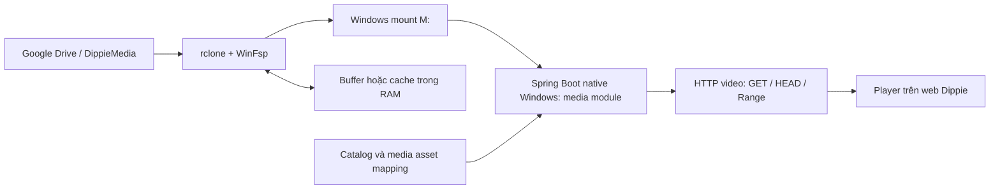

# Google Drive mount trên Windows cho video hoạt hình

Trạng thái: **DESIGN / BACKLOG, chưa triển khai hoặc mount**. Yêu cầu người dùng ngày 14/10/2026: dùng Google Drive làm nơi lưu video và mount vào máy Windows để phục vụ web. Ưu tiên đầu tiên là tiết kiệm ổ cứng; chọn read-only mount không dùng disk cache; không tự bật full-cache. Giữ tone xanh lá. M3 đang triển khai giữ nguyên scope; storage/playback là milestone riêng sau M3, trước khi lập lịch phần AI nếu người dùng vẫn ưu tiên xem phim.

## 1. Quyết định thiết kế

Google Drive lưu media gốc; rclone + WinFsp cung cấp filesystem trên Windows. Backend đang chạy native Windows đọc mount qua adapter storage, trả video bằng HTTP có Range để browser tua. Profile không dùng VFS disk cache; ưu tiên buffer RAM theo tài nguyên thực và không dùng disk cache làm fallback. Không truyền video qua FastAPI/Qwen, không thêm AI hoặc training. Không cần dựng microservice storage độc lập ngay từ đầu: triển khai module trong Spring hiện có trước, interface cho phép tách origin sau nếu measurement chứng minh cần.



Sơ đồ chỉ mô tả hướng dữ liệu khi đọc; upload do quản trị viên qua luồng riêng. Remote phục vụ app mặc định read-only. Mount không tự làm video xem được trên web, không tăng tốc internet và không cung cấp ổ cứng offline đầy đủ.

## 2. Đối chiếu dự án hiện tại

- Movie entity/DTO/frontend có `videoUrl`, MovieDetail có HTML5 video trong overlay. Field này hiện được UI gọi là trailer/bản xem trước, chưa phải mô hình tập phim/phim đầy đủ.
- Compose mới mount AI models và database; Nginx chưa có media origin riêng. Không có rclone/storage API đang hoạt động.
- Chưa có mapping movie/episode → Drive asset, playback authorization, Range contract hoặc nghiệm thu video thật.
- Không tự gắn phim trong catalog với file Drive bằng tên gần giống; không chuyển trailer thành full movie bằng đổi nhãn.

## 3. Mount không cache video xuống ổ cứng

**Yêu cầu mới nhất của người dùng:** RAM/CPU/GPU không phải mối lo; tránh hết ổ cứng là ưu tiên chính. Không áp quota RAM thấp chỉ để tiết kiệm tài nguyên nếu làm giảm trải nghiệm. Bỏ profile full-cache 2G khỏi phương án triển khai, không tự bật disk cache khi phát chậm.

| Cấu hình | Quyết định thiết kế |
| --- | --- |
| Remote / folder dự kiến | dippie-drive:DippieMedia; xác nhận khi triển khai |
| Mount Windows | M: nếu còn trống; backend cùng account/session phải đọc được |
| Mount policy | read-only, VFS cache mode off |
| Cache nội dung video trên disk | tắt; không mirror/offline/sync toàn kho |
| Buffer RAM | điều chỉnh theo RAM thực và measurement playback, không khóa ở4M |
| Baseline để đo | buffer32M/file, chunk8M tăng tối đa32M; chưa phải kết quả tối ưu |
| Capacity | đo1/2 rồi3/5 viewers; không đặt giới hạn thấp chỉ vì tiết kiệm CPU/RAM |
| Tự khởi động/cài đặt | chưa thực hiện, cần runbook triển khai riêng |

Lệnh tham khảo để review, chưa chạy:

    rclone mount "dippie-drive:DippieMedia" M: --read-only --vfs-cache-mode off --buffer-size 32M --vfs-read-chunk-size 8M --vfs-read-chunk-size-limit 32M --vfs-read-chunk-streams 0

Profile off không ghi VFS disk cache của nội dung video. Metadata/config/log và OS/browser vẫn có thể ghi ổ; không hứa toàn hệ thống0byte. Buffer32M/file chỉ là baseline của rclone, không phải tổng RAM stream: cần cộng backend, WinFsp, OS và browser. Chunk size không phải dung lượng RAM giữ toàn bộ. [Rclone VFS/chunked reading](https://rclone.org/commands/rclone_mount/)

Mount chỉ cấu hình sau khi kiểm tra rclone/WinFsp, drive letter, filesystem và account OAuth. Config/token ngoài repo; không tạo rclone.conf trong Git. Không dùng sync/purge/move. Không thay registry/firewall/startup/permissions để né visibility khác account/elevation. Không tự cài hoặc mount trong lượt thiết kế.

Read-only snapshot14/10/2026: C: còn25.0GiB, D: còn22.7GiB; phải kiểm tra lại khi chạy thật. Kho Drive lớn không đòi hỏi chép toàn bộ xuống máy. Backend/proxy/browser test profile phải được kiểm tra không tạo temp video hoặc spill-to-disk lớn; tắt proxy disk buffering/cache cho media route khi dùng proxy, xác minh cấu hình không ảnh hưởng API khác.

### Tối ưu trong RAM và nguyên tắc chọn profile

Tăng read buffer/prefetch trong RAM khi phép đo cho thấy có lợi, giữ concurrency/backpressure để tải ổn định. Có thể nghiên cứu RAM cache dùng chung với ngân sách theo RAM khả dụng, key asset/version/range, dedupe đọc đồng thời và eviction; chỉ thêm nếu benchmark chứng minh đáng làm. Không cần nạp cả phim vào RAM trước khi Play và không tự tạo RAM disk hoặc đổi pagefile/OS settings. Khi áp lực bộ nhớ thì giảm prefetch/evict RAM, không tự chuyển sang temp file.

Giữ HTTP Range/seek/cancel đúng. So sánh startup, p50/p95 seek, stall duration, upstream bytes/request count và disk allocated; đo cả xem dài, pause/stop và tua tới cuối. Không dùng throughput đơn lẻ để kết luận tốt nhất. Theo dõi RAM/CPU để xác nhận hoạt động ổn định, không tối ưu giảm chúng bằng cách đẩy dữ liệu sang disk.

Nếu read-only mount không phù hợp reader/seek, đánh giá Direct Drive Range adapter với cùng auth/contracts, buffer RAM và không disk cache. Không tự xây cả hai data planes; không tự bật full-cache để che lỗi. Phương án disk cache chỉ được mở lại khi người dùng thay đổi yêu cầu.

Nếu chuẩn bị MP4 fast-start/encode cần tool xử lý, tách việc đó khỏi stream và lập kế hoạch scratch space trước: không âm thầm tạo thêm bản video lớn trên ổ máy. Không thay hay chiếm tài nguyên process Qwen đang chạy chỉ vì user không lo GPU.

## 4. Tổ chức media và catalog

Ví dụ bố cục:

```text
DippieMedia/
  movies/<canonicalMovieId>/<assetVersion>/feature.mp4
  movies/<canonicalMovieId>/<assetVersion>/trailer.mp4
  series/<canonicalSeriesId>/season-01/episode-001/<assetVersion>/video.mp4
```

Phim bộ/tập là hướng mở rộng, không tự thêm episode schema vào ticket mount ban đầu. Thư mục có canonical ID và version để tránh cache cũ khi thay nội dung cùng tên; không bắt buộc tên phim Unicode làm key.

Thêm mapping media asset có migration review được: assetId, movieId (và episodeId khi thực sự có), kind=feature/trailer, storageProvider, relativePath, file identity/version, mimeType, byteLength, duration khi đã probe, availability và thời điểm kiểm tra. Có thể lưu Drive fileId nội bộ để đối chiếu khi rename, không lộ OAuth token/path Windows cho client. Không ghi đè existing movie IDs hoặc user library.

Luồng đăng ký: quản trị viên chọn file có thật → kiểm tra root/path/metadata → preview mapping → đăng ký asset → smoke playback → đánh dấu ready. Không tự scan mọi Drive hoặc import live. File bổ sung không làm app tự nhận là available khi mount đang offline.

## 5. Delivery và HTTP contract dự kiến

Backend module chạy native Windows là topology đầu tiên. Storage adapter chỉ đọc trong MEDIA_ROOT đã cấu hình; browser không nhận `M:\...`, Drive sharing URL hoặc rclone credentials.

- API cấp playback descriptor theo movie/asset canonical ID, phân biệt feature/trailer. Media chưa được đăng ký thì không hiện nút Xem phim như đã có nội dung thật.
- Data plane dùng URL ổn định của app hoặc URL ký hạn ngắn qua API cấp descriptor; `GET`/`HEAD`, MIME, Content-Length, Accept-Ranges, 206/Content-Range khi range hợp lệ, 416 khi range vượt file. Kiểm thử đầu/giữa/cuối file và byte integrity, không chỉ status code.
- Không nạp toàn bộ file vào heap hoặc tạo bản sao tải hết trước mỗi lần play. Giới hạn concurrency/backpressure và đóng stream khi client hủy.
- Phân biệt unknown asset404 với mount/quota/network unavailable503 có hướng retry. Request không treo vô hạn khi filesystem remote bị mất kết nối; thiết kế deadline/circuit breaker không để worker threads bị chiếm không giới hạn. Sau khi response đã bắt đầu không thể sửa HTTP status: ghi lỗi, đóng stream, player thông báo gián đoạn/retry hợp lý.
- Nếu playback cần auth: HTML video native không tự thêm Bearer token đang ở localStorage như fetch của app. Chọn giải pháp cụ thể trước code: descriptor được cấp qua request Bearer, trả URL ký hạn ngắn ràng buộc asset/version/expiry/method; hoặc session cookie theo thiết kế auth riêng. Không nhét Google access token vào src. Luồng signed URL cần refresh khi hết hạn và resume currentTime, kiểm thử seek sau expiry.
- Chỉ resolve assetId đã đăng ký → relative path; cấm arbitrary path/URL, traversal, reparse-point escape và directory listing. Luồng streaming read-only không cung cấp upload/delete tùy ý.
- Không cache response riêng tư ở shared proxy nếu chưa có policy authorization rõ. CORS/same-origin phải kiểm thử với frontend thực; Range không được proxy làm mất.

Drive API hỗ trợ partial download với Range cho file binary; đó là khả năng upstream, không tự bảo đảm backend/WinFsp/player của dự án hỗ trợ seek đúng. Cần nghiệm thu toàn đường truyền. [Google Drive downloads](https://developers.google.com/workspace/drive/api/guides/manage-downloads)

## 6. Trải nghiệm người xem

Giữ thiết kế xanh lá hiện tại, player gọn, thao tác chính rõ. Nút Xem phim chỉ cho feature asset có thật; trailer có nhãn riêng. Player có loading/buffering, lỗi hữu ích, thử lại, full screen và keyboard/focus đúng. Không đưa lỗi đường mount/stack trace vào thông báo người xem.

Khi Drive mất kết nối, catalog/watchlist/rating vẫn hoạt động; UI báo nguồn phát tạm chưa sẵn sàng thay vì tác phẩm bị xóa. Retry khi người dùng chọn có thể giữ currentTime nếu asset version không đổi. Resume/continue-watching lưu theo account và episode là tính năng sau lõi streaming; không sửa M1 data model ngầm trong ticket mount. HLS, adaptive quality và transcode là giai đoạn sau, chỉ làm khi có nhu cầu và bộ encode/asset thật; không gắn nhãn HD/4K/subtitle chưa xác minh.

## 7. Windows và Docker

Không giả định ổ WinFsp M: được Docker Desktop/Linux containers nhìn thấy chỉ bằng bind mount. Topology đầu là Spring media module chạy native Windows cùng account nhìn thấy mount, frontend/gateway đi tới HTTP endpoint đã kiểm tra.

Nếu cần backend/gateway chạy Docker: làm spike riêng xác minh kết nối host media origin, binding/firewall/auth và range; loopback127.0.0.1 trong container không phải host. Không tự mở origin ra mọi network để thử. Phương án mount Linux trong container là thiết kế khác với yêu cầu Windows hiện tại và cần tài nguyên/runbook riêng; chưa triển khai.

## 8. Capacity và vận hành

Đây là thiết kế origin dựa trên máy Windows: máy host/mount phải chạy để remote viewers truy cập. Cache và tốc độ upload của host ảnh hưởng mọi stream; Drive không cung cấp CDN cho ứng dụng bằng việc mount. Ví dụ tính capacity, không phải kết quả đo: 5 streams × 8Mbps cần khoảng40Mbps outbound chưa tính overhead; phải đo trên mạng/bitrate thật trước hứa số người xem.

Đo cold/warm start, seek latency, stall ratio, upstream bytes/request, cache allocated bytes và host CPU/RAM ở1/3/5 streams thử nghiệm. Chốt budgets sau baseline. Drive có quota/rate-limit responses403/429; dùng backoff và trạng thái unavailable thay retry dồn dập, không ghi một mức download quota cứng chưa xác minh cho tài khoản người dùng. [Google Drive usage limits](https://developers.google.com/workspace/drive/api/guides/limits)

Tách catalog health khỏi media health; kiểm tra mount có deadline và không scan cả kho ở mỗi health request. Logs/metrics không chứa signed tokens/OAuth credentials. Dừng/restart chỉ process mount/media do mình sở hữu; không kill services AI/Gemini. Offline hoặc đầy cache không làm xóa Drive/file/thư viện.

## 9. Các bước giao Gemini và nghiệm thu

1. **STORAGE-01 / Windows spike:** kiểm tra prerequisites và đường mount dự kiến; template config/runbook, test file video ngắn trong thư mục Drive test do người dùng chọn. Lắp đặt/OAuth/mount thực là bước triển khai riêng, không được thực hiện chỉ vì tài liệu này tồn tại.
2. **MEDIA-01 / Catalog mapping và ranged delivery:** asset registration preview/test DB riêng, adapter local fixture rồi mounttest; backend partial streaming, auth/expiry, cancellation và file/path boundary tests. Không thay AI.
3. **PLAYER-01 / UI playback:** feature/trailer thật, buffering/retry/seek/fullscreen/keyboard/mobile; không tuyên bố full playback từ một ảnh có nút Play.
4. **Acceptance:** local clip fixture test offline + Windows-mounted test có xác nhận; cold/warm/seek, pause/resume, multi-stream, mount disconnect, revoked auth, quota simulation, disk low và process restart. Đo memory không tăng theo file size, cacheallocated/free-space đúng thực tế, cancellation không để active streams/rclone buffers tăng mãi. Giữ regression M1/M2/M3. Report phân biệt fixture vs Drive thật, local viewer vs remote viewer, pass/skip và giới hạn.

Lõi playback có thể nghiệm thu trước tính năng continue-watching/phim bộ. Không cài WinFsp/rclone, đăng nhập Google, upload/download toàn kho, mở firewall, auto-start, mount hoặc đổi live DB trong lượt **thiết kế** này. Chỉ bắt đầu triển khai sau khi M3 được review và giao prompt storage riêng.
