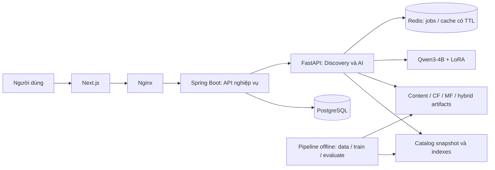

# Kế hoạch kỹ thuật và phát triển sản phẩm

**Ưu tiên hiện hành (13/10/2026):** Người dùng chuyển sang giao milestone lớn và để AI sau. Thực hiện `docs/PRODUCT_MILESTONES.md`: M1 account/library → M2 catalog/search → M3 chất lượng/vận hành. Gemini triển khai trọn milestone; Codex chỉ lập prompt/nghiệm thu. Roadmap AI và thứ tự ticket bên dưới giữ làm tham chiếu lịch sử, không phải lệnh giao hiện hành.

Ngày lập: 13/10/2026. Vai trò theo yêu cầu mới: Codex là kỹ sư trưởng; bạn sở hữu toàn bộ AI/FastAPI và kết quả của các tính năng AI hướng người dùng. Đây là kế hoạch triển khai, không phải báo cáo các chức năng đã hoàn thành.

Phân công hiện hành đã chốt: **Codex chỉ lập kế hoạch, prompt kỹ sư trưởng và nghiệm thu; Gemini triển khai mã ứng dụng.** Các bước bắt đầu và prompt nằm tại `docs/START_HERE_GEMINI_PLAN.md`. Không tự chuyển sang coding khi chưa được người dùng thay đổi phân công này.

Ưu tiên trải nghiệm được cụ thể hóa tại `docs/USER_EXPERIENCE_BLUEPRINT.md`: release theo hành trình chọn phim, cá nhân hóa, tìm lại/reference và trợ lý ra quyết định. Roadmap AI bên dưới là dependency kỹ thuật; không bắt người dùng chờ mọi experiment hoàn thành mới có tính năng dùng được. Evidence cơ bản, failure UX và feedback scope phải có ngay từ lát cắt đầu.

Quyết định giao diện đã chốt với người dùng: **tone xanh lá làm màu chủ đạo**, thể hiện nhất quán trong nhận diện, các hành động chính và trạng thái chọn; giữ bố cục nhẹ nhàng và độ tương phản dễ đọc.

Tài liệu kế thừa `ANIMATION_DISCOVERY_PROJECT_BIBLE.md` và `docs/PRODUCT_FEATURE_PLAN.md`. Phân công mới trong tài liệu này thay thế mô tả Codex chỉ lập kế hoạch/review ở kế hoạch cũ. Các quyết định về animation, Qwen3-4B và recommender độc lập với LLM được giữ nguyên.

## 1. Kết quả sản phẩm phải đạt

Người dùng phải tìm được một phim phù hợp, hiểu vì sao phù hợp và lưu hoặc phản hồi dễ dàng. Giao diện cung cấp cả nút/bộ lọc và chat, dùng chung engine.

Các hành trình dùng để nghiệm thu:

| Hành trình | Ví dụ | Kết quả nhìn thấy được |
|---|---|---|
| Chọn phim tối nay | “Phim ấm áp, dưới 100 phút, xem một mình” | Ba phim hợp điều kiện, lý do ngắn, điểm có thể không hợp, nút lưu/chọn |
| Tìm lại phim | “Cô bé vào thế giới linh hồn, bố mẹ biến thành lợn” | Ứng viên có manh mối khớp; cho xác nhận đúng phim hoặc làm rõ |
| Tìm phim giống phim thích | “Giống Coraline nhưng bớt đáng sợ” | Giữ các facet muốn giữ, giảm scariness khi dữ liệu hỗ trợ |
| Gợi ý theo gu | Chọn vài phim yêu thích, đánh giá phim đã xem | Danh sách thay đổi theo profile thật, có bằng chứng lý do |
| Điều chỉnh tiếp | “Ngắn hơn”, “bớt buồn”, “không musical nữa” | Intent chỉ đổi phần yêu cầu; điều kiện khác được giữ |
| Ra quyết định | So sánh hai phim, “chọn giúp tôi” | Một lựa chọn từ tập hợp hợp lệ; có thể đổi phương án |
| Khám phá khác gu | “Khác gu một chút” | Tăng novelty có kiểm soát; giữ điều kiện bắt buộc |
| Xem cùng người khác | Hai bộ sở thích và các điều kiện không chấp nhận | Phim dung hòa, không vượt hard constraint của bất kỳ người nào |

Thứ tự ưu tiên: chọn được phim và dữ liệu đúng → cá nhân hóa → trợ lý ra quyết định → mở rộng nhóm và giải thích sâu.

## 2. Hiện trạng làm mốc

Đã có Next.js/React, Spring Boot auth/catalog/watchlist/rating, FastAPI discovery và loader Qwen3-4B + LoRA Phase23. Review gần nhất chạy lại 18 unit tests thành công, hai GPU integration tests được skip; live health/readiness báo full NF4 CUDA.

Các findings health/config resolution/patch artifact của SERVE-01-F01 đã được sửa qua F02 và nghiệm thu độc lập: 23 unit/contract tests pass, 2 GPU integration tests skipped, F02 patch parse/reverse checks exit 0. Review tại `docs/reviews/SERVE-01-F02_REVIEW.md`. Không giao lại các ticket này. Live health trước đó xác nhận full Qwen3-4B + LoRA NF4 CUDA; review F02 không chạy lại GPU inference hoặc benchmark latency.

Các khoảng trống chính:

- Catalog frontend là dữ liệu mẫu; mục “dành riêng cho bạn” chưa cá nhân hóa.
- Chat gọi trực tiếp FastAPI; request chưa mang session riêng.
- Auth có nhánh mock login/register khi kết nối lỗi; localStorage chưa phân tách tài khoản.
- Retrieval đang dùng overlap từ/thể loại/rating, chưa phải TF-IDF thật.
- Stage recommender lấy tám ứng viên đầu; ranking dùng heuristic và matchPercentage 75–99.
- `userId`/`user_profile` chưa đi vào ranking thực sự.
- Script training recommender/ranker mới ghi cấu hình; benchmark recommendation dùng predictions cố định.
- Phase23 đã có adapter và benchmark parser. Không coi fine-tune chưa làm; cũng không suy ra toàn bộ recommender đã đạt chất lượng từ benchmark parser.

Mục tiêu lần phát triển này là thay phần giả lập/heuristic còn thiếu bằng một engine đo được, nối vào sản phẩm thật.

## 3. Kiến trúc service và quyền sở hữu



Hai backend được triển khai độc lập. Module bên trong mỗi backend có contract riêng để phát triển và kiểm thử; chưa tách mỗi module thành một process mới.

### Spring Boot: hệ thống nghiệp vụ

| Module | Trách nhiệm | Dữ liệu sở hữu |
|---|---|---|
| Identity | Đăng ký/đăng nhập, phân quyền, trạng thái tài khoản | Users, credentials, auth/session policy |
| Catalog | Search/filter/detail, aliases, import, publish/archive | Catalog chuẩn, metadata và nguồn |
| Library & Feedback | Watchlist, favorite, rating, watched, preferences | Tín hiệu gốc có timestamp và scope |
| Discovery Gateway | Validate request, cấp session, gọi AI, hydrate kết quả theo ID | Request ownership, public API contract |
| Conversation | Hội thoại, quyền truy cập, snapshot intent/version | Lịch sử và state cần bảo toàn |
| Context | Timezone, context giờ và weather tùy chọn | Lựa chọn người dùng và snapshot context |
| Administration | Import preview, báo lỗi dữ liệu, audit | Published versions, reports, audit |

### FastAPI: phần bạn sở hữu đầy đủ

| Module | Trách nhiệm |
|---|---|
| Intent & Conversation | Parse/validate intent, resolve reference, merge patch |
| Retrieval | Exact/alias, sparse, dense, reference và candidate fusion |
| Recommendation | Content profile, user/item CF, MF, cold start |
| Constraints | Hard/soft/relative, tri-state dữ liệu và contradiction |
| Conditional Ranking | Chọn signals/trọng số theo mode, negative preferences |
| Diversity & Exploration | MMR, franchise redundancy, novelty |
| Evidence & Decision | Lý do, tradeoff, compare, choose-one, why-not |
| Serving & Jobs | Model lifecycle, bounded queue, admission, deadlines, status |
| Artifacts | Schema/catalog/features/models version, atomic switch và rollback |
| Evaluation | Offline metrics, golden journeys, ablation và performance |

FastAPI không lấy `userId` từ trình duyệt để tự truy vấn hồ sơ. Nó chỉ nhận snapshot được Spring Boot cấp và kiểm tra. Không cung cấp endpoint AI nội bộ trực tiếp cho frontend khi phát hành.

Catalog nghiệp vụ là nguồn chuẩn. FastAPI dùng snapshot/index bất biến có version; nó không nhập catalog tùy ý từ client và không tự xuất bản metadata mới.

Redis chứa state/cache có TTL. Dữ liệu library/profile gốc và conversation cần giữ lâu được Spring Boot bảo toàn. Queue/job state phải được chia sẻ giữa API và worker nếu chạy khác process.

### Khi nào tách thêm microservice?

- Tách Qwen inference worker khi phải chạy jobs nền hoặc mở rộng CPU API mà vẫn giữ một bản weights trên GPU. Trong bản đầu có thể dùng một process FastAPI làm cả API và một worker có admission giới hạn.
- Tách catalog/identity khỏi Spring Boot khi có đội sở hữu riêng, nhu cầu release riêng hoặc số liệu cho thấy contention; không đặt việc này trước vòng discovery hoàn chỉnh.
- Pipeline huấn luyện/index chạy offline, không dùng tài nguyên GPU serving cùng lúc trong cửa sổ người dùng cần AI. Có lịch vận hành thủ công trước, tự động hóa sau khi cần.

Thiết kế hỗ trợ khoảng 1.000 người dùng web hoạt động theo định hướng dự án; chưa cam kết 1.000 inference đồng thời. Một GPU 6 GB phải có chính sách admission thực tế.

## 4. Phân công và cách làm việc

| Vai trò | Trách nhiệm kết quả |
|---|---|
| Codex — kỹ sư trưởng | Chốt kiến trúc/contract/ưu tiên, thiết kế ticket, giải thích thuật toán, review code và nghiệm thu bằng bằng chứng; xử lý xung đột xuyên service |
| Bạn — chủ sở hữu AI/FastAPI | Xây và hiểu data/features, thuật toán, train/evaluate, serving/API; chịu trách nhiệm end-to-end các hành trình AI |
| Team nền Spring Boot | Identity, catalog, library, session ownership, migrations, gateway/context theo contract đã chốt |
| Team nền/frontend hoặc agent triển khai được giao | Giao diện/API client, loading/error, discovery/feedback flows; không tự đổi nghiệp vụ |

Nếu không có team, giữ nguyên backlog nhưng thực hiện tuần tự. Các phần chưa có backend thật dùng fixture contract để phát triển engine; fixture không được giả thành dữ liệu production.

“Full AI” nghĩa là bạn có pipeline thực từ dữ liệu đến sản phẩm và hiểu các thuật toán chính. Không bắt buộc đưa mọi model đã thử vào serving; giữ model khi evaluation chứng minh giá trị.

Mỗi ticket: vấn đề người dùng → input/output → nghiệp vụ → file/module → dependencies → acceptance cases → lệnh kiểm tra/bằng chứng. Trạng thái: planned → contract ready → implementing → review → accepted.

Khi triển khai thuật toán lõi, giải thích trực giác/công thức, hand-check toy example, rồi mới chạy data thật và so baseline. Không thay học thuật toán bằng một library call không được giải thích.

## 5. Dữ liệu: nền của tính năng

### 5.1 Catalog và taxonomy

Bắt đầu bằng khoảng 100–200 phim hoạt hình thật có metadata đáng tin để kiểm tra luồng; đây là quy mô bootstrap đề xuất, không phải ngưỡng chất lượng cuối. Mở rộng sau khi ETL và evaluation chạy được. Chọn nguồn dữ liệu ở ticket DATA-01, kiểm tra điều kiện sử dụng và khả năng lưu/hiển thị trước import.

Schema chuẩn tối thiểu:

- `movieId`, title gốc, aliases, tên Việt nếu có, releaseYear.
- `runtimeMinutes` dạng số; display runtime là trường hiển thị.
- Genres/themes; director/studio/country/language khi có.
- `animationTechniques`, tone, pacing, audience/maturity, scariness, musical intensity.
- Summary không spoil, poster/trailer references khi có nguồn.
- Rating source, value, scale, voteCount; tách điểm cộng đồng khỏi match score.
- `status` draft/published/archived, source references, updatedAt.
- Facet value kèm provenance, confidence/annotation status; thiếu dữ liệu là unknown.

Facet cần rubric cụ thể: ví dụ scariness trên thang 0–4 với mô tả từng mức, không tự gán theo cảm giác của một prompt. Có thể dùng LLM hỗ trợ annotation nhưng phải đánh dấu nguồn suy luận và human-review mẫu; không dùng output LLM như bằng chứng chắc chắn về content safety.

Nếu ràng buộc bắt buộc là dưới 90 phút, phim thiếu runtime không được khẳng định đáp ứng. Nếu mọi phim thiếu một facet cần thiết, hệ thống trả điều kiện chưa kiểm chứng và yêu cầu sửa/làm rõ.

### 5.2 Interactions

Các signal tách ngữ nghĩa: rating 1–10, favorite, watched, watchlist, explicit dislike, impression, opened detail, session dismissal. Watchlist là ý định xem; mở detail không có nghĩa đã xem; không click không phải dislike.

Một interaction có actor, movie ID, timestamp, type và scope. Preferences gốc không phải vector suy luận. Profile version đổi sau cập nhật hợp lệ; rating/favorite/watched sửa/xóa phải làm profile dẫn xuất phản ánh lại.

Không tạo 50 người dùng giả rồi dùng benchmark đó để tuyên bố personalization thật. Có thể dùng synthetic users cho unit/integration tests; evaluation collaborative cần dữ liệu tương tác thật hoặc dataset được chọn và giới hạn domain được ghi rõ.

### 5.3 Split và artifacts

- Dedupe trước split; aliases/franchise và query paraphrase cần kiểm tra leakage.
- Interaction evaluation dùng split theo thời gian khi có timestamp; features/profile chỉ dùng dữ liệu được biết trước cutoff.
- Tune trên validation; test freeze và chỉ dùng để báo kết quả cuối.
- Manifest có schemaVersion, catalogVersion, featureVersion, modelVersion, training split, seeds/checksums.
- Artifact bundle được load/verify rồi swap nguyên bộ; mismatch làm readiness lỗi, không trộn indexes/model khác version.

## 6. Xây toàn bộ engine AI theo thứ tự

### AI-01 — Evaluation framework và baseline

Xây metric HR/Recall/Precision/NDCG@K, MRR cho tìm danh tính, coverage/diversity và constraint violation. Toy tests kiểm tra công thức bằng tay.

Popularity/quality baseline có rating scale/vote count và chính sách thiếu dữ liệu rõ. Nó là baseline chạy trên catalog thật, không phải predictions hard-code. Chốt nhóm query benchmark và relevant labels trước tune.

Đầu ra: reproducible CLI evaluate, frozen splits, baseline report, error cases. Người dùng nhận danh sách cold-start hợp điều kiện cơ bản.

### AI-02 — Features và TF-IDF từ nguyên lý

Implement tokenizer/normalization, TF, IDF, TF-IDF, L2 normalization, cosine; tách text vector và multi-hot/categorical/facet features. So một toy corpus với phép tính tay và implementation tham chiếu.

Không gọi overlap hiện tại là TF-IDF. Offline precompute vectors; online không fit lại corpus theo từng query.

Đầu ra: feature artifact và lexical search thật. UI nhận tìm tên/alias, mô tả và “vì bạn thích phim X” bản content.

### AI-03 — Remembered-title retrieval và dense hybrid

Flow: task detection → clue extraction → exact/alias → sparse/dense candidates → fusion → identity ranking → hỏi làm rõ nếu mơ hồ.

Xây sparse baseline trước; lựa chọn embedding model ở ticket riêng, đo tiếng Việt/animation queries, RAM/latency và conditions of use. Dense model chỉ được đưa vào khi cải thiện trên validation. Có thể dùng reciprocal-rank fusion để tránh trộn điểm khác thang một cách tùy ý.

Trong mode tìm danh tính, user taste không được đẩy đáp án đúng xuống; include-watched không bị personal-history filter chặn. Explanation trích manh mối thực trong metadata.

Đầu ra: benchmark MRR/Recall@K; UI “Tìm lại phim”, ứng viên và câu hỏi phân biệt.

### AI-04 — Constraints và reference nhiều facet

Hard predicates lọc bắt buộc; soft preference góp score; relative preference so facet với reference. Có các kết quả satisfied/violated/unknown và trace lý do.

Resolve reference về ID, hỗ trợ ambiguous titles/year. Similarity riêng cho visual/tone/theme/narrative; “giống về hình ảnh” tăng visual, “bớt đáng sợ” kiểm tra scariness. Soft/hard strictness phải được UI và contract thể hiện.

Không có kết quả: nêu điều kiện đang gây tắc, chỉ đề xuất relax; không tự bỏ điều kiện. Counterfactual tạo nhánh session mới.

Đầu ra: structured-filter discovery và “like X” có căn cứ; relative chỉ accepted khi facet được kiểm chứng.

### AI-05 — User taste, cold start và negative preferences

Profile gồm long-term, recent, declared positives/negatives và session intent. Weighted content profile từ favorite/rating/watched/onboarding; recency decay cho recent signals. Trọng số khởi đầu là giả thuyết và phải tune, không tuyên bố tối ưu.

Onboarding UI cho chọn khoảng năm phim, thể loại muốn tránh và có thể bỏ qua. Nội bộ đủ room cho 5–10 selections theo data; không ép trả lời dài.

Default personal discovery có thể exclude watched, cho phép bật rewatch. Dismiss “không hợp hôm nay” chỉ ảnh hưởng session; “không thích musical” có tùy chọn lưu lâu dài rõ.

Đầu ra: hai profile fixture khác nhau tạo khác biệt kết quả/evidence; sửa/xóa signal cập nhật derived profile thật.

### AI-06 — User/item collaborative filtering

Xây sparse user-item, similarity, neighbor selection, shrinkage khi ít overlap và prediction/ranking; viết readable NumPy implementation trước.

So user-CF, item-CF, content và popularity trên cùng split. Nếu dữ liệu quá thưa/ít animation overlap, ghi limitation và hạ confidence CF trong hybrid. Không dùng feature test-label vào neighbors.

Đầu ra: experiments/reports và artifact CF; demo “người có gu gần bạn” chỉ khi signal thật hỗ trợ.

### AI-07 — Bias-aware matrix factorization

Model: `r_hat(u,i) = mu + b_u + b_i + p_u dot q_i`. Xây regularized loss, SGD, early stopping, reproducible seed; hand-check gradient/update trên toy matrix.

Theo dõi train/validation loss, RMSE/MAE nếu prediction explicit ratings và ranking metrics phù hợp. Ranking candidates phải loại training interactions theo policy evaluation; không chỉ báo loss giảm.

Đầu ra: MF model, learning curves, comparison và failure modes. Người dùng có dữ liệu đủ nhận collaborative candidates; cold-start vẫn có content path.

### AI-08 — Multi-source candidates và conditional hybrid ranking

Nguồn: query sparse/dense, content taste, reference facets, item-CF, MF và quality. Có budget mỗi nguồn, dedupe theo ID, lưu source contribution. Ví dụ thử nghiệm 100–200 candidates tổng; số cuối dựa trên Recall/latency của catalog thực tế.

Hard filtering phải tham gia candidate generation khi index hỗ trợ, sau fusion và trước trả kết quả. Nếu prefilter để hết candidates hợp lệ, mở rộng budget có giới hạn; không kết luận no-results chỉ vì top-N ban đầu không hợp.

Ranker chuẩn hóa score bằng stats từ train/validation, chọn weights theo mode và CF confidence. Signals gồm query/reference/taste/quality/novelty; negative/relative penalties có evidence.

Tune weights trên validation và ablate mỗi source. Learned ranker/BPR là thực nghiệm nâng cấp sau weighted hybrid; chỉ deploy nếu có lift đáng tin trên test thích hợp.

Đầu ra: personalization và contextual fit thật. Không hiển thị matchPercentage như xác suất; thay bằng lý do/labeled match có căn cứ.

### AI-09 — MMR, exploration và decision tools

MMR cân bằng relevance/diversity, similarity xét franchise/studio/theme/style khi có dữ liệu. Tune lambda, đo mất relevance và gain diversity. Exploration có relevance floor và novelty budget.

Compare dùng cùng evidence của kết quả; choose-one chọn trong tập hợp đã lọc, hỗ trợ đổi phương án với recent exposure exclusion. Không dùng random pick vượt điều kiện.

Đầu ra: slider quen gu/khám phá, ít lặp, bảng compare, chọn giúp một phim.

### AI-10 — Qwen parser và conversational refinement

Giữ adapter Phase23 hiện tại làm baseline. Đo raw JSON validity, semantic field validity, parser accuracy và post-normalization accuracy riêng; báo parser source và sửa lỗi thực trong debug trace.

Version intent v2 để thêm runtime, facets, relative/preserve facets và retrieval task; có adapter v1 và fixture compatibility. Không giả định adapter hiện tại đã được train mọi trường mới.

Patch có operation rõ: SET/ADD/REMOVE/CLEAR; validate field và base intent version. Hai lượt cập nhật cùng session phải serialized hoặc dùng compare-and-set; request retry không apply patch hai lần.

History có giới hạn; input Qwen gồm effective intent và relevant turns, không chỉ gửi query cuối. Session ownership thuộc Spring Boot; default session dùng chung được loại bỏ.

Benchmark hội thoại frozen có query + previous intent + history + expected patch/effective intent. Benchmark hiện ghi conversational patch intent accuracy 1,5% là số từ báo cáo cũ; phải đo lại sau parser/merger changes, không coi normalizer pass là model raw đã đúng.

Nếu fields mới/patch vẫn kém sau prompt/schema fixes, mở vòng SFT/QLoRA cải thiện riêng với dataset train/validation/test mới. Không huấn luyện lại vô điều kiện hoặc dùng frozen test làm training data.

### AI-11 — Evidence, grounded explanation, why-not

Mỗi kết quả có constraints statuses, score components, source/facet references và tradeoffs. Evidence là output của engine, không phải lời LLM đoán lại.

Template explanation là default nhanh, đảm bảo dữ liệu. Nếu gọi Qwen verbalize, limit task/length và validate movie IDs/claims. Model-only assertions không được thêm vào factual evidence.

Tách parser failure khỏi optional verbalization failure: full parser + fallback false vẫn trả lỗi khi inference/JSON thất bại. Optional explanation có thể dùng template theo contract đã chốt và ghi explanationSource; không biến lỗi parser thành success.

Why-not phân biệt hard-filtered, unknown required data, not retrieved và ranked lower; không bịa counterfactual score khi chưa thực sự tính. Evidence riêng tư không lộ sang người khác.

### AI-12 — Serving, jobs, observability và release

Fast discovery từ structured filters/profile phải chạy không cần Qwen parse. Natural-language discovery gọi full Qwen; user được biết loại tác vụ và trạng thái.

Đo parse/generate, retrieval, rank, explanation riêng; warm/cold runs, input/output tokens, valid JSON, queue wait, p50/p95 và throughput tại concurrency mục tiêu. Lần smoke trước từng ghi khoảng 81 giây, vì vậy chưa hứa chat tức thì.

Một bản weights phục vụ GPU; ban đầu max active inference = 1. Admission có bounded pending queue và timeout/deadline; không dựa vào `async def` để tăng tốc blocking GPU generation.

Jobs: queued/running/succeeded/failed/cancelled/expired. Progress phản ánh phase thực, không phần trăm giả. Hủy job chưa chạy có thể bỏ khỏi queue; hủy khi đang generate chỉ có hiệu lực thực nếu worker hỗ trợ stopping criteria. Không hiển thị “đã dừng GPU” chỉ vì UI đóng.

Nếu FastAPI chạy nhiều CPU workers, không cho mỗi worker auto-load Qwen. Chuyển inference sang một worker dùng chung/queue trước khi tăng process count. Khi job backend chưa durable, restart phải trả failed/expired rõ, không để polling vô hạn.

Observability ghi request ID, mode, queue time, phase timings, versions, error code, cache hit và parser source. Query/user data tối thiểu hóa và có retention. Có smoke test rollback và readiness artifact compatibility.

## 7. Các contract cần chốt trước code

Các endpoint dưới đây là **đề xuất mới**, chưa phải endpoint đã triển khai.

### 7.1 Public API do Spring Boot sở hữu

| API đề xuất | Hành vi |
|---|---|
| `GET /api/v1/movies` | Search/filter/sort, cursor/limit, published-only |
| `GET /api/v1/movies/{id}` | Metadata, unknown fields và rating sources |
| `POST /api/v1/discovery/sessions` | Cấp session riêng cho guest/account |
| `POST /api/v1/discovery/sessions/{id}/turns` | Query hoặc structured input/patch; synchronous result hoặc 202 job |
| `GET /api/v1/discovery/jobs/{id}` | Owner-scoped job status và result |
| `DELETE /api/v1/discovery/jobs/{id}` | Yêu cầu cancel, trả trạng thái thật |
| `POST /api/v1/discovery/sessions/{id}/feedback` | Session feedback, scope rõ |
| `POST /api/v1/discovery/compare` | 2–3 IDs và context/result reference |
| `POST /api/v1/discovery/choose` | Chọn một từ snapshot kết quả hợp lệ |
| `PUT/DELETE /api/v1/me/watchlist/{movieId}` | Đặt membership, retry idempotent |
| `PUT/DELETE /api/v1/me/favorites/{movieId}` | Trạng thái thích riêng |
| `PUT/DELETE /api/v1/me/ratings/{movieId}` | Rating hiện hành 1–10, sửa/xóa |
| `PUT/DELETE /api/v1/me/watched/{movieId}` | Đã xem, optional watchedAt |
| `GET/PUT /api/v1/me/preferences` | Khai báo/edit; optimistic version nếu cần |

Identity endpoints hiện hữu có thể giữ để chuyển đổi từng bước. Không đổi toàn bộ routes trong một ticket. API library lists cần paging; PUT state tránh toggle khi retry. Guest token/session không trao quyền account; guest→account import là hành động chủ động.

### 7.2 Internal FastAPI contract

Ưu tiên một orchestration contract `/internal/v1/discover`, thay vì frontend gọi nhiều AI stages. Health/readiness cho vận hành. Thêm `/internal/v1/jobs` khi jobs cần thiết; compare/choose có thể là strategy trong service hoặc internal endpoints có mục đích rõ.

Input gồm:

- `requestId`, stable idempotency key cho một turn, session ID scoped.
- `intentSchemaVersion`, `catalogVersion`, `profileVersion`, `sessionVersion`.
- Query hoặc structured request/patch; task/mode, limit bị giới hạn.
- Effective previous intent và bounded relevant history.
- Profile snapshot đã validate, context snapshot và exposed/dismissed IDs có giới hạn.
- Deadline và execution mode; internal caller identity.

Output gồm:

- `outcome`: RESULTS / NEEDS_CLARIFICATION / NO_RESULTS; execution errors có HTTP/error code riêng. `degraded` và `parserSource` là metadata tách biệt, không trộn no-results với lỗi model.
- Effective intent/version, question/reason khi cần clarification.
- Ordered results với movieId, evidence, tradeoffs, score nội bộ và evidence version.
- Next actions có kiểu dữ liệu; warnings về unknown facets khi liên quan.
- Actual catalog/profile/artifact versions, execution metadata dành cho server; không đưa toàn bộ pipeline internals ra UI.

Spring Boot hydrate metadata theo ID, giữ thứ tự. Nếu ID đã bị archive hoặc version lệch, áp dụng policy rõ: bỏ item không còn published và yêu cầu refresh/result warning; không lặng lẽ dùng metadata khác version để kiểm chứng constraints.

FastAPI phải kiểm tra contract compatibility và internal authorization. Trace ID đi xuyên services. Không retry generation lỗi tự động không giới hạn; retry transport dùng cùng turn key và result/job identity.

### 7.3 Error và cache policy

- Validation/schema conflict → 400/422 theo public contract chốt; auth/ownership → 401/403; stale version → 409.
- Capacity → 429 kèm retry guidance; model unavailable → 503; generation/invalid model output → 502.
- Job timeout/expired có error code ổn định và UX tiếp theo; successful no-results là nghiệp vụ, không lỗi hạ tầng.
- Cache key gồm relevant request/intent/profile/catalog/artifact/context versions và actor scope khi cá nhân hóa. Guest/account không dùng chung personalized response key.
- Thay profile hoặc catalog invalidates kết quả phụ thuộc. Không cache toàn bộ request có user data vào shared public cache.
- Deadline/timeout giữa Nginx, Spring, FastAPI và job polling được thiết kế cùng nhau; job dài không giữ request HTTP mở vô hạn.

## 8. Trải nghiệm hướng người dùng cần triển khai

| Màn hình/flow | Hành vi bắt buộc | Phần AI/FastAPI bạn làm |
|---|---|---|
| Trang chủ | Ô khám phá, tìm lại phim, cold-start hoặc personalized rails có nhãn thật | Home strategies, cold-start, dedup across rails |
| Onboarding | Chọn vài phim, avoid preferences, bỏ qua được | Build initial content profile, version và confidence |
| Discovery | Chat và quick filters dùng cùng intent; chips sửa được | Parse/patch/constraints, outcome và next actions |
| Result card | Lý do ngắn, thời lượng, tradeoff, lưu, đã xem, không hợp | Evidence, ranked result và session feedback |
| Tìm lại phim | Manh mối khớp và xác nhận đúng | Identity retrieval, clarification |
| Phim tham chiếu | Chọn giữ visual/tone/theme và điều chỉnh facet | Multi-facet reference/relative scoring |
| Compare/choose | So 2–3 phim, chọn một, đổi lựa chọn | Compare facts/evidence, valid choose-one |
| Library/profile | Dữ liệu theo account, edit/reset, rewatch toggle | Derived-profile refresh, negative/session separation |
| Hội thoại | Session mới, trở lại lượt cũ, pending/error/retry | Versioned intent state, exposure, job lifecycle |
| Context | Chọn timezone/city, weather opt-in, apply mood shortcut | Consume context đã normalized; không suy tâm trạng |

Nguyên tắc UI: mặc định ba lựa chọn; đủ rõ trước khi hiển thị nhiều hơn. Guest khám phá ngay. Đăng nhập để đồng bộ dữ liệu cá nhân. Không đưa tên model, scores nội bộ hoặc five-stage pipeline vào user flow thông thường.

Loading/error/empty/clarification là màn hình có hành động tiếp theo. UI lưu optimistic phải rollback hoặc thông báo chưa lưu khi backend lỗi. Có mobile/keyboard nghiệm thu cho các flow cốt lõi.

## 9. Roadmap phát hành và dependency

Chưa có deadline và quy mô team nên chốt theo đầu ra, không gán số tuần giả. Mỗi đợt có thể release một vertical slice nhỏ sau khi đạt gate.

| Đợt | Đầu việc | Kết quả người dùng | Gate kết thúc |
|---|---|---|---|
| R0 — nền đúng | SERVE-01 follow-up, FND-01/02/03/04, DATA-01, schema/contract fixtures | Đăng nhập thật, catalog thật, dữ liệu riêng đúng | Movie IDs thống nhất; không mock auth; đổi account không lẫn; backend CI |
| R1 — khám phá và lưu | AI-01/02/04 basic, gateway/session, result UI, watchlist | Structured discovery tìm/lưu được phim thật | UI→Spring→FastAPI→result→save; failure/unknown/no-result đúng |
| R2 — tìm lại/like X/ngôn ngữ | AI-03, AI-04 reference, AI-10 v1 integration, serving jobs khi cần | Tìm theo mô tả và query Việt, phim giống X, follow-up cơ bản | Query gold/identity metrics; separate sessions; 503/502 không success giả |
| R3 — cá nhân hóa đầy đủ | AI-05/06/07/08, onboarding/library, negative/rewatch | Kết quả theo gu có căn cứ | Same splits baseline comparison; profile thực ảnh hưởng rank; no leakage |
| R4 — trợ lý chọn phim | AI-09/10 extended/11, relative facets, compare/choose | Ít lặp, refinement đúng, choose-one, tradeoffs | Patch suite, groundedness, relative constraints và UI journeys đạt |
| R5 — ổn định và chứng minh | AI-12, load/failure checks, ablation, admin import/report | Trải nghiệm ổn định và dữ liệu sửa được | Release bundle/rollback, measured latency, capacity policy, full AI report |
| R6 — mở rộng có giá trị | Group, why-not, counterfactual, context nâng cao; learned ranker/BPR/visual experiments | Chọn theo nhóm và khám phá sâu hơn | Core không suy giảm; privacy/group constraints và evidence đủ |

Evaluation/CI không chờ đến R5: viết và chạy cùng mỗi component. R5 tổng hợp full end-to-end và performance/ablation trước nghiệm thu cuối.

Critical path: catalog/schema → evaluation/features → constraints/content → gateway/UI slice → profile/CF/MF → hybrid/evidence → advanced decisions → load/ablation.

Qwen serving đã có, có thể tích hợp parser song song với content baseline. Dense/relative features phụ thuộc data facets/labels; không để việc chọn embedding hoặc retune LLM chặn baseline usable.

CTX-01 (API time/weather) có thể làm độc lập phía Spring. Tích hợp context vào ranking sau R2; weather là shortcut opt-in trước, signal có trọng số thấp sau khi có evaluation.

## 10. Backlog đợt đầu để giao việc

| Ticket | Chủ sở hữu | Phụ thuộc | Phạm vi và nghiệm thu |
|---|---|---|---|
| SERVE-01-F01 | Bạn/FastAPI, Codex review | Patch hiện tại | Health full+GGUF fallback truthful; thêm test; full live vẫn đúng |
| DATA-01 | Bạn chốt, team catalog hỗ trợ | Không | Nguồn + schema + 100–200 movie bootstrap; duplicate/provenance validation |
| FND-01 | Team catalog | DATA schema | Published catalog API và snapshot cùng ID/version; aliases/runtime số |
| FND-02 | Team identity/frontend | Identity contract | Bỏ mock auth, expired token/logout/account-switch tests |
| FND-03 | Team nền | Schema | Migration, Java/Python/TS CI phù hợp; dev seed không chạy prod |
| CONTRACT-01 | Codex + bạn + team | DATA/identity | Public/internal discovery, profile snapshot, errors, fixtures v1→v2 |
| AI-01 | Bạn | DATA-01 | Metrics toy tests, frozen query/interaction splits, actual baseline |
| AI-02 | Bạn | DATA-01/AI-01 | TF-IDF/cosine/features from principles, reproducible artifact |
| AI-04A | Bạn | Schema/AI-02 | Runtime/year/excludes với tri-state; no silent relax |
| FEAT-02 | Team gateway + bạn | CONTRACT-01 | Session riêng/ownership; frontend bỏ direct FastAPI và client catalog |
| FEAT-03 | Frontend + bạn | FEAT-02/AI-04A | Results/clarification/no-results/model errors; chips và evidence |
| FEAT-04A | Team library/frontend | FND-01/02 | Watchlist state idempotent, UI save truthful và account isolation |

R1 đầu tiên ưu tiên đường structured filters để engine cơ bản đo được và UI dùng được. Sau đó nối query Qwen hiện hữu vào cùng contract; không xây hai recommender khác nhau cho chat và nút.

## 11. Cấu trúc mã đề xuất

Đây là hướng refactor theo ticket, không yêu cầu đổi toàn bộ cây thư mục trong một lần.

```text
ai/
  datasets/        # raw manifests, validated catalog, splits, annotations
  core/            # math/metrics/features/constraints không import FastAPI
  retrieval/       # sparse, dense, fusion, reference
  recommenders/    # content, user/item CF, MF, baselines
  ranking/         # normalized hybrid, MMR, evidence
  training/        # training offline, tuning, artifact export
  evaluation/      # query/personalization/patch/ablation suites
  models/          # versioned bundles và Qwen adapter giữ nguyên
backend/fastapi/
  app/             # API routes/contracts/dependencies/lifespan
  services/        # orchestration, profiles, sessions, jobs, model provider
  tests/           # unit/contract, opt-in full-model integration
```

Có thể giữ `main.py` làm entrypoint tương thích. Core dùng Python/NumPy và typed schemas; không chứa HTTP handler hoặc query DB. `qwen_service.py` tách provider/lifecycle khỏi intent normalization theo từng ticket, giữ behavior đã nghiệm thu.

## 12. Kiểm thử, số liệu và gates

| Lớp | Kiểm tra | Tiêu chí |
|---|---|---|
| Math/core | TF-IDF/cosine/CF/MF updates/NDCG/MMR toy cases | Kết quả có thể hand-check, reproducible |
| Data | Dedupe, missing, alias, runtime/facet validation, split leakage | Không biến unknown thành satisfied; provenance rõ |
| AI offline | Same splits baseline/content/CF/MF/hybrid, query modes | Báo raw scores, uncertainty và failure cases; test không dùng tune |
| Parser | Raw JSON/field accuracy, normalized accuracy, history/patch | Ghi model vs rule contribution; tests frozen |
| Contract | Mock model/provider, API outcomes/errors/version conflict | Không tải weights; error semantics đúng |
| Business | Guest/account/session ownership, feedback scope, idempotency | Không lẫn dữ liệu hoặc apply patch hai lần |
| UX | Discovery→refine→compare→save, mobile/keyboard/error | Người dùng hoàn thành flow và biết bước tiếp theo |
| Serving | Existing-server smoke hoặc opt-in isolated GPU suite | Full Qwen verified; không tạo model copy vô tình |
| Performance | Queue wait/phase timings/p50/p95, capacity/timeout/restart | Không queue vô hạn; có chính sách overload/cancel rõ |
| Release | Version swap, archive/hydration, rollback | Artifact/catalog/profile compatibility được kiểm chứng |

Gates cứng: zero hard-constraint violations trong acceptance suite, zero unauthorized access trong isolation suite, zero unsupported claims trong explanation suite đã human-review. Đây là yêu cầu kiểm thử, không phải lời bảo đảm tuyệt đối với mọi input thực tế.

Các target latency và quality được chốt sau baseline. Mục tiêu UX đề xuất ban đầu: thao tác catalog/filter có phản hồi dưới một giây ở tải đã định; admission/progress cho AI dài xuất hiện nhanh; structured discovery cố gắng đạt p95 dưới một giây ở cấu hình đo rõ. Chưa coi các con số này là khả năng đã chứng minh.

Trước final report cần ablation: popularity → content → CF/MF → hybrid → +query/dense → +reference/relative → +temporal/negative → +MMR; so base-Qwen vs fine-tuned trên parser benchmark riêng khi có điều kiện chạy. Nếu thành phần không đem lợi ích, vẫn báo kết quả nghiên cứu nhưng không buộc giữ trong serving.

Product metrics: thời gian đến khi chọn được phim, xác nhận tìm đúng title, usefulness feedback, save/choose rate có kiểm soát context, số lượt sửa điều kiện, no-result/clarification và lỗi theo mode. Không suy chất lượng chỉ từ số lượt chat hoặc click.

## 13. Rủi ro và cách xử lý thực tế

1. **Thiếu facet đáng tin:** làm taxonomy/annotation trước relative promises; trả unknown, không bịa.
2. **Thiếu interactions animation:** content/cold-start usable; thử CF/MF bằng dataset hợp lệ và báo coverage/domain gap.
3. **Qwen chậm trên GPU hiện có:** structured path + jobs/progress, đo decoding/JSON; không tự đổi model xuống 0.6B khi full policy không cho phép.
4. **Schema mới vượt khả năng adapter:** compatibility + benchmark; fine-tune bổ sung có mục tiêu sau khi có evidence.
5. **Mở rộng workers làm nhân weights:** one GPU worker, route compute có queue chia sẻ trước scaling API.
6. **Profile/context làm giảm đúng intent:** hard constraints trước; explicit session request vượt long-term taste; weather thấp và opt-in.
7. **Catalog đổi làm kết quả cũ sai:** versions, stale policy, hydrate đúng và revalidate publication/constraints khi cần.
8. **Phạm vi quá lớn:** release theo vertical slice; group/social/visual learned ranker sau core usable.

## 14. Definition of Done của toàn bộ phần bạn sở hữu

- Dữ liệu thật có taxonomy, ETL và split tái lập được.
- Các thuật toán content, CF, MF, hybrid, constraints, MMR được triển khai/giải thích/đánh giá.
- Qwen fine-tuned hoạt động trong language layer; parser/patch limitations có benchmark và đường sửa.
- FastAPI có contract versioned, lifecycle, capacity/deadlines/jobs phù hợp, errors và observable versions.
- UI dùng các khả năng qua Spring Boot: tìm lại, reference, contextual discovery, personal taste, refine, compare/choose và feedback.
- Profile có tác động thật; mood tạm thời không đổi gu lâu dài; missing data/constraint conflict không bị che.
- Explanation dựa trên evidence; không hiển thị heuristic như xác suất.
- Báo cáo gồm baselines, held-out results, ablation, parser vs normalization, latency/capacity và failure modes.
- Có demo các hành trình chính và rollback release tương thích.

Full AI completion không chỉ là Qwen trả HTTP 200. Nó là khả năng chọn và giải thích phim đúng cho người dùng, có thuật toán và bằng chứng xuyên suốt.
