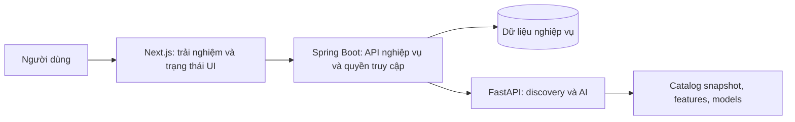

# Kế hoạch tính năng — Personalized Animation Discovery Engine

Ngày: 13/10/2026. Phạm vi: thiết kế sản phẩm, nghiệp vụ và kế hoạch triển khai; chưa triển khai mã ứng dụng.

## 1. Sản phẩm phải giúp người dùng đạt điều gì?

Nếu tôi là người dùng, tôi không vào website để xem hệ thống có bao nhiêu mô hình. Tôi muốn:

1. Chọn được một phim phù hợp mà không phải đọc hàng chục trang.
2. Tìm lại một phim khi chỉ nhớ vài chi tiết.
3. Tìm phim giống tác phẩm mình thích, nhưng thay đổi đúng điểm mình muốn.
4. Nhận gợi ý theo gu, tâm trạng, thời gian và người xem cùng.
5. Hiểu vì sao phim phù hợp; biết điểm có thể không hợp trước khi quyết định.
6. Lưu lựa chọn, phản hồi dễ dàng, và thấy lần sau hệ thống hiểu mình hơn.

Định vị: trợ lý ra quyết định xem phim hoạt hình. Thước đo chính là người dùng tìm được lựa chọn hữu ích, không phải số lượng phim hoặc số lượt chat.

Nguyên tắc trải nghiệm:

- Cho phép khám phá ngay khi chưa đăng nhập; yêu cầu tài khoản khi cần lưu và đồng bộ dữ liệu cá nhân.
- Hỗ trợ cả thao tác bằng nút/bộ lọc và ngôn ngữ tự nhiên.
- Hiển thị ít lựa chọn có lý do rõ ràng; luôn có đường xem thêm.
- Điều kiện bắt buộc do người dùng đặt phải được tôn trọng.
- Người dùng có quyền sửa, tạm bỏ hoặc xóa sở thích đã khai báo.
- Trạng thái lỗi, dữ liệu thiếu và chế độ suy giảm phải được thể hiện đúng.

## 2. Vai trò và trách nhiệm

| Vai trò | Trách nhiệm |
|---|---|
| Bạn — kỹ sư chính, chủ sở hữu tính năng | Chốt nghiệp vụ và ưu tiên; triển khai tính năng xuyên frontend/Spring Boot/FastAPI thông qua agent; phụ trách chuyên sâu AI |
| Team xây nền | Khung giao diện, hệ thống đăng nhập, dữ liệu và cấu trúc backend, môi trường chạy, CI theo contract đã thống nhất |
| Agent code | Thực hiện ticket có phạm vi và tiêu chí nghiệm thu; báo cáo thay đổi và bằng chứng kiểm tra |
| Codex — thiết kế và kiểm soát | Phân tích sản phẩm, thiết kế ranh giới, soạn ticket, review diff, phát hiện sai nghiệp vụ và xác nhận tiêu chí nghiệm thu |

Đây là phân công theo trách nhiệm, không giả định số thành viên. Một tính năng luôn có một người chịu trách nhiệm kết quả cuối cùng dù đi qua nhiều service.

## 3. Hiện trạng cần đưa vào kế hoạch

Quan sát từ code ngày 13/10/2026, chưa phải kết luận từ kiểm thử hệ thống đang chạy:

- Spring Boot có auth, catalog, watchlist, rating; chưa thấy controller tích hợp discovery hoặc module favorites/watch history.
- Chat Next.js và tuyến Nginx hiện gọi FastAPI trực tiếp, bỏ qua lớp nghiệp vụ Spring Boot.
- Frontend có đăng nhập/đăng ký giả trong nhánh lỗi kết nối. Đây không phải đăng nhập đã được xác thực.
- Watchlist/favorites/ratings lưu bằng khóa localStorage chung; đồng bộ watchlist chạy khi khởi tạo và gộp dữ liệu cũ. Cần thiết kế lại theo tài khoản và guest.
- FastAPI mặc định dùng session `default`, có dictionary lưu intent theo session. Thiếu tách biệt hội thoại nếu không cấp session riêng.
- `DiscoverRequest.userId` chưa được dùng trong đường chạy hiện tại; `user_profile` chưa đi vào orchestration. Chưa đủ cơ sở nghiệm thu cá nhân hóa.
- Bước recommender hiện lấy tám ứng viên đầu; điểm `matchPercentage` hiện được giới hạn trong khoảng 75–99 từ heuristic. Chưa có cơ sở diễn giải nó là xác suất phù hợp.
- Catalog tồn tại ở frontend, seed Spring Boot và `DEFAULT_MOVIES` FastAPI. Cần thống nhất định danh và dữ liệu thật trước khi nối vòng phản hồi.
- Báo cáo Phase 23 đánh giá parser, không thay thế đánh giá chất lượng toàn bộ recommender. Báo cáo hiện ghi intent accuracy 82% và conversational patch 1,5%; đây là số liệu trong báo cáo, chưa được tái chạy ở lần lập kế hoạch này.
- Lần gọi Maven test dừng vì thiếu `JAVA_HOME`; chưa xác nhận build/test Spring Boot. CI hiện thấy bước kiểm tra TypeScript, chưa thấy job kiểm tra backend.

### Hạ tầng và mốc AI đã kiểm tra

Cập nhật ngày 13/10/2026: người dùng xác nhận đã hoàn thành fine-tune Qwen3-4B. Xem đây là mốc đã hoàn thành để lập kế hoạch tích hợp, không giao agent huấn luyện lại cho các ticket nghiệp vụ.

- Docker Compose khai báo Nginx :80, Next.js :3000, Spring Boot :8080, FastAPI :8000, PostgreSQL 16 và Redis 7; có mạng nội bộ và volume `pgdata`. Đây là cấu hình khai báo, chưa xác nhận các container đang chạy.
- Spring Boot dev dùng H2 file; prod dùng PostgreSQL. Có launcher chạy ba ứng dụng trực tiếp trên Windows.
- Máy đang truy cập có GPU NVIDIA GeForce RTX 3050 Laptop, VRAM 6144 MiB, xác nhận bằng `nvidia-smi`. Chưa đo latency/concurrency phục vụ Qwen3-4B.
- Artifact LoRA có trong `ai/models/qwen3-4b-phase23-lora` và gói `ai/phase23_package/best_adapter`. Adapter config ghi base `Qwen/Qwen3-4B`; có weights/tokenizer. Model GGUF nhỏ `Qwen3-0.6B-Q8_0.gguf` cũng hiện diện.
- Full Qwen3-4B + LoRA có nhánh load bằng PEFT, nhưng `USE_FULL_QWEN3_4B_LORA` mặc định false. `phase23AdapterLoaded` được đặt true khi tìm thấy metadata adapter, trước khi nạp weights; cờ này một mình không chứng minh full 4B đang inference.
- Compose hiện vẫn cấu hình `Qwen/Qwen2.5-0.5B-Instruct`, `DEVICE=cpu` và chỉ mount `ai/models` sang `/app/models`; chưa đồng bộ với các default path của loader. Requirements hiện chưa khai báo `peft` hoặc `llama-cpp-python` dù code có nhánh dùng chúng.
- Lần kiểm tra GET localhost:8000/health không truy cập được. Không suy ra người dùng chưa chạy AI ở môi trường khác hoặc chưa fine-tune xong.
- JDK theo launcher tồn tại tại `C:\Program Files\Java\jdk-25.0.3`; lỗi Maven đã ghi nhận là thiếu JAVA_HOME trong process kiểm tra, chưa đủ cơ sở kết luận máy thiếu JDK.

Đầu việc serving riêng: xác nhận model thực sự inference, cách lượng tử hóa phục vụ phù hợp VRAM, đường dẫn artifact và dependencies, readiness và giới hạn concurrency. Thời tiết/context không cần gọi hoặc tải Qwen để thu thập ngữ cảnh.

Cập nhật sau thay đổi Gemini: paths Compose và dependencies đã bổ sung; loader đã tách artifact verified khỏi adapter loaded và có nhánh NF4. Health local hiện truy cập được, trả `activeInferenceBackend=qwen3-0.6b-gguf+phase23-normalizer`, `phase23AdapterLoaded=false`. Full Qwen4B fine-tuned chưa được nghiệm thu; Compose vẫn tắt flag full model và chưa cấp GPU. Các nhận xét trước đó về dependencies/cờ metadata/health là snapshot trước cập nhật này. Review và prompt follow-up nằm tại `docs/reviews/SERVING-01_REVIEW.md`.

Cập nhật mới nhất sau sửa SERVE-01: đã kiểm tra local health/readiness báo full Qwen3-4B + LoRA NF4 CUDA, base weights có đủ ba shard. Smoke test discovery trả kết quả sau 81,15 giây; 12 unit tests được rerun thành công. Local serving full được xác nhận; còn patch nhỏ về Docker fallback, inference failure, unit test isolation và health metadata trước khi đóng ticket. Review hiện hành ở `docs/reviews/SERVE-01_RUNTIME_REVIEW.md`. Các snapshot trước về model thiếu hoặc runtime light đã được thay thế bởi trạng thái này.

## 4. Các hành trình người dùng quan trọng

### A. Tôi chưa biết xem gì tối nay

Vào trang chủ → chọn tâm trạng, thời gian và xem cùng ai → nhận ba lựa chọn → xem lý do và điểm có thể không hợp → chọn một phim → lưu hoặc đánh dấu dự định xem → sau đó xác nhận đã xem và phản hồi.

Nghiệp vụ: lựa chọn hiện tại không tự trở thành gu lâu dài. Chỉ tạo watch history khi người dùng xác nhận đã xem; bấm mở trang chi tiết không có nghĩa đã xem.

### B. Tôi nhớ một phim nhưng quên tên

Nhập chi tiết nhớ được → nhận ứng viên có các chi tiết khớp → nếu còn mơ hồ, trả lời một câu hỏi phân biệt → xác nhận đúng phim → mở trang chi tiết.

Nghiệp vụ: tối ưu tìm đúng danh tính phim, không để gu cá nhân đẩy phim cần tìm xuống. Thiếu cơ sở thì trình bày ứng viên, không khẳng định chắc chắn.

### C. Tôi thích Coraline nhưng muốn bớt đáng sợ

Chọn phim tham chiếu → chọn những điểm muốn giữ → giảm độ đáng sợ → nhận kết quả → điều chỉnh tiếp bằng nút hoặc chat.

Nghiệp vụ: chỉ thay đổi chiều được yêu cầu; giữ các điều kiện còn lại. Nếu dữ liệu không có thuộc tính tương ứng, thông báo giới hạn thay vì coi điều kiện đã được đáp ứng.

### D. Hai người muốn tìm một phim xem cùng

Chọn hai hồ sơ hoặc nhập gu tạm thời → khai báo các điều kiện không chấp nhận → nhận lựa chọn dung hòa → xem lý do phù hợp cho từng người → biểu quyết hoặc chốt phim.

Nghiệp vụ: không công khai dữ liệu riêng của thành viên; điều kiện bắt buộc của một người không bị điểm trung bình của nhóm che lấp.

## 5. Danh mục tính năng đầy đủ

P0: cần cho bản sản phẩm cốt lõi. P1: tạo khác biệt và tăng chất lượng sau khi vòng cốt lõi đạt nghiệm thu. P2: mở rộng có giá trị nhưng phụ thuộc nền và dữ liệu. Đây là thứ tự ưu tiên, không phải cam kết thời gian.

### 5.1. Vào website và bắt đầu khám phá

| ID | Mong muốn của người dùng | Hành vi và quy tắc nghiệp vụ | Ưu tiên |
|---|---|---|---|
| ENTRY-01 | Thử website trước khi tạo tài khoản | Guest được tìm kiếm, xem chi tiết và khám phá; có session riêng; lưu lâu dài cần tài khoản | P0 |
| ENTRY-02 | Đăng nhập và dùng dữ liệu trên nhiều thiết bị | Đăng ký/đăng nhập/đăng xuất thật; phiên hết hạn yêu cầu xác thực lại; lỗi backend không tạo danh tính giả | P0 |
| ENTRY-03 | Có gợi ý hữu ích ngay từ lần đầu | Onboarding ngắn: chọn vài phim thích, thể loại tránh, mức sẵn sàng khám phá; cho phép bỏ qua | P0 |
| ENTRY-04 | Giữ lựa chọn đã làm khi đăng nhập | Cho phép chủ động nhập danh sách guest vào tài khoản; xem trước dữ liệu; chống trùng; không tự gộp dữ liệu của tài khoản khác | P1 |
| ENTRY-05 | Khôi phục tài khoản và quản lý phiên | Khôi phục mật khẩu bằng kênh xác minh; xem/thu hồi phiên nếu được đưa vào phạm vi phát hành | P1 |

Onboarding chỉ hỏi những thông tin ảnh hưởng trực tiếp đến gợi ý. Không buộc người dùng trả lời bảng khảo sát dài trước khi được thử sản phẩm.

### 5.2. Tìm kiếm và thông tin phim

| ID | Mong muốn của người dùng | Hành vi và quy tắc nghiệp vụ | Ưu tiên |
|---|---|---|---|
| CAT-01 | Tìm phim bằng tên mình biết | Tìm theo tên gốc, tên thay thế, tên tiếng Việt và lỗi gõ phổ biến; hiển thị năm để phân biệt trùng tên | P0 |
| CAT-02 | Thu hẹp kết quả nhanh | Bộ lọc thể loại, khoảng năm, thời lượng, kỹ thuật hoạt hình và các thuộc tính có dữ liệu; kết hợp được các bộ lọc | P0 |
| CAT-03 | Quyết định mà không bị spoil | Trang chi tiết gồm tóm tắt không spoil, thời lượng, thể loại, tác giả/studio khi có, đặc điểm nội dung, điểm đánh giá và nguồn điểm | P0 |
| CAT-04 | Biết phim có thật sự đáp ứng yêu cầu | Hiển thị điều kiện đã khớp và thuộc tính chưa biết; không biến dữ liệu thiếu thành giá trị mặc định | P0 |
| CAT-05 | Tìm từ khóa nhớ mơ hồ | Chế độ “Tìm lại phim”: chi tiết nhân vật, cảnh, bối cảnh; ứng viên và các manh mối khớp | P0 |
| CAT-06 | Biết có thể xem ở đâu | Liên kết nguồn xem theo khu vực nếu có nguồn dữ liệu; ghi thời điểm cập nhật; dữ liệu availability tách khỏi chất lượng đề xuất | P1 |
| CAT-07 | Xem trailer hoặc thông tin thêm | Nội dung preview và liên kết được catalog quản lý; mở preview không tự ghi là đã xem phim | P1 |

Catalog dùng một `movieId` chuẩn xuyên hệ thống; tên hiển thị không phải định danh. Thời lượng phải có giá trị số để kiểm tra ràng buộc; chuỗi “1h 30m” chỉ phục vụ hiển thị. Điểm cộng đồng, điểm nguồn ngoài và mức phù hợp là các khái niệm khác nhau.

### 5.3. Khám phá theo hoàn cảnh hiện tại

| ID | Mong muốn của người dùng | Hành vi và quy tắc nghiệp vụ | Ưu tiên |
|---|---|---|---|
| DISC-01 | Nói nhu cầu bằng tiếng Việt tự nhiên | Ví dụ “phim hơi buồn nhưng kết thúc tích cực, dưới 100 phút”; hiển thị các điều kiện hệ thống hiểu để sửa được | P0 |
| DISC-02 | Tìm phim hợp tâm trạng và thời gian | Nút chọn tâm trạng/thời lượng/người xem cùng và ô nhập tự do dùng chung một intent | P0 |
| DISC-03 | Tìm phim giống tác phẩm yêu thích | Chọn phim tham chiếu; ưu tiên các đặc điểm phù hợp với yêu cầu; không chỉ đối chiếu thể loại | P0 |
| DISC-04 | Giữ điểm thích, giảm điểm không thích | “Giống X nhưng ít đáng sợ hơn”; xử lý sở thích tương đối và cho biết dữ liệu nào hỗ trợ kết luận | P1 |
| DISC-05 | Tiếp tục điều chỉnh mà không nhập lại | Nút “nhẹ nhàng hơn”, “ngắn hơn”, “ít giống nhau hơn” hoặc chat; cập nhật đúng intent của hội thoại đó | P0 |
| DISC-06 | Không bị hệ thống đoán sai âm thầm | Hỏi làm rõ khi phim tham chiếu mơ hồ, yêu cầu mâu thuẫn hoặc thiếu thông tin quan trọng | P0 |
| DISC-07 | Có phương án khi không có phim phù hợp | Hiển thị không có kết quả và đề xuất từng cách nới điều kiện; chỉ chạy với điều kiện mới sau khi người dùng chọn | P0 |
| DISC-08 | Khám phá ngoài gu mà vẫn có điểm quen thuộc | Chế độ “an toàn / cân bằng / khám phá”; tăng đa dạng và mới lạ, vẫn giữ điều kiện bắt buộc | P1 |
| DISC-09 | Không thấy lại những phim vừa loại | “Ẩn khỏi lượt này” có hiệu lực trong session; phân biệt với dislike lâu dài | P0 |
| DISC-10 | Có phim phù hợp khi model gặp lỗi | Trả gợi ý từ chiến lược còn hoạt động và đánh dấu chế độ suy giảm; nếu không thể đáp ứng thì báo lỗi có thể thử lại | P0 |
| DISC-11 | Nhận gợi ý hợp thời tiết nơi mình chọn | Chọn thành phố và bật ngữ cảnh thời tiết; dữ liệu có nguồn/thời điểm; đưa ra lựa chọn theo ngữ cảnh để người dùng áp dụng; không tự suy ra tâm trạng | P1 |
| DISC-12 | Chọn phim hợp thời điểm xem tại địa phương | Dùng múi giờ IANA cho buổi sáng/chiều/tối/khuya; cho đổi giờ dự định xem; giờ muộn không tự biến thành giới hạn thời lượng | P1 |
| DISC-13 | Chọn phim kịp trước giờ mình cần kết thúc | Người dùng khai báo giờ bắt đầu/giờ kết thúc hoặc số phút có thể xem; chuyển thành ràng buộc thời lượng rõ ràng; xử lý qua ngày và timezone | P1 |

Nếu yêu cầu nói “không musical”, đây là điều kiện loại trừ. “Tốt nhất ít buồn” thường là ưu tiên. Giao diện cho phép đổi mức bắt buộc/ưu tiên; hệ thống không tự chuyển điều kiện bắt buộc thành ưu tiên để đủ số kết quả.

### 5.4. Giảm khó khăn khi quyết định

| ID | Mong muốn của người dùng | Hành vi và quy tắc nghiệp vụ | Ưu tiên |
|---|---|---|---|
| PICK-01 | Chỉ xem vài lựa chọn thật sự đáng cân nhắc | Mặc định ba ứng viên với lý do ngắn; có “xem thêm”; yêu cầu số lượng riêng được tôn trọng khi đủ ứng viên | P0 |
| PICK-02 | Hiểu vì sao phim được đề xuất | Giải thích dựa trên evidence: điều kiện, phim tham chiếu, dữ liệu sở thích đã được sử dụng | P0 |
| PICK-03 | Biết điểm có thể khiến mình không thích | Hiển thị một vài tradeoff có dữ liệu: chậm hơn, dài hơn, tone nặng hơn; không bịa thuộc tính | P1 |
| PICK-04 | So sánh hai hoặc ba phim dễ dàng | Bảng so sánh theo thời lượng, tone, chủ đề, kỹ thuật, lý do phù hợp; thuộc tính thiếu ghi chưa biết | P1 |
| PICK-05 | Nhờ website chọn giúp một phim | “Chọn giúp tôi”: chọn một phim từ tập hợp hợp lệ, giải thích; cho đổi phương án mà không phá điều kiện | P1 |
| PICK-06 | Hiểu vì sao phim tôi nghĩ tới không xuất hiện | “Tại sao không phải phim X?”: xác định bị loại bởi điều kiện hay chỉ xếp hạng thấp; nêu lý do kiểm chứng được | P2 |
| PICK-07 | Xem điều gì thay đổi nếu bỏ một điều kiện | “Nếu bỏ giới hạn 90 phút?”: tạo nhánh khám phá tạm; giữ lượt gốc để quay lại | P2 |
| PICK-08 | Giảm lặp và loay hoay giữa các kết quả | Ghi các phim đã hiển thị/đã loại trong session; cho quay lại lựa chọn trước; không đánh đổi chất lượng chỉ để tránh lặp | P1 |

Không hiển thị “95% hợp gu” khi điểm chưa được hiệu chỉnh và kiểm chứng. Bản đầu dùng nhãn/lý do có căn cứ; điểm nội bộ có thể phục vụ debug, không phải xác suất cho người dùng.

### 5.5. Thư viện cá nhân và vòng phản hồi

| ID | Mong muốn của người dùng | Hành vi và quy tắc nghiệp vụ | Ưu tiên |
|---|---|---|---|
| LIB-01 | Lưu phim muốn xem sau | Watchlist thêm/xóa được, đồng bộ tài khoản, chống trùng; đánh dấu đã xem không tự xóa khỏi watchlist nếu người dùng chưa chọn hành vi đó | P0 |
| LIB-02 | Ghi nhận phim mình đã xem | Đánh dấu đã xem/bỏ đánh dấu; tùy chọn ngày xem; có lịch sử và bộ lọc | P0 |
| LIB-03 | Chấm điểm và sửa ý kiến | Rating 1–10, một giá trị hiện hành cho mỗi user–movie; cho sửa/xóa; UI hiển thị trạng thái lưu thật | P0 |
| LIB-04 | Lưu phim mình yêu thích | Favorite độc lập với watchlist và rating; một trạng thái hiện hành cho mỗi user–movie | P0 |
| LIB-05 | Phản hồi vì sao gợi ý chưa hợp | Lý do nhanh: đã xem, quá buồn, quá trẻ con, không thích thể loại, chỉ không hợp hôm nay | P1 |
| LIB-06 | Xem lại phim mà không bị chặn | Mặc định discovery có thể ẩn phim đã xem; người dùng bật “xem lại”; tìm tên trực tiếp vẫn thấy phim đã xem | P0 |
| LIB-07 | Tổ chức thư viện theo mục đích | Bộ sưu tập riêng: xem cuối tuần, xem với gia đình, phim chữa lành; một phim được ở nhiều collection | P1 |
| LIB-08 | Hiểu và sửa hồ sơ sở thích | Xem sở thích khai báo và suy luận riêng biệt; chỉnh negative preferences; tắt dùng tín hiệu không mong muốn | P1 |
| LIB-09 | Giữ hoặc xóa lịch sử hội thoại | Xem lại session, đặt tên, tạo cuộc trò chuyện mới, xóa lịch sử theo lựa chọn | P1 |
| LIB-10 | Bắt đầu lại khi gu thay đổi | Reset hồ sơ suy luận mà không bắt buộc xóa tài khoản hoặc toàn bộ thư viện; giải thích tác động trước khi thực hiện | P1 |

Phản hồi phải phân biệt ý nghĩa: lưu watchlist là ý định xem, favorite là thích rõ ràng, rating thấp là đánh giá sau trải nghiệm, bỏ qua là tín hiệu yếu. Không coi mọi click là thích hoặc mọi phim không click là ghét.

### 5.6. Trang chủ hữu ích hơn theo thời gian

| ID | Mong muốn của người dùng | Hành vi và quy tắc nghiệp vụ | Ưu tiên |
|---|---|---|---|
| HOME-01 | Biết bắt đầu từ đâu | Trang chủ có ô khám phá, lối tìm lại phim và vài danh sách dễ hiểu; tránh dồn mọi chức năng vào chat | P0 |
| HOME-02 | Nhìn thấy gợi ý dành cho mình | Người mới nhận cold-start có nhãn; người có dữ liệu nhận danh sách cá nhân hóa được kiểm chứng | P0 |
| HOME-03 | Tiếp tục lựa chọn đang dang dở | Mở lại session khám phá gần nhất và watchlist; không dùng nhãn “xem tiếp” nếu không quản lý tiến độ playback | P1 |
| HOME-04 | Nhận lý do theo gu cụ thể | Danh sách “vì bạn thích X” có reference thật và evidence; người dùng đổi hoặc bỏ reference được | P1 |
| HOME-05 | Có chút mới lạ thay vì cùng một loại phim | Các danh sách quen gu và khám phá tách mục đích; giới hạn lặp trên cùng màn hình | P1 |
| HOME-06 | Biết chất lượng khi thông tin còn ít | Hiển thị điểm đánh giá cùng số lượng đánh giá khi có; không coi một rating 10/10 là chắc chắn vượt phim có nhiều đánh giá | P1 |

### 5.7. Xem cùng nhau và chia sẻ

| ID | Mong muốn của người dùng | Hành vi và quy tắc nghiệp vụ | Ưu tiên |
|---|---|---|---|
| GROUP-01 | Tìm phim cho hai người/nhóm | Nhập gu tạm hoặc mời thành viên tự chọn tham gia; kết quả dung hòa và giữ mọi hard constraint | P2 |
| GROUP-02 | Chốt phim bằng biểu quyết | Danh sách ngắn, mỗi người một phiếu cho mỗi phim; chủ phòng chốt; phòng có hạn dùng và quyền truy cập | P2 |
| GROUP-03 | Chia sẻ một danh sách hay | Link chia sẻ chỉ chứa nội dung được chọn; private mặc định; người dùng thu hồi link được | P1 |
| GROUP-04 | Nhờ bạn bè gợi ý mà không lộ hồ sơ | Chia sẻ phim/collection thay vì xuất toàn bộ ratings hoặc cuộc trò chuyện | P1 |
| GROUP-05 | Có bài viết/review không spoil | Review có cảnh báo spoiler và báo cáo nội dung; chỉ đưa vào sau khi có năng lực moderation | P2 |

Tính năng nhóm có thể bắt đầu bằng nhập hai bộ sở thích tạm thời, rồi mới xây phòng nhiều thành viên. Giá trị cốt lõi là tìm lựa chọn dung hòa, không phải số lượng chức năng xã hội.

### 5.8. Quản trị để chất lượng sản phẩm bền vững

| ID | Nhu cầu vận hành | Hành vi và quy tắc nghiệp vụ | Ưu tiên |
|---|---|---|---|
| ADMIN-01 | Quản lý catalog chuẩn | Tạo/sửa/ẩn phim, aliases, metadata, nguồn dữ liệu; mọi thao tác kiểm tra quyền admin ở backend | P0 |
| ADMIN-02 | Không phát hành dữ liệu lỗi | Kiểm tra trùng phim, thiếu trường, thời lượng sai, năm sai; tách draft/published/archived | P0 |
| ADMIN-03 | Cập nhật dữ liệu theo lô an toàn | Import có preview, báo cáo lỗi theo bản ghi, chống trùng và kiểm tra version; không âm thầm ghi đè | P1 |
| ADMIN-04 | Nhìn thấy truy vấn nào đang thất bại | Dashboard no-result, clarification, lỗi và latency theo mode; hạn chế dữ liệu cá nhân trong log | P1 |
| ADMIN-05 | Kiểm soát phiên bản AI/catalog | Ghi artifact/catalog/schema version cho mỗi release, kiểm thử trước phát hành, có đường rollback tương thích | P0 |
| ADMIN-06 | Tiếp nhận lỗi thông tin từ người dùng | Nút báo phim sai metadata, link hỏng hoặc kết quả không hợp; phân loại để sửa catalog hay thuật toán | P1 |
| ADMIN-07 | Quản lý tài khoản và nội dung chia sẻ | Vô hiệu hóa tài khoản khi cần, thu hồi session và xử lý report; thao tác có audit log | P1 |

## 6. Tối ưu các bài toán nghiệp vụ xuyên suốt

### 6.1. Từ nhiều lựa chọn đến một quyết định

Khó khăn: danh sách dài làm người dùng tiếp tục lướt mà không chọn được.

Thiết kế: ba ứng viên đầu → lý do ngắn → so sánh → chọn giúp → lưu quyết định. Cho xem thêm khi người dùng muốn, không che catalog.

Nghiệm thu: người dùng đi từ yêu cầu đến lựa chọn mà không phải nhập lại điều kiện; so sánh dùng dữ liệu cùng nguồn; đổi lựa chọn vẫn giữ hard constraints.

### 6.2. Thiếu dữ liệu người dùng mới

Khó khăn: đăng ký xong nhưng hệ thống chưa biết gu.

Thiết kế: onboarding có thể bỏ qua; kết hợp lựa chọn khai báo với nội dung phim; dùng baseline phù hợp khi chưa có tín hiệu; giảm mức cá nhân hóa được khẳng định khi dữ liệu ít.

Nghiệm thu: guest và user mới đều nhận kết quả hợp điều kiện. Chỉ có `userId` không đủ để gắn nhãn kết quả là cá nhân hóa.

### 6.3. Gu lâu dài khác nhu cầu hôm nay

Khó khăn: thường thích phim buồn nhưng hôm nay muốn phim nhẹ nhàng.

Thiết kế: profile lâu dài và session intent tách biệt. Yêu cầu hiện tại điều khiển kết quả lượt này; cập nhật profile qua tín hiệu có ngữ nghĩa phù hợp.

Nghiệm thu: “hôm nay không muốn buồn” không ghi thành dislike lâu dài; “tôi luôn không thích musical” chỉ lưu vào hồ sơ sau thao tác xác nhận phù hợp.

### 6.4. Không có kết quả hợp mọi điều kiện

Khó khăn: nhiều ràng buộc khiến tập ứng viên rỗng.

Thiết kế: giữ yêu cầu gốc; chỉ ra một số phương án nới điều kiện; cho biết số kết quả dự kiến nếu có thể tính; phân biệt “catalog không có” với “dịch vụ đang lỗi”.

Nghiệm thu: không trả phim vi phạm mà vẫn nói đáp ứng yêu cầu; không tự đưa default movies vào để lấp kết quả rỗng. Chưa có đủ evidence để xác định điều kiện gây rỗng thì không khẳng định nguyên nhân.

### 6.5. Dữ liệu hành vi phải phản ánh đúng ý nghĩa

Khó khăn: click, watchlist, favorite, rating và đã xem có ý nghĩa khác nhau.

Thiết kế: lưu trạng thái nghiệp vụ hiện hành và event phục vụ đo lường riêng. Event có loại, thời điểm, request/session tham chiếu và khóa chống trùng. Dữ liệu suy luận có version; rating bị sửa/xóa phải được phản ánh trong snapshot mới.

Nghiệm thu: retry không tạo tín hiệu trùng; click không tạo watched; guest không ghi vào user khác; dữ liệu không tồn tại phải được xử lý rõ.

### 6.6. Đồng bộ giữa catalog và AI

Khó khăn: AI trả phim không có trong DB, hoặc metadata khác phiên bản.

Thiết kế: Spring Boot sở hữu catalog chuẩn. FastAPI có snapshot/features/index cùng `movieId` và version. Import/publish xong mới xây và kích hoạt artifact tương ứng. Spring Boot bổ sung thông tin hiển thị theo ID, giữ thứ tự xếp hạng.

Nghiệm thu: không xuất phim đã ẩn vào discovery mới; lệch version có trạng thái xử lý và log; không gửi toàn bộ catalog ở mỗi truy vấn khi đã có snapshot; xử lý phim thiếu không tạo truy vấn DB riêng cho từng kết quả.

### 6.7. Tài khoản và phiên phải tách biệt

Khó khăn: tài khoản A đăng xuất rồi B đăng nhập trên cùng trình duyệt; session chat đang dùng chung.

Thiết kế: trạng thái local được gắn đúng owner; chuyển account xóa/reset dữ liệu UI liên quan; session discovery gắn với user hoặc guest credential; backend kiểm tra ownership trước khi đọc/cập nhật.

Nghiệm thu: B không thấy ratings/watchlist/session của A; sửa ID trong request không truy cập được dữ liệu người khác; userId cho nghiệp vụ lấy từ danh tính đã xác thực.

### 6.8. AI chậm hoặc không khả dụng

Khó khăn: UI treo hoặc trả lỗi nhưng người dùng không biết làm gì.

Thiết kế: trạng thái đang xử lý, timeout và retry rõ; giới hạn tác vụ tốn tài nguyên; profile fallback nhẹ có kiểm thử; các chức năng catalog/thư viện vẫn dùng độc lập được.

Nghiệm thu: timeout không tự gửi lại vô hạn; hủy chờ ở UI không được diễn giải là đã dừng GPU nếu backend chưa hỗ trợ; cùng một hành động lưu không bị lặp khi người dùng thử lại.

### 6.9. Gợi ý theo thời tiết và giờ địa phương

Giá trị: giảm công sức mô tả hoàn cảnh, tạo những lối khám phá như “một phim ấm áp cho tối mưa” hoặc “chọn phim xem trước giờ ngủ”. Đây là các đề xuất mà người dùng chủ động áp dụng; chưa phải quy luật rằng mưa đồng nghĩa thích phim buồn.

Trải nghiệm đề xuất:

1. Người dùng chọn thành phố; hệ thống hiển thị khu vực và timezone rõ ràng. Có thể chỉ chọn timezone để dùng ngữ cảnh giờ mà không lấy thời tiết.
2. Thời tiết là tùy chọn riêng, có thể tắt; chọn thành phố là đủ cho bản đầu, không cần GPS chính xác.
3. Hiển thị thông tin hiện tại cùng thời điểm cập nhật, trạng thái dữ liệu và nguồn; mô tả là dữ liệu mô hình thời tiết khi nguồn sử dụng mô hình.
4. Hiển thị các lựa chọn ngữ cảnh có thể bấm, ví dụ “ấm áp”, “nhẹ nhàng”, “khám phá kỳ ảo”. Chỉ bấm chọn mới bổ sung sở thích tương ứng vào session intent.
5. Nếu người dùng muốn hệ thống tự cân nhắc thời tiết, đây là tùy chọn riêng ở đợt tích hợp; trọng số thấp và phải đánh giá so với baseline không dùng thời tiết.
6. Chọn thời điểm xem trong tương lai dùng forecast tương ứng khi có dữ liệu; không lấy thời tiết hiện tại và trình bày là dự báo tối mai.
7. Chọn giờ cần kết thúc tạo ngân sách thời gian do người dùng khai báo, độc lập với thời tiết và tone phim. Không tự giả định “khuya thì phải xem phim ngắn”.

Quy tắc:

- Thứ tự ưu tiên: hard constraints → yêu cầu hiện tại → gu cá nhân → ngữ cảnh tự động. Thời tiết không loại phim hoặc vượt điều kiện bắt buộc.
- Context hiện tại không ghi vào sở thích lâu dài và không có quyền suy luận tâm trạng người dùng.
- Thời điểm lưu dưới dạng instant; giờ địa phương tính bằng timezone IANA với clock có thể kiểm thử, không lấy timezone máy chủ hoặc cố định UTC+7 cho mọi người.
- Hỏng nguồn weather: thời gian vẫn có thể hoạt động khi timezone hợp lệ; weather là unavailable, không giả định trời nắng. Provider model timestamp và thời điểm tải dữ liệu là hai trường khác nhau.
- Weekend/holiday không tự suy từ một quy tắc chung cho mọi khu vực; chỉ bổ sung sau khi có dữ liệu lịch và lựa chọn phù hợp của người dùng.
- Context service thuộc Spring Boot; FastAPI nhận snapshot đã chuẩn hóa ở đợt tích hợp, không gọi weather provider theo từng ứng viên.
- Cache theo thành phố và loại dữ liệu, không theo danh tính cá nhân; không cache nguyên response chứa giờ hiện tại. Cache có TTL, giới hạn kích thước và concurrency.
- Đo mức hữu ích và constraint violations khi bật/tắt context; chưa đủ bằng chứng thì giữ như shortcut UX, không khẳng định tăng chất lượng ranking.

Lát cắt triển khai: CTX-01 API context và kiểm thử → CTX-02 giao diện chọn khu vực/bật tắt/áp dụng context → CTX-03 truyền intent/context qua Spring Boot đến FastAPI → CTX-04 forecast và ngân sách giờ kết thúc. Prompt CTX-01 ở `docs/prompts/CTX-01_GEMINI_PROMPT.md`.

## 7. Ranh giới kiến trúc để triển khai

Giữ hai backend có trách nhiệm rõ ở giai đoạn này. Trong Spring Boot chia module theo nghiệp vụ: identity, catalog, library, discovery orchestration, conversation, administration. FastAPI tách intent, retrieval/ranking, profile derivation, constraints, explanation và artifact lifecycle. Chỉ tách thêm service khi có nhu cầu vận hành đo được.

| Dữ liệu/năng lực | Nguồn sở hữu |
|---|---|
| Danh tính, quyền, tài khoản, phiên đăng nhập | Spring Boot |
| Catalog hiển thị và trạng thái published/archived | Spring Boot |
| Ratings, favorites, watchlist, watched history, khai báo sở thích | Spring Boot |
| Quyền truy cập session, lịch sử hội thoại lưu lâu dài | Spring Boot |
| Intent hiệu lực, retrieval, ranking, derived taste, explanation | FastAPI |
| Snapshot/index/model và thông tin version | FastAPI, từ dữ liệu được xuất theo contract |
| Trạng thái UI và draft chưa lưu | Frontend |

FastAPI có thể lưu cache intent/derived profile, nhưng đó không phải bản duy nhất của dữ liệu người dùng cần bảo toàn. Chọn cơ chế lưu/cache phù hợp sau khi biết yêu cầu nhiều worker và giới hạn bộ nhớ; session phải có hạn dùng.

## 8. Contract tối thiểu cần chốt trước khi agent code

Các trường dưới đây là đề xuất thiết kế, không phải mô tả API đã có. Với endpoint hiện hữu, cần adapter hoặc phiên bản mới để chuyển đổi có kiểm soát.

### 8.1. Discovery

- Frontend gửi query, session tham chiếu, số lượng mong muốn và các filter do người dùng chọn. Không gửi `availableMovies` tùy ý làm catalog chuẩn.
- Spring Boot xác thực ownership, cấp/kiểm tra session, đọc dữ liệu sở thích được phép sử dụng rồi gọi FastAPI.
- Contract nội bộ gồm request ID, session ID có scope, query, limit, filter/intent patch, snapshot sở thích có version và catalog/artifact version tương thích.
- Profile phải có giới hạn kích thước và ý nghĩa trường rõ; không gửi lịch sử người dùng không giới hạn.
- FastAPI trả outcome, intent hiệu lực, kết quả xếp hạng với movie ID/evidence, câu hỏi làm rõ hoặc lý do chưa có kết quả, và version được sử dụng.
- Outcome phân biệt results / needs clarification / no results / degraded. Lỗi hạ tầng có error code riêng; không dùng cùng trạng thái với catalog rỗng.
- Spring Boot bổ sung metadata hợp lệ theo ID, giữ thứ tự; frontend hiển thị thông điệp phù hợp và thao tác tiếp theo.
- Dữ liệu debug như pipeline internals chỉ đưa ra giao diện quản trị/development phù hợp, không mặc định cho người dùng.

### 8.2. Thư viện và feedback

- Chốt rating 1–10 và quy tắc xóa/sửa trước khi triển khai; không để frontend và AI dùng thang khác nhau.
- Các thao tác đặt trạng thái yêu thích/đã xem/thêm watchlist phải có kết quả idempotent; gửi lại cùng ý định không đảo trạng thái.
- Một rating hiện hành/user/movie; một membership hiện hành/user/movie/list.
- Feedback session-only và long-term có trường scope hoặc endpoint ngữ nghĩa rõ.
- API trả trạng thái đã lưu để UI đồng bộ; lỗi lưu có rollback hoặc thông báo, không báo thành công giả.
- API danh sách có phân trang, giới hạn và thứ tự ổn định; validation và error shape thống nhất.
- Hai request sửa rating đồng thời cần quy tắc rõ: bản cập nhật thành công cuối cùng, hoặc kiểm tra version để tránh ghi đè ngoài ý muốn.

### 8.3. Giao diện và dữ liệu

- Loading, empty, error, unauthorized và degraded đều có thiết kế, không chỉ màn hình happy path.
- Tên phim, source rating, số lượng đánh giá và metadata thiếu được hiển thị nhất quán.
- UI tìm kiếm/filter có thể dùng bàn phím; mobile dùng được các luồng cốt lõi; trạng thái chọn không chỉ phân biệt bằng màu.
- Chốt profile guest và quy tắc chuyển guest → account; không tự hợp nhất dữ liệu theo trình duyệt chung.
- Khóa ký token và dữ liệu seed được cấu hình theo môi trường; seed tài khoản demo không chạy trong production.

## 9. Lộ trình triển khai theo kết quả có thể nghiệm thu

| Đợt | Kết quả người dùng nhận được | Phạm vi | Điều kiện kết thúc |
|---|---|---|---|
| R0 — nền và contract | Dữ liệu và tài khoản đáng tin cậy | Catalog chuẩn, auth thật, session ownership, error contract, migration/version, build và CI | Chạy được nền; đổi tài khoản không lẫn dữ liệu; mọi service thống nhất ID và schema |
| R1 — vòng chọn phim đầu tiên | Tìm, nhận gợi ý, hiểu và lưu được phim | CAT P0, DISC P0, PICK-01/02, watchlist, guest, trang chủ cơ bản | Một yêu cầu đi từ UI qua Spring đến FastAPI, hiển thị phim thật và lưu đúng tài khoản |
| R2 — cá nhân hóa có căn cứ | Dữ liệu cá nhân ảnh hưởng kết quả đúng | Onboarding, rating, favorite, watched, snapshot profile, negative preferences, xem lại | Thay đổi profile tạo ảnh hưởng có giải thích; temporary mood không đổi gu lâu dài |
| R3 — trợ lý ra quyết định | Chọn nhanh hơn và điều chỉnh được | Relative reference, comparison, choose-for-me, controls đa dạng, phản hồi lý do, profile editor | Các luồng nhiều lượt giữ điều kiện; đo được tác động và kiểm tra các trường hợp thất bại |
| R4 — thư viện và vận hành | Sử dụng đều đặn và sửa lỗi được | Collections, chia sẻ, conversation history, catalog import, reporting, admin quality dashboard | Phân quyền và thu hồi chia sẻ đúng; dữ liệu cập nhật có version; metric giúp tìm nguyên nhân lỗi |
| R5 — tính năng nổi bật | Tìm phim theo nhóm và khám phá có giải thích sâu | Group discovery/vote, why-not, counterfactual, review nếu có moderation | Kết quả tôn trọng điều kiện mọi thành viên; privacy đúng; evidence hỗ trợ giải thích |

Không cam kết số tuần khi chưa có deadline, quy mô team và tốc độ thực hiện. Phạm vi mỗi đợt có thể thu nhỏ, nhưng giữ nguyên các tiêu chí an toàn dữ liệu và đúng nghiệp vụ.

Tính năng phụ thuộc:

- Relative preference phụ thuộc facet đáng tin; không đủ facet thì chưa nghiệm thu lời hứa tương đối.
- Personalization phụ thuộc profile vào ranking thật, không chỉ truyền user ID.
- Group discovery phụ thuộc single-user discovery, constraints và ownership.
- Why-not/counterfactual phụ thuộc evidence, trace filter/rank và snapshot version.
- Availability phụ thuộc nguồn dữ liệu và cơ chế cập nhật; thiếu nguồn thì không ghi “đang có trên nền tảng X”.
- Community review phụ thuộc moderation; không đưa sớm nếu làm giảm chất lượng discovery.

## 10. Backlog giao việc ban đầu

Mỗi hàng là một đầu việc cần tách tiếp thành ticket nhỏ. Foundation do team xây; feature do bạn sở hữu và điều phối agent.

| Ticket | Phạm vi | Loại/chủ sở hữu kết quả | Phụ thuộc | Nghiệm thu chính |
|---|---|---|---|---|
| FND-01 | Chuẩn hóa movie ID, schema, nguồn dữ liệu, sample catalog thật | Foundation/team, bạn chốt contract | Không | Phim mẫu có mặt nhất quán ở DB, API và snapshot AI |
| FND-02 | Auth, profile môi trường, ownership, error shape | Foundation/team | Contract identity | Token sai không tạo user; API riêng tư từ chối truy cập trái quyền |
| FND-03 | DB migration, build/CI, môi trường integration | Foundation/team | Schema thống nhất | Build/test backend chạy; migration không làm mất dữ liệu hiện hữu |
| FND-04 | UI foundation, component/loading/error, API client | Foundation/team | Contract public | UI xử lý đủ loading/empty/error; responsive và keyboard cơ bản |
| FEAT-01 | Catalog thật: search/filter/detail qua Spring Boot | Feature/bạn | FND-01/04 | Bỏ lệ thuộc mock catalog cho luồng phát hành; filter kết hợp đúng |
| FEAT-02 | Discovery đi qua Spring Boot với session riêng | Feature/bạn | FND-01/02 | A và B không chia sẻ intent; test contract không cần tải model lớn |
| FEAT-03 | Kết quả discovery, clarification, no-result, fallback | Feature/bạn | FEAT-02 | Bốn trạng thái có UX và hành vi đúng; không âm thầm nới hard constraints |
| FEAT-04 | Watchlist/rating/favorite/watched đồng bộ | Feature/bạn | FND-01/02 | Retry không trùng; sửa/xóa đúng; account switch không lẫn |
| FEAT-05 | Onboarding và profile snapshot cho ranking | Feature/bạn, trọng tâm AI | FEAT-04 | Positive/negative signals được dùng thật và có bằng chứng ảnh hưởng |
| FEAT-06 | Refinement nhiều lượt, filter chips và hide-this-session | Feature/bạn | FEAT-02/03 | Patch sửa đúng trường, giữ các điều kiện khác và không làm đổi profile lâu dài |
| FEAT-07 | Evidence/lý do và kiểm soát cách hiển thị mức phù hợp | Feature/bạn | FEAT-03/05 | Mỗi lý do dựa trên dữ liệu; không gắn heuristic thành xác suất |
| FEAT-08 | Comparison, choose-for-me, exploration | Feature/bạn | FEAT-06/07 | Giúp chốt lựa chọn; mọi phim vẫn thỏa hard constraints |
| FEAT-09 | Collections/share/history/profile editor | Feature/bạn | FEAT-04/06 | Scope và quyền đúng; sửa hồ sơ có tác động dễ hiểu |
| FEAT-10 | Metrics, golden journeys, load/failure checks | Feature/bạn phối hợp team | Triển khai cùng R1–R4 | Có baseline và số liệu để quyết định giữ/sửa tính năng |
| FEAT-11 | Group discovery và vote | Feature/bạn | FEAT-05/07/08 | Không bỏ qua hard constraint cá nhân; không lộ dữ liệu riêng |
| FEAT-12 | Why-not và counterfactual | Feature/bạn | Evidence/trace đầy đủ | Giải thích được phân biệt filter-out/rank-low; nhánh không ghi đè yêu cầu gốc |
| FEAT-13 | Thời tiết, giờ địa phương và ngân sách thời gian | Feature/bạn; API context thuộc Spring Boot | FEAT-02/06 cho tích hợp; CTX-01 có thể làm độc lập | Context có opt-in, timezone đúng, provider lỗi không giả dữ liệu; không vượt hard constraints |

Team có thể làm song song nền frontend, nền Spring Boot và môi trường khi dùng chung contract. Bạn có thể phát triển engine theo fixture trước khi UI hoàn chỉnh. Tích hợp sớm bằng một lát cắt chạy xuyên hệ thống, rồi mở rộng từng tính năng.

## 11. Đo hiệu quả thực tế

| Bài toán | Chỉ số sản phẩm | Chỉ số kỹ thuật/AI bổ trợ |
|---|---|---|
| Chọn phim nhanh | Thời gian từ yêu cầu đến lựa chọn được xác nhận; tỷ lệ người dùng nói đã tìm được phim phù hợp | Latency từng mode, lỗi, số lượt refinement |
| Tìm lại phim | Tỷ lệ xác nhận tìm đúng, số lần phải hỏi thêm | MRR/Recall@K trên benchmark tìm danh tính |
| Gợi ý hợp điều kiện | Phản hồi phù hợp theo query/context | Hard-constraint violation, no-result đúng, NDCG/Recall khi có nhãn |
| Cá nhân hóa | Mức hữu ích do người dùng đánh giá; tỷ lệ loại vì không hợp gu | So với non-personalized baseline; kiểm tra leakage và cold-start |
| Đa dạng và khám phá | Tỷ lệ chọn phim mới với người dùng, phản hồi về mức mới lạ | Diversity, coverage, relevance tradeoff |
| Hội thoại | Tỷ lệ sửa intent đúng, người dùng phải sửa lại điều kiện bao nhiêu lần | Patch accuracy với history; session isolation |
| Giải thích | Người dùng hiểu lý do và phát hiện được tradeoff | Groundedness/faithfulness, số claim không có evidence |
| Thư viện | Tỷ lệ lưu thành công, lỗi đồng bộ, dữ liệu mất/lẫn | Persistence, idempotency, ownership, race conditions |

Watchlist, click và mở chi tiết là proxy, không chứng minh người dùng đã xem hoặc hài lòng. Thu thập xác nhận trực tiếp nhẹ nhàng: “Bạn đã tìm được phim muốn xem chưa?” hoặc phản hồi sau khi đánh dấu đã xem. Không tối ưu thời gian lướt như mục tiêu chính.

Chốt ngưỡng sau khi đo baseline và xác định môi trường tải. Các mục tiêu tính đúng phải giữ: không lẫn account/session, không báo lưu thành công khi chưa lưu, không âm thầm vi phạm hard constraints.

## 12. Các ca nghiệm thu bắt buộc trước phát hành

1. Guest tìm phim, đăng nhập và chủ động nhập lựa chọn của mình mà không nhập nhầm dữ liệu tài khoản khác.
2. User A đăng xuất, user B đăng nhập cùng trình duyệt: thư viện và hội thoại riêng biệt.
3. Hai người dùng khám phá và refinement đồng thời: intent không bị trộn.
4. Yêu cầu “dưới 90 phút, không musical” không xuất phim vi phạm; metadata không đủ được xử lý theo policy rõ.
5. Tìm tên phim đã xem vẫn tìm được; khám phá mới có tùy chọn ẩn/hiện lại.
6. “Giống Coraline nhưng bớt đáng sợ” giữ các điều kiện khác và có bằng chứng cho chiều tương đối.
7. Không có kết quả: cho người dùng chọn nới một điều kiện; không tự trả default catalog.
8. Phim tham chiếu trùng tên: hỏi hoặc cho chọn đúng năm/tác phẩm.
9. Cập nhật/xóa rating, favorite và watched: profile snapshot mới phản ánh thay đổi đúng.
10. Retry thêm watchlist/rating/feedback không tạo bản ghi hoặc tín hiệu trùng.
11. AI timeout/model chưa sẵn sàng: catalog/thư viện hoạt động; discovery có trạng thái phù hợp.
12. Phim archived sau khi artifact được tạo: không bị đưa vào discovery mới như phim đang phát hành trong catalog.
13. Giải thích không gọi phim “không có musical” hoặc “phù hợp trẻ nhỏ” nếu dữ liệu không hỗ trợ.
14. Quyền admin và private collection kiểm tra ở backend; sửa URL/ID không vượt quyền.
15. UI mobile, keyboard và lỗi validation vẫn hoàn thành được hành trình cốt lõi.

## 13. Quy trình kiểm soát agent code

Mỗi lượt giao việc dùng mẫu sau:

1. **Vấn đề người dùng:** người dùng đang gặp gì và tính năng giải quyết điều gì.
2. **Phạm vi:** story ID; repository paths dự kiến; service phải thay đổi; phần nền phụ thuộc.
3. **Contract:** input/output, quyền truy cập, source of truth, trạng thái nghiệp vụ, tương thích endpoint hiện hữu.
4. **Quy tắc nghiệp vụ:** hard/soft, session/long-term, retry, duplicate, missing data, concurrency, failure.
5. **Tiêu chí nghiệm thu:** hành trình và kết quả quan sát được, gồm failure cases quan trọng.
6. **Bằng chứng:** diff, lệnh kiểm tra và kết quả, ảnh/video UI khi cần, contract fixture, migration impact.
7. **Điểm còn thiếu:** agent ghi rõ chưa hoàn thành hoặc chưa kiểm tra; không thay bằng lời khẳng định chung.

Đánh giá theo ba lớp:

- **Đúng sản phẩm:** giải quyết nhu cầu, có đường tiếp theo khi không đạt kết quả, không làm người dùng hiểu sai.
- **Đúng nghiệp vụ:** dữ liệu, quyền, ràng buộc, trạng thái, đồng bộ và rollback đúng.
- **Đúng kỹ thuật:** contract tương thích, giới hạn tài nguyên, kiểm tra phù hợp, log hữu ích và bảo trì được.

Trạng thái ticket: planned → contract ready → implementing → review → accepted. Agent báo code xong chỉ chuyển đến review. Chỉ accepted khi tiêu chí nghiệm thu đã có bằng chứng; model chạy được hoặc trang render được chưa đủ.

Codex giữ vai trò lập kế hoạch và review. Agent khác triển khai mã ứng dụng. Khi thay đổi phạm vi, cập nhật ticket và quyết định kiến trúc trước để các agent không tự chọn contract khác nhau.

## 14. Việc nên giao trước

Đợt đầu nên chốt FND-01/02/03/04 với team, sau đó giao một lát cắt FEAT-01 → FEAT-02 → FEAT-03 → phần watchlist của FEAT-04. Kết quả là người dùng tìm/khám phá phim thật, hiểu kết quả và lưu thành công qua hệ thống đầy đủ.

Lát cắt tiếp theo nối onboarding → rating/favorite/watched → profile snapshot → ranking → evidence. Đây là bước biến sản phẩm từ tìm kiếm có AI thành trợ lý khám phá có cá nhân hóa kiểm chứng được.

Đưa comparison và choose-for-me vào ngay sau vòng cốt lõi, vì chúng trực tiếp giảm khó khăn ra quyết định. Group discovery và counterfactual là các hướng nổi bật tiếp theo khi dữ liệu và evidence đủ chất lượng.
