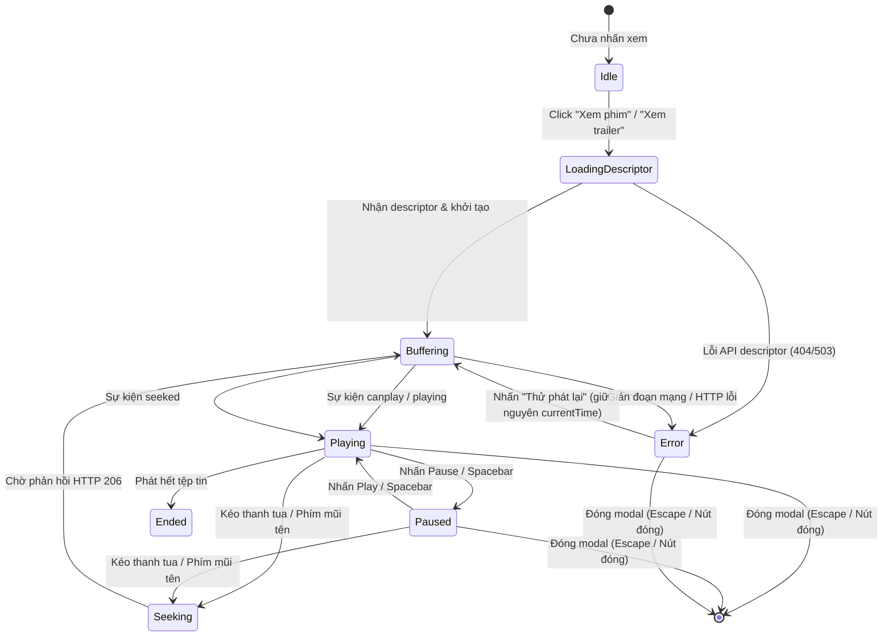

# M4 Media Playback & Storage Architecture Contract

- **Version:** 1.0.0
- **Milestone:** M4 — Xem video thật, tua mượt và nền tảng storage Windows
- **Trạng thái:** DRAFT -> ACTIVE
- **Ngày ban hành:** 2026-10-14
- **Phạm vi áp dụng:** Spring Boot backend (`/api/movies/{id}/media-descriptor`, `/api/media/stream/{assetId}`), Next.js frontend (`MovieDetail`, `VideoPlayerModal`), và bộ công cụ đo lường hiệu năng (`scripts/benchmark_media_playback.cjs`).

---

## 1. Mục tiêu và Nguyên tắc Thiết kế

1. **Người dùng thực tế:**
   - Tác phẩm có video hoàn chỉnh (Feature) hiển thị nút "Xem phim" với trải nghiệm phát và tua mượt mà.
   - Tác phẩm chỉ có đoạn giới thiệu tiếp tục được định danh chính xác là "Xem trailer / giới thiệu".
   - Tác phẩm chưa đăng ký tài nguyên media không hiển thị nút phát giả mạo.
2. **Kiến trúc tinh gọn:**
   - Tích hợp trực tiếp module media vào Spring Boot hiện hữu; không dựng microservice, transcoder hay message queue không cần thiết.
   - Hỗ trợ chuẩn phát tuần tự HTTP Range (RFC 9110 / RFC 7233) cho phép trình duyệt tua đầu/giữa/cuối trực tiếp từ máy chủ.
   - Storage Adapter dạng cắm-rút (Pluggable):
     - **Local Storage Provider (Primary):** Phục vụ các tệp tin media nằm dưới thư mục gốc `MEDIA_ROOT`.
     - **Drive Storage Provider (Gated):** Phục vụ khi có sẵn mount rclone/WinFsp hợp lệ. Nếu thiếu điều kiện môi trường, trạng thái được ghi nhận là `BLOCKED_EXTERNAL_INPUT` mà không làm gián đoạn luồng phát local.

---

## 2. Mô hình Dữ liệu (`media_assets`)

Bảng lưu trữ thông tin tài nguyên video được bổ sung theo nguyên tắc **Additive Migration** bảo toàn 100% dữ liệu hiện hữu:

```sql
CREATE TABLE IF NOT EXISTS media_assets (
    id VARCHAR(64) PRIMARY KEY,                         -- Canonical asset identifier (UUID hoặc chuỗi định danh duy nhất)
    movie_id VARCHAR(100) NOT NULL,                     -- Tham chiếu canonical movie ID
    kind VARCHAR(20) NOT NULL,                          -- 'feature' | 'trailer'
    storage_provider VARCHAR(30) NOT NULL DEFAULT 'local', -- 'local' | 'drive'
    relative_path VARCHAR(500) NOT NULL,                -- Đường dẫn tương đối bên dưới MEDIA_ROOT
    version VARCHAR(50) NOT NULL DEFAULT 'v1',          -- Định danh phiên bản tệp để tránh stale cache
    mime_type VARCHAR(100) NOT NULL DEFAULT 'video/mp4',-- MIME type chuẩn của tệp
    byte_length BIGINT NOT NULL,                        -- Kích thước tệp tính theo bytes
    duration_seconds DOUBLE PRECISION,                  -- Thời lượng video tính theo giây (null nếu chưa probe được)
    is_public BOOLEAN NOT NULL DEFAULT TRUE,            -- Quyền xem công khai (guest/auth)
    is_available BOOLEAN NOT NULL DEFAULT TRUE,         -- Trạng thái sẵn sàng của asset trên đĩa
    created_at TIMESTAMP DEFAULT CURRENT_TIMESTAMP,
    updated_at TIMESTAMP DEFAULT CURRENT_TIMESTAMP,
    CONSTRAINT fk_media_movie FOREIGN KEY (movie_id) REFERENCES movies(id) ON DELETE CASCADE,
    CONSTRAINT uq_movie_kind_version UNIQUE (movie_id, kind, version)
);

CREATE INDEX IF NOT EXISTS idx_media_movie_id ON media_assets(movie_id);
CREATE INDEX IF NOT EXISTS idx_media_movie_kind ON media_assets(movie_id, kind);
```

*Ghi chú về quan hệ bảng:*
- `movie_id` tham chiếu `movies(id)` có `ON DELETE CASCADE`: Khi một phim hoạt hình bị xóa khỏi catalog, các media assets liên quan sẽ được tự động dọn dẹp tương ứng.

---

## 3. Giao diện Lập trình Ứng dụng (REST API Endpoints)

### 3.1. Truy vấn Mô tả Phát Media (Playback Descriptor)
- **Endpoint:** `GET /api/movies/{movieId}/media-descriptor`
- **Xác thực:** Public (Guest và Authenticated người dùng đều truy cập được).
- **Phản hồi 200 OK:**
  ```json
  {
    "movieId": "m2-synthetic-anim-001",
    "hasFeature": true,
    "hasTrailer": true,
    "feature": {
      "assetId": "ast-feat-001",
      "kind": "feature",
      "streamUrl": "/api/media/stream/ast-feat-001",
      "mimeType": "video/mp4",
      "byteLength": 104857600,
      "durationSeconds": 6300.0,
      "isPublic": true,
      "version": "v1"
    },
    "trailer": {
      "assetId": "ast-trl-001",
      "kind": "trailer",
      "streamUrl": "/api/media/stream/ast-trl-001",
      "mimeType": "video/mp4",
      "byteLength": 15728640,
      "durationSeconds": 120.0,
      "isPublic": true,
      "version": "v1"
    }
  }
  ```
- **Fallback Trailer:** Nếu phim chưa có asset `kind='trailer'` trong bảng `media_assets` nhưng trường `videoUrl` của bảng `movies` có giá trị, descriptor sẽ trả về trailer với `streamUrl` trỏ trực tiếp tới `videoUrl` đó để đảm bảo tính tương thích ngược (Backward Compatibility) của Milestone M1/M2/M3.
- **Trường hợp lỗi:**
  - `404 Not Found`: Khi `movieId` không tồn tại trong hệ thống.
  - `500 Internal Server Error`: Lỗi kết nối cơ sở dữ liệu.

---

### 3.2. Kiểm tra Thông tin Luồng Tệp (Stream Header Preflight)
- **Endpoint:** `HEAD /api/media/stream/{assetId}`
- **Headers Phản hồi:**
  - `Content-Type`: `video/mp4`
  - `Content-Length`: Dung lượng toàn phần (bytes)
  - `Accept-Ranges`: `bytes`
  - `ETag`: `"assetId-version"`
  - `Cache-Control`: `public, max-age=3600`
- **Trường hợp lỗi:**
  - `404 Not Found`: Khi `assetId` không tồn tại trong cơ sở dữ liệu.
  - `503 Service Unavailable`: Khi file vật lý không thể truy cập (ví dụ thư mục media bị ngắt kết nối).

---

### 3.3. Phát Video và Tua Tuần tự (Ranged Video Streaming)
- **Endpoint:** `GET /api/media/stream/{assetId}`
- **Quy tắc Xử lý Header `Range` (RFC 9110):**
  1. **Không có header `Range`:**
     - Trả về **HTTP 200 OK**.
     - Headers: `Content-Type: video/mp4`, `Content-Length: <totalBytes>`, `Accept-Ranges: bytes`.
     - Body: Toàn bộ nội dung tệp tin.
  2. **Range hợp lệ dạng Khép kín (`bytes=start-end`):**
     - Ví dụ: `Range: bytes=0-1023`
     - Trả về **HTTP 206 Partial Content**.
     - Headers:
       - `Content-Range`: `bytes 0-1023/10485760`
       - `Content-Length`: `1024`
       - `Accept-Ranges`: `bytes`
     - Body: 1024 bytes tương ứng từ vị trí 0 đến 1023.
  3. **Range hợp lệ dạng Mở (`bytes=start-`):**
     - Ví dụ: `Range: bytes=1048576-`
     - Trả về **HTTP 206 Partial Content**.
     - Headers:
       - `Content-Range`: `bytes 1048576-10485759/10485760`
       - `Content-Length`: `9437184`
     - Body: Các bytes từ vị trí `start` đến hết tệp.
  4. **Range hợp lệ dạng Hậu tố (`bytes=-suffixLength`):**
     - Ví dụ: `Range: bytes=-500` (500 bytes cuối tệp).
     - Trả về **HTTP 206 Partial Content**.
     - Headers:
       - `Content-Range`: `bytes 10485260-10485759/10485760`
       - `Content-Length`: `500`
  5. **Range không thỏa mãn (`start >= totalBytes` hoặc cú pháp không hợp lệ):**
     - Ví dụ: `Range: bytes=20000000-` (khi tệp chỉ có 10,485,760 bytes).
     - Trả về **HTTP 416 Range Not Satisfiable**.
     - Headers: `Content-Range: bytes */10485760`.
     - Không trả về body stream.

---

## 4. An toàn Bảo mật và Giới hạn Bộ nhớ (Security & Resource Safety)

1. **Phòng chống Path Traversal Tuyệt đối:**
   - Client chỉ được truyền `assetId` duy nhất (UUID/token); client **không bao giờ** được gửi đường dẫn tệp tin, relative path hay Windows drive letter lên máy chủ.
   - `MediaStorageAdapter` resolve đường dẫn:
     - Chuẩn hóa canonical path qua `Path.normalize().toRealPath()`.
     - Kiểm tra bắt buộc: `canonicalPath.startsWith(mediaRoot.toRealPath())`.
     - Bất kỳ chuỗi nào chứa `..`, null byte, hoặc cố tình trỏ ra ngoài `MEDIA_ROOT` (ví dụ `C:\Windows\...`) lập tức bị từ chối với lỗi `SecurityException` -> chuyển thành HTTP 400 Bad Request.
2. **Không nạp toàn bộ video vào bộ nhớ (Zero Heap Overflow):**
   - Nghiêm cấm sử dụng `Files.readAllBytes()`, `ByteArrayOutputStream` hoặc đệm toàn bộ video vào Heap.
   - Sử dụng cơ chế truyền dòng trực tiếp (Streaming `ResourceRegion` hoặc bounded chunk buffer 64 KiB) có kiểm soát tốc độ (backpressure).
   - Tự động đóng tệp tin và luồng đọc ngay khi client ngắt kết nối (`ClientAbortException`) hoặc đóng player.

---

## 5. Trạng thái Trình phát Video (Player State Machine)

Giao diện người dùng tại `MovieDetail` tuân thủ máy trạng thái tuần tự:



**Tiêu chuẩn Tiếp cận & Khả năng Dùng (A11y & Controls):**
- Giữ nguyên focus trapping và phục hồi focus về opener button từ Milestone M3.
- Toàn bộ các nút điều khiển (Play/Pause, Mute, Fullscreen, Seek bar, Retry) đạt kích thước tối thiểu $\ge 44 \times 44$px.
- Phím tắt bàn phím:
  - `Space`: Tạm dừng / Tiếp tục phát (không chặn khi đang gõ text form).
  - `ArrowLeft` / `ArrowRight`: Tua lùi / Tua tới 5 giây.
  - `KeyM`: Bật / Tắt âm thanh.
  - `KeyF`: Chuyển đổi toàn màn hình (Fullscreen).
  - `Escape`: Đóng player modal.

---

## 6. Chính sách Cổng Drive (Google Drive Gate Policy)

- Do máy tính kiểm thử hiện tại chưa được cài đặt `rclone` và chưa cấu hình mount WinFsp (`rclone mount`), hạng mục tích hợp Drive trực tiếp được đánh dấu là:
  **`BLOCKED_EXTERNAL_INPUT`**.
- Hạng mục phát video cục bộ (Local Storage Adapter), Range delivery, và kiểm thử trình phát vẫn được triển khai 100% độc lập và hoàn tất nghiệm thu đầy đủ mà không phụ thuộc vào Drive.
- Tài liệu [`docs/runbooks/MEDIA_STORAGE_RUNBOOK.md`](file:///D:/Class/movie-rcm-system/docs/runbooks/MEDIA_STORAGE_RUNBOOK.md) cung cấp hướng dẫn rõ ràng từng bước cho quản trị viên khi kích hoạt Drive trong tương lai.
