# ERD cơ sở dữ liệu Dippie

Sơ đồ gồm toàn bộ 29 bảng MySQL. Mỗi đường biểu diễn một khóa ngoại vật lý. Cột không có trên hình được liệt kê trong từ điển dữ liệu.

- `||` biểu thị đúng một và `|o` biểu thị 0 hoặc 1 ở phía bảng cha.
- `o{` biểu thị 0 đến nhiều ở phía bảng con.
- Đường liền biểu thị khóa ngoại là một phần của khóa chính bảng con. Đường chấm biểu thị quan hệ còn lại.

```mermaid
erDiagram
    users {
        bigint id PK
        varchar username UK
        varchar email UK
        varchar role
    }
    movies {
        varchar id PK
        varchar title
        int release_year
        double rating
    }
    watchlist_items {
        bigint id PK
        bigint user_id FK
        varchar movie_id FK
        timestamp added_at
    }
    favorite_items {
        bigint id PK
        bigint user_id FK
        varchar movie_id FK
        timestamp added_at
    }
    movie_ratings {
        bigint id PK
        bigint user_id FK
        varchar movie_id FK
        int rating
    }
    media_assets {
        varchar id PK
        varchar movie_id FK
        varchar kind
        varchar version
        varchar mime_type
    }
    movie_genre_terms {
        varchar name PK
    }
    movie_genres {
        varchar movie_id PK, FK
        varchar genre_name PK, FK
    }
    catalog_packages {
        varchar id PK
        int revision
        varchar status
    }
    catalog_snapshots {
        varchar id PK
        bigint snapshot_version UK
        varchar status
    }
    catalog_genres {
        varchar id PK
        longtext labels_json
    }
    catalog_attribute_scales {
        varchar id PK
        varchar name
        double minimum
        double maximum
    }
    catalog_sources {
        varchar id PK
        varchar kind
        varchar title
        datetime retrieved_at
    }
    catalog_series {
        varchar id PK
        varchar title
        int release_year_start
        int release_year_end
    }
    catalog_seasons {
        varchar id PK
        varchar series_id FK
        int number
        varchar title
        date release_date
    }
    catalog_episodes {
        varchar id PK
        varchar series_id FK
        varchar season_id FK
        int number
        varchar title
        date release_date
        varchar publication_status
    }
    catalog_segments {
        varchar id PK
        varchar episode_id FK
        int position
        varchar title
        bigint episode_start_ms
        bigint episode_end_ms
    }
    catalog_characters {
        varchar id PK
        varchar name
        varchar role
    }
    catalog_episode_characters {
        varchar episode_id PK, FK
        varchar character_id PK, FK
    }
    catalog_episode_genres {
        varchar episode_id PK, FK
        varchar genre_id PK, FK
    }
    catalog_series_characters {
        varchar series_id PK, FK
        varchar character_id PK, FK
    }
    catalog_series_genres {
        varchar series_id PK, FK
        varchar genre_id PK, FK
    }
    catalog_character_series {
        varchar character_id PK, FK
        varchar series_id PK, FK
    }
    catalog_media_assets {
        varchar id PK
        varchar content_type
        varchar role
        bigint duration_ms
        varchar related_asset_id FK
        varchar access_policy
    }
    catalog_episode_assets {
        varchar episode_id PK, FK
        varchar media_asset_id PK, FK
    }
    catalog_text_tracks {
        varchar id PK
        varchar media_asset_id FK
        varchar episode_id FK
        varchar source_id FK
        varchar language
        varchar kind
        varchar format
    }
    catalog_scenes {
        varchar id PK
        varchar media_asset_id FK
        varchar episode_id FK
        varchar segment_id FK
        bigint start_ms
        bigint end_ms
    }
    watch_progress {
        bigint id PK
        bigint user_id FK
        varchar episode_id FK
        varchar asset_id FK
        bigint position_ms
        bigint opt_lock_version
    }
    audit_log {
        bigint id PK
        varchar table_name
        varchar record_id
        varchar operation
        timestamp action_at
    }

    catalog_characters ||--o{ catalog_character_series : "character_id"
    catalog_series ||--o{ catalog_character_series : "series_id"
    catalog_episodes ||--o{ catalog_episode_assets : "episode_id"
    catalog_media_assets ||--o{ catalog_episode_assets : "media_asset_id"
    catalog_episodes ||--o{ catalog_episode_characters : "episode_id"
    catalog_characters ||--o{ catalog_episode_characters : "character_id"
    catalog_episodes ||--o{ catalog_episode_genres : "episode_id"
    catalog_genres ||--o{ catalog_episode_genres : "genre_id"
    catalog_seasons |o..o{ catalog_episodes : "series_id, season_id"
    catalog_series ||..o{ catalog_episodes : "series_id"
    catalog_media_assets |o..o{ catalog_media_assets : "related_asset_id"
    catalog_media_assets |o..o{ catalog_scenes : "media_asset_id"
    catalog_episodes ||..o{ catalog_scenes : "episode_id"
    catalog_segments |o..o{ catalog_scenes : "segment_id"
    catalog_series ||..o{ catalog_seasons : "series_id"
    catalog_episodes ||..o{ catalog_segments : "episode_id"
    catalog_characters ||--o{ catalog_series_characters : "character_id"
    catalog_series ||--o{ catalog_series_characters : "series_id"
    catalog_genres ||--o{ catalog_series_genres : "genre_id"
    catalog_series ||--o{ catalog_series_genres : "series_id"
    catalog_episodes |o..o{ catalog_text_tracks : "episode_id"
    catalog_sources |o..o{ catalog_text_tracks : "source_id"
    catalog_media_assets |o..o{ catalog_text_tracks : "media_asset_id"
    movies ||..o{ favorite_items : "movie_id"
    users ||..o{ favorite_items : "user_id"
    movies ||..o{ media_assets : "movie_id"
    movie_genre_terms ||--o{ movie_genres : "genre_name"
    movies ||--o{ movie_genres : "movie_id"
    movies ||..o{ movie_ratings : "movie_id"
    users ||..o{ movie_ratings : "user_id"
    catalog_media_assets ||..o{ watch_progress : "asset_id"
    catalog_episodes ||..o{ watch_progress : "episode_id"
    users ||..o{ watch_progress : "user_id"
    movies ||..o{ watchlist_items : "movie_id"
    users ||..o{ watchlist_items : "user_id"
```

Khóa ngoại ghép `(series_id, season_id)` của tập bảo đảm mùa thuộc cùng bộ. Liên kết tới mùa là tùy chọn. Tệp liên quan của `catalog_media_assets` là quan hệ tự tham chiếu. Track có thể bám tệp, hoặc có đồng thời tập và nguồn. Kiểu liên kết được kiểm tra bằng CHECK.

`catalog_packages` và `catalog_snapshots` có dấu băm dùng đối chiếu luồng nhập. `audit_log.record_id` giữ mã tập kể cả sau khi xóa tập. Ba bảng này độc lập theo khóa ngoại.

[Từ điển dữ liệu](data-dictionary.md) · [Phân tích chuẩn hóa](normalization.md) · [Ký hiệu ER của Mermaid](https://mermaid.js.org/syntax/entityRelationshipDiagram.html)
