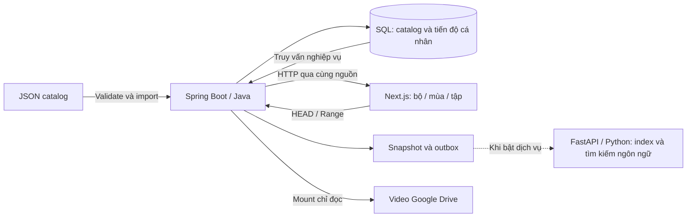

# ANIMATION-PREVIEW-01 — Bản dùng thử hoạt hình có dữ liệu bền vững

Ngày: 27/10/2026. Nhánh `dev`, nền `92316ed`. Cấp bàn giao: **usable_preview**.

Milestone hoàn thiện trải nghiệm hoạt hình và cách vận hành đủ để chạy thử, demo và giải thích luồng dữ liệu. Chưa nghiệm thu triển khai Internet hoặc 20 video đồng thời.

## Phần dùng được

- Trang chủ và tìm kiếm dùng catalog hoạt hình thật: Jadoo, 4 mùa, 99 tập. Chọn mùa, lọc tập trong bộ, trước/sau theo thứ tự số; không tự chuyển qua mùa khác.
- Khách xem video public không cần đăng nhập. Tiến độ khách lưu trên thiết bị; tài khoản lưu trong SQL. Không tự nhập lịch sử khách vào tài khoản.
- Có lựa chọn xem tiếp, kệ “Chuyện còn đang kể”, liên kết đúng tập/asset/mốc file. Lưu có giới hạn nhịp; cập nhật cũ bị từ chối bằng version thay vì ghi đè mốc mới.
- Tự chuyển tập là tùy chọn, mặc định tắt. Có đếm ngược, hủy, và dừng khi trang bị ẩn.
- Một lệnh khởi động nền, mặc định không chạy FastAPI/Qwen. SQL preview có thư mục cố định; import kiểm tra trước khi ghi; backup có hash và restore giữ bản recovery.
- API/video đi qua cùng nguồn `/api` ở Next.js tới Spring Boot loopback. Gateway `/api/chat` giữ riêng. Không cần đưa địa chỉ `localhost:8080` vào trình duyệt người dùng khi cấu hình Tunnel sau này.
- CORS dùng origin cụ thể; quản trị cần quyền; H2 console bị khóa mặc định; giữ frame protection. Đăng nhập có giới hạn 30 lượt/phút/IP, đăng ký 20 lượt/giờ/IP, bộ nhớ theo dõi IP hữu hạn.
- Hộp đăng nhập và chat tải khi cần, giữ dư địa JS; hội thoại trong phiên vẫn còn khi đóng/mở khung chat.

## Luồng dữ liệu để trình bày đồ án



SQL là nguồn chính, không lấy JSON thay database cho mỗi truy vấn. Giữ cấu hình PostgreSQL cùng migration `05_add_watch_progress.sql`; bản thử hiện dùng H2 file riêng. Năm tệp contract catalog không đổi từng byte. Không đổi model hoặc dùng GPU trong milestone này.

## Kiểm chứng

| Kiểm tra | Kết quả |
|---|---|
| Spring Boot, profile test với H2 riêng | 206/206 pass, package thành công |
| Frontend Node 20 và Node 26 | 125/125 mỗi runtime |
| TypeScript | 0 lỗi |
| PowerShell 5.1 | Helper, native exit code 0/7, 13 kiểm tra import/backup/restore pass |
| Trình duyệt và Drive thật | Full HD tập 1/2, pause/resume, ba lần tua gồm gần cuối, reload/xem tiếp, hủy và tự chuyển tập, màn hình 375px pass |
| Tài khoản qua API cùng nguồn | 10 kiểm tra pass; hai cập nhật cạnh tranh trả 200/409; khách và tài khoản khác không đọc lịch sử riêng |
| Restore và restart | Giữ 99 tập, 4 mùa và đúng asset/mốc/version tài khoản; không import lại |
| Database cũ | SHA-256 giữ nguyên; chỉ vận hành database preview riêng |
| Khởi động được ghi nhận | Exit 0, 41,67 giây, bao gồm chuẩn bị artifact |

JS gzip: `/` **132.059 B**, `/search` **128.354 B**, `/movies/[id]` **137.968 B**, `/profile` **137.548 B**; trần **143.360 B**.

Probe tải ngắn trên chính máy Windows, qua Next.js và Spring Boot:

| Kịch bản | Request | Lỗi ngoài dự kiến | p95 |
|---|---:|---:|---:|
| 10 phiên catalog | 120 | 0 | 948,73 ms |
| 20 phiên catalog | 240 | 0 | 1.619,72 ms |
| 5 reader Drive, HEAD + ba Range 2 MiB/reader | 20 | 0 | 5.527,16 ms |

Đây là các lượt đo riêng, ngắn và trên loopback. Chưa đại diện tải liên tục, tốc độ Internet, buffering của 20 browser hoặc 20 video cùng lúc. Giữ giới hạn 5 stream Drive, không tăng queue/worker để vượt kiểm tra.

## Chạy lại

Từ thư mục gốc dự án:

```powershell
powershell.exe -NoProfile -ExecutionPolicy Bypass -File scripts/start_preview_stack.ps1 -Background -MountDrive
# Mở http://127.0.0.1:3000
powershell.exe -NoProfile -File scripts/stop_preview_stack.ps1
```

Chi tiết nhập dữ liệu, sao lưu, khôi phục và chuẩn bị Tunnel: [USABLE_PREVIEW.md](../runbooks/USABLE_PREVIEW.md).

Bằng chứng: [browser trước restart](../reviews/evidence/animation-preview-01/browser-before.json), [browser sau restart](../reviews/evidence/animation-preview-01/browser-after.json), [SQL sau restore](../reviews/evidence/animation-preview-01/restart-data.json), [quyền và cạnh tranh](../reviews/evidence/animation-preview-01/account-security.json), [tải ngắn](../reviews/evidence/animation-preview-01/load-summary.json), [JS budget](../reviews/evidence/animation-preview-01/budget.json).

## Giới hạn còn lại

Qwen đang tắt theo yêu cầu, nên chưa nghiệm thu thêm suy luận hoặc chất lượng tìm kiếm ngôn ngữ trong đợt này. Cloudflare Tunnel do người dùng thiết lập sau. Trước khi chia sẻ Internet, phải đổi secret/tài khoản demo, cấu hình origin HTTPS đúng và kiểm tra lại qua hostname thật. Đây chưa phải cấu hình phát hành công khai.

Sau bàn giao, preview được để chạy ở loopback với Drive chỉ đọc; browser kiểm thử được đóng. Các database, catalog riêng, cache, token và file ngoài phạm vi không nằm trong commit.
