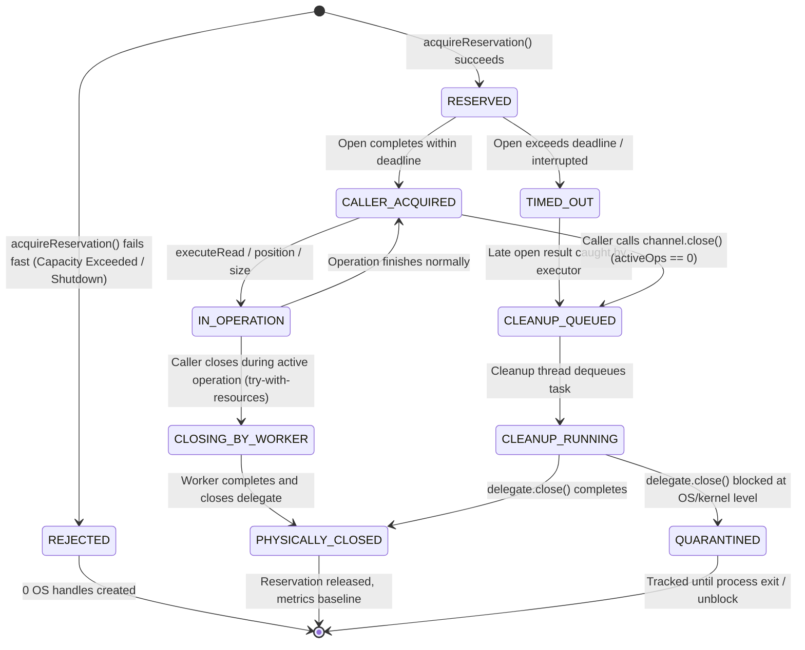

# Google Drive Storage — Cleanup Admission & Lifecycle Contract Specification

**Module:** `backend/springboot/src/main/java/com/dippie/moviercm/service/storage`  
**Components:** `DriveIoExecutor`, `DriveSeekableByteChannel`, `DriveMediaStorageAdapter`  
**Checkpoint:** DRIVE-01-F04  
**Status:** Authoritative Architectural Contract  

---

## 1. Executive Summary & Architectural Motivation

In checkpoint `DRIVE-01-F03`, reviewer reproduction `DRIVE_F03_cleanup_pressure.java` demonstrated an ownership collapse under cleanup saturation:
When fallback cleanup was blocked and 300 channel closures were submitted against a 256-slot cleanup executor equipped with `DiscardOldestPolicy`, 42 close tasks were silently discarded from the queue, leaving 42 physical OS file descriptors permanently leaked. Simultaneously, `actualOutstandingWorkers` reported only main IO worker threads, completely concealing the cleanup queue overflow and pending physical closures.

This specification establishes an **ownership-preserving bounded resource lifecycle** governed by four foundational rules:
1. **Explicit Admission Gate (`acquireReservation()`):** Capacity is reserved *before* physical resources are created; saturation triggers fail-fast rejection, never post-acceptance silent discard.
2. **Four Disjoint Metric Lanes:** Active main IO, physical cleanup workers, queued cleanup obligations, and active resource reservations are tracked independently and accurately.
3. **Shutdown Drain Guarantee:** Queued close obligations are drained and physically completed on shutdown; `shutdownNow()` cannot abandon or leak accepted resources.
4. **Conservation Law:** Total acquired resources strictly equal caller-held + operation-active + cleanup-queued/running + physically closed resources at all times.

---

## 2. Resource Lifecycle State Machine

Each resource (e.g., `FileChannel`, `SeekableByteChannel`, `InputStream`) transitions through a finite set of mutually exclusive states. At any point in time, exactly one entity possesses legal ownership and responsibility for closing the underlying physical handle.



### State Definitions:
- **RESERVED:** An admission permit has been granted by `DriveIoExecutor`. Zero OS handles exist yet. Capacity is reserved in advance for eventual cleanup.
- **CALLER_ACQUIRED:** The channel or stream has been successfully opened and handed to the caller (`DriveSeekableByteChannel` wrapper). The caller owns the responsibility to either use the channel or call `close()`.
- **IN_OPERATION:** An IO task (`read`, `position`, `size`) is actively running on a background worker thread (`activeWorkerOperations > 0`). The operation owns execution.
- **TIMED_OUT:** The caller's finite wait deadline expired while opening the file. The caller receives `MediaUnavailableException` and exits. The late-arriving native handle belongs to the executor's late-disposal path.
- **CLOSING_BY_WORKER:** The caller invoked `close()` while an operation was still active in the background. The caller returns immediately; ownership transfers to the active worker thread, which will execute `delegate.close()` in its `finally` block upon completion.
- **CLEANUP_QUEUED:** The caller invoked `close()` when no operations were active (`activeWorkerOperations == 0`). The resource is enqueued in the executor's cleanup queue. Ownership belongs to the cleanup queue.
- **CLEANUP_RUNNING:** A cleanup worker thread has picked up the close task and is executing `delegate.close()`. Ownership belongs to the physical cleanup worker.
- **PHYSICALLY_CLOSED:** The native file descriptor or stream has been closed (`delegate.close()` executed). The reservation permit is released. The resource is destroyed.
- **QUARANTINED:** A native system call inside `delegate.close()` is permanently blocked in the OS kernel (WinFsp CGO dispatch). The resource remains accounted for in reserved capacity to prevent unbounded system degradation.

---

## 3. Explicit Admission Gate (`acquireReservation()`)

### 3.1 Admission Contract
Before allocating any native channel or initiating an asynchronous file open, the caller or storage adapter must invoke:
```java
DriveReservation reservation = driveIoExecutor.acquireReservation();
```
If admission cannot be granted, `acquireReservation()` throws `MediaUnavailableException` immediately. No IO is scheduled, and no OS file handle is allocated.

### 3.2 Capacity Ceiling
The total number of concurrent active reservations is bounded by:
$$\text{MaxReservations} = \text{MaxMainWorkers} + \text{MaxCleanupQueueCapacity}$$
Where:
- $\text{MaxMainWorkers}$ is the maximum number of concurrent active IO threads (default: 10).
- $\text{MaxCleanupQueueCapacity}$ is the maximum bounded capacity of the cleanup queue (e.g., 256).

### 3.3 Fail-Fast Rejection Policy
When $\text{activeReservations} \ge \text{MaxReservations}$ or when the executor `isShutdown()`:
1. Admission is rejected immediately without blocking the caller.
2. The Circuit Breaker failure counter is updated if appropriate.
3. Zero threads, zero memory buffers, and zero OS file descriptors are leaked.
4. Callers receive an actionable `MediaUnavailableException("Dịch vụ lưu trữ Google Drive đã đạt giới hạn dung lượng xử lý")`.

---

## 4. Four Disjoint Metric Lanes

To eliminate metric ambiguity and prevent conflation of main worker threads with total system occupancy, `DriveIoExecutor` publishes four distinct metric getters:

| Metric Lane | Getter Method | Description | Accounting Invariant |
| :--- | :--- | :--- | :--- |
| **Lane 1: Active Main IO Workers** | `getActiveMainWorkers()` / `getActualOutstandingWorkers()` | Number of background worker threads currently executing `read()`, `position()`, or `size()`. | $0 \le \text{Lane 1} \le \text{maxWorkers}$ |
| **Lane 2: Active Physical Cleanup Workers** | `getActiveCleanupWorkers()` | Number of dedicated cleanup worker threads currently executing native `delegate.close()`. | $0 \le \text{Lane 2} \le \text{cleanupMaxThreads}$ |
| **Lane 3: Queued Close Obligations** | `getQueuedCleanupObligations()` | Number of accepted resource closure tasks residing in the cleanup queue awaiting thread assignment. | $0 \le \text{Lane 3} \le \text{cleanupQueueCapacity}$ |
| **Lane 4: Active Resource Reservations** | `getActiveReservations()` | Total count of accepted resources that have not yet physically completed closure (Caller-held + In-Operation + Queued + Running Close). | $0 \le \text{Lane 4} \le \text{MaxReservations}$ |

### Strict Metric Rules:
- Lane 1 (`actualOutstandingWorkers`) measures **only** active main IO threads. It is never used as a proxy for "all resources are released".
- Lane 4 (`activeReservations`) measures the **true system burden**. It increments upon `acquireReservation()` and decrements strictly **after** `delegate.close()` returns (or is quarantined).
- All lanes must read `0` when the system is idle and all opened resources have completed closure.

---

## 5. Non-Discarding Cleanup Queue & Ownership Retention

### 5.1 Elimination of `DiscardOldestPolicy`
`ThreadPoolExecutor.DiscardOldestPolicy` is strictly forbidden in `DriveIoExecutor`. Dropping a task from a cleanup queue is equivalent to silently leaking an OS file descriptor.

### 5.2 Guaranteed Enqueue / Retention
Because admission is gated by $\text{MaxReservations} \le \text{MaxMainWorkers} + \text{MaxCleanupQueueCapacity}$, the cleanup queue has sufficient pre-allocated capacity for every admitted resource. Under no circumstances may an admitted resource be dropped on the floor.
If an unexpected edge case causes queue rejection:
- The resource is transferred to an internal bounded retained-overflow ledger or immediate daemon drain.
- The resource's delegate is closed before its reservation is cleared.
- Under no circumstance is `delegateClosed` set to `true` while the physical delegate remains open without an owner.

---

## 6. Shutdown & Drain Semantics

### 6.1 Graceful `shutdown()`
When `driveIoExecutor.shutdown()` is called:
1. Admission is closed: subsequent calls to `acquireReservation()` fail fast with `MediaUnavailableException`.
2. Active main worker tasks are allowed to complete within their remaining finite deadlines.
3. The cleanup executor stops accepting new tasks and **drains all existing queued close obligations to completion**.
4. The method waits for up to a finite drain deadline (e.g., 5 seconds) for all accepted resources to physically close.

### 6.2 Abrupt `shutdownNow()`
When `driveIoExecutor.shutdownNow()` is called:
1. All running worker threads are interrupted (`Thread.interrupt()`).
2. All tasks remaining in the cleanup queue are extracted via `cleanupExecutor.shutdownNow()`.
3. **Task Drain Guarantee:** Every runnable extracted from `shutdownNow()` that encapsulates an unclosed `AutoCloseable` is immediately invoked or closed directly by the draining thread.
4. No task returned by `shutdownNow()` may be dropped or garbage collected while its underlying file handle remains open.

---

## 7. Mathematical Conservation Law

At any time $t \ge 0$, for any set of resources $R$ admitted through the executor:

$$\boxed{N_{\text{acquired}}(t) = N_{\text{caller}}(t) + N_{\text{operation}}(t) + N_{\text{cleanup-queued}}(t) + N_{\text{cleanup-running}}(t) + N_{\text{physically-closed}}(t)}$$

### Conservation Properties:
1. **Disjoint Sets:** A resource belongs to exactly one term on the right-hand side of the equation.
2. **Exactly-Once Closure:** Every admitted resource that enters the cleanup pipeline transitions to $N_{\text{physically-closed}}$ exactly once:
   $$\forall r \in R, \quad \text{CloseCount}(r) \equiv 1$$
3. **Zero Phantom Releases:** A permit in `activeReservations` is never decremented until `delegate.close()` has finished execution or the resource has been formally logged into the quarantine pool.
4. **Baseline Recovery:** Following the completion of all callers and the release of any test synchronizers (latches):
   $$N_{\text{caller}} = 0, \quad N_{\text{operation}} = 0, \quad N_{\text{cleanup-queued}} = 0, \quad N_{\text{cleanup-running}} = 0$$
   $$\implies N_{\text{acquired}} = N_{\text{physically-closed}}$$
   All 4 metric lanes return identically to `0`.

---

## 8. WinFsp Kernel Cancellation Boundaries & Quarantining

### 8.1 Physical Constraint of Windows NT Mini-Filters
As established in `GOOGLE_DRIVE_WINDOWS_RUNBOOK.md` §5.5, the Windows NT kernel and WinFsp mini-filter driver do not support safe asynchronous preemption (hard cancel) of in-flight file system operations (`ReadFile`, `CloseHandle`, `SetFilePointerEx`).
- An interrupted Java thread (`Thread.interrupt()`) sets a flag in the JVM; it cannot abort a thread blocked inside a native CGO dispatch loop without corrupting kernel data structures or triggering driver deadlock.

### 8.2 Architectural Handling in F04
1. **Caller Isolation:** When an operation or close blocks indefinitely in native code, the caller thread is never blocked. The caller receives a timeout exception and is released.
2. **Quota Retention:** The stalled thread retains its physical worker / cleanup slot.
3. **Quarantine Limit:** If native close fails to complete within a quarantine threshold (e.g., 30 seconds), the slot is accounted for under `quarantinedWorkers`.
4. **Circuit Breaker Trip:** Persistent kernel stalls exhaust capacity, tripping the `DriveCircuitBreaker` and failing subsequent requests fast to protect the server heap and OS stability. Healthy local disk providers (`LocalMediaStorageAdapter`) remain fully isolated and unaffected.
