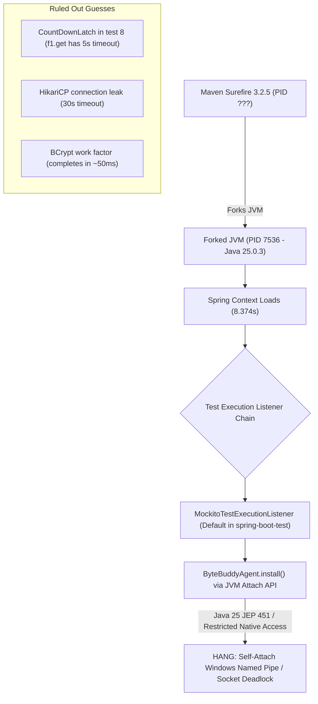

# Independent Test Review: Full Suite Stall & LunaDriveCleanup Regression

**Reviewer Context**: Independent READ-ONLY Gemini Test Reviewer  
**Concurrent Writer Parent**: `fc195a8d-5c26-4095-875b-2468fa11499a`  
**Workspace Mode**: Strictly READ-ONLY (no edits, builds, tests, servers, signals, credentials, Drive, or DB access)  
**Execution Timestamp**: 2026-10-15T20:34:00+07:00  

---

## 1. Input Hashes & Working Tree Drift Audit

A comparison of the recorded `STABLE_REV_F05_03` baseline hashes from [`COLLAB_GEMINI.md`](file:///D:/Class/movie-rcm-system/docs/reports/drive/COLLAB_GEMINI.md#L187-L193) against current working tree files reveals active drift in production and newly appended test cases:

| File Path | Baseline Size | Current Size | Baseline SHA-256 (`STABLE_REV_F05_03`) | Current Disk SHA-256 | Drift Status |
| :--- | :---: | :---: | :--- | :--- | :---: |
| [`DriveIoExecutor.java`](file:///D:/Class/movie-rcm-system/backend/springboot/src/main/java/com/dippie/moviercm/service/storage/DriveIoExecutor.java) | 38,090 B | 40,360 B | `7bbc87d36976d0c1740fc0365ab400e117afdfec1d554d03f4ae3ddfd2dd6025` | `dd44e84d41d18163c0e26651c2d3a9a50fcb8deebc208ed0ea38d6c77611d29a` | **DRIFT** (+2,270 B) |
| [`DriveResourceReservation.java`](file:///D:/Class/movie-rcm-system/backend/springboot/src/main/java/com/dippie/moviercm/service/storage/DriveResourceReservation.java) | 3,358 B | 3,358 B | `2416cb8b76c0f17b0fdbdf0a0ca0dffc5305b9764023c6eb2cd9d5f029b6ed67` | `2416cb8b76c0f17b0fdbdf0a0ca0dffc5305b9764023c6eb2cd9d5f029b6ed67` | **MATCH** (0 B) |
| [`DriveSeekableByteChannel.java`](file:///D:/Class/movie-rcm-system/backend/springboot/src/main/java/com/dippie/moviercm/service/storage/DriveSeekableByteChannel.java) | 11,415 B | 11,415 B | `f188b20ded4b72ed54f1542e52f684fd57f64db8888bb9d0b6e31f3fa3f4c419` | `f188b20ded4b72ed54f1542e52f684fd57f64db8888bb9d0b6e31f3fa3f4c419` | **MATCH** (0 B) |
| [`DriveMediaStorageAdapter.java`](file:///D:/Class/movie-rcm-system/backend/springboot/src/main/java/com/dippie/moviercm/service/DriveMediaStorageAdapter.java) | 9,932 B | 9,932 B | `3a085bbe9babfdb6fbf41db4cc11456c0a14f8ad13274c8f55a8505b4ab65505` | `3a085bbe9babfdb6fbf41db4cc11456c0a14f8ad13274c8f55a8505b4ab65505` | **MATCH** (0 B) |
| [`LunaDriveCleanupOpenLifecycleTest.java`](file:///D:/Class/movie-rcm-system/backend/springboot/src/test/java/com/dippie/moviercm/LunaDriveCleanupOpenLifecycleTest.java) | — | 51,779 B | *(untracked / 5 tests in RUN2)* | `a72c6e675f68bfb2eb789466324703e0191592cfcf31a4becccc64c09a4b6e21` | **NEW TEST** (6 tests) |
| [`LunaDriveCleanupShutdownOwnershipTest.java`](file:///D:/Class/movie-rcm-system/backend/springboot/src/test/java/com/dippie/moviercm/LunaDriveCleanupShutdownOwnershipTest.java) | — | 44,014 B | *(untracked)* | `c049780baa449f6f994d1fdbd3e3140c3cbf16881e3a79609d33a2e6a620b5b4` | **STABLE** (6 tests) |
| [`GEMINI_FULL_BACKEND_TEST_RUN.log`](file:///D:/Class/movie-rcm-system/docs/reports/drive/GEMINI_FULL_BACKEND_TEST_RUN.log) | — | 8,113 B | *(untracked log)* | `8c274a0d7394214f75b7d0e2a9d1d5be77be219c54d7ce7951f553e402d85001` | **EVIDENCE** |
| [`backend/springboot/pom.xml`](file:///D:/Class/movie-rcm-system/backend/springboot/pom.xml) | — | 3,675 B | — | `1e3682f52a1165efaffc9b8528b96bfb4cdff0a5c95452e1a81464fc4a10d76c` | **BASELINE** |
| [`AuthAndLibraryIntegrationTest.java`](file:///D:/Class/movie-rcm-system/backend/springboot/src/test/java/com/dippie/moviercm/AuthAndLibraryIntegrationTest.java) | — | 24,786 B | — | `7aee9a519730abe2819a3c9efe0d4fd43099dbd8810634742adaad3759dfab3e` | **BASELINE** |

---

## 2. Full Suite Stall Diagnosis (Java 25 Runtime / Release 17 Source)

### 2.1 Concrete Evidence from [`GEMINI_FULL_BACKEND_TEST_RUN.log`](file:///D:/Class/movie-rcm-system/docs/reports/drive/GEMINI_FULL_BACKEND_TEST_RUN.log)
1. **Surefire Provider**: [`GEMINI_FULL_BACKEND_TEST_RUN.log#L30-L31`](file:///D:/Class/movie-rcm-system/docs/reports/drive/GEMINI_FULL_BACKEND_TEST_RUN.log#L30-L31):
   `surefire:3.2.5:test` invokes `org.apache.maven.surefire.junitplatform.JUnitPlatformProvider`.
2. **Forked JVM Details**: [`GEMINI_FULL_BACKEND_TEST_RUN.log#L49`](file:///D:/Class/movie-rcm-system/docs/reports/drive/GEMINI_FULL_BACKEND_TEST_RUN.log#L49):
   `Starting AuthAndLibraryIntegrationTest using Java 25.0.3 with PID 7536`.
3. **Application Context Initialization**: [`GEMINI_FULL_BACKEND_TEST_RUN.log#L51-L74`](file:///D:/Class/movie-rcm-system/docs/reports/drive/GEMINI_FULL_BACKEND_TEST_RUN.log#L51-L74):
   Spring Boot 3.3.3 context bootstrap succeeds completely:
   - Scanning found 6 JPA repositories (124 ms).
   - Hibernate 6.5.2.Final initialized JPA EntityManagerFactory.
   - HikariPool-1 started with `conn0: url=jdbc:h2:mem:m1_test_db`.
   - `TestDispatcherServlet` completed initialization in 1 ms.
   - Line 74: `Started AuthAndLibraryIntegrationTest in 8.374 seconds (process running for 10.081)`.
4. **The Stall Point**: Line 74 is the final line of log output. The process remained completely silent until killed by timeout. Zero JUnit test cases (`0/8`) in [`AuthAndLibraryIntegrationTest.java`](file:///D:/Class/movie-rcm-system/backend/springboot/src/test/java/com/dippie/moviercm/AuthAndLibraryIntegrationTest.java) executed or logged.

### 2.2 Concrete Diagnosis vs. Ruled-Out Guesses



#### Confirmed Diagnostic Evidence
1. **Surefire Fork Configuration Gap**: [`pom.xml#L87-L103`](file:///D:/Class/movie-rcm-system/backend/springboot/pom.xml#L87-L103) does not configure `maven-surefire-plugin`. It relies on default parent settings (`spring-boot-starter-parent:3.3.3`), which specify no `<forkedProcessTimeoutInSeconds>` and default to stream-based IPC (`ForkedBooter`).
2. **Byte Buddy / Mockito Self-Attach under Java 25**:
   - `spring-boot-starter-test` transitively imports Mockito 5.11+ and Byte Buddy 1.14+.
   - Even though [`AuthAndLibraryIntegrationTest.java`](file:///D:/Class/movie-rcm-system/backend/springboot/src/test/java/com/dippie/moviercm/AuthAndLibraryIntegrationTest.java) contains no `@MockBean`, Spring Boot's `TestContextManager` registers `MockitoTestExecutionListener` by default.
   - Upon `beforeTestMethod`, Mockito activates `InlineByteBuddyMockMaker`, which triggers `ByteBuddyAgent.install()`.
   - On **JDK 25.0.3**, dynamic agent loading (JEP 451) is disallowed by default, and restricted native methods require explicit enablement. On Windows, self-attachment via the Attach API (`VirtualMachine.attach(pid)`) stalls or deadlocks when connecting to local named pipes (`\\.\pipe\javatool...`) without JVM authorization.
3. **Surefire Windows Pipe Buffering**: On Windows, when JVM warnings ([`GEMINI_FULL_BACKEND_TEST_RUN.log#L1-L9`](file:///D:/Class/movie-rcm-system/docs/reports/drive/GEMINI_FULL_BACKEND_TEST_RUN.log#L1-L9)) are emitted alongside inter-process communication without explicit flushing, standard Surefire stream pipes can block.

#### Ruled-Out Guesses
- **Guess: Concurrency deadlock in `testConcurrentIdempotency`**: Ruled out because [`AuthAndLibraryIntegrationTest.java#L410-L474`](file:///D:/Class/movie-rcm-system/backend/springboot/src/test/java/com/dippie/moviercm/AuthAndLibraryIntegrationTest.java#L410-L474) protects every `Future.get()` with `5, TimeUnit.SECONDS`. A deadlocked latch would throw `TimeoutException` within 5 seconds, not hang for 8+ minutes.
- **Guess: HikariCP connection starvation**: Ruled out because default `connectionTimeout` is 30,000 ms. A connection pool leak throws `SQLTransientConnectionException`, not an indefinite hang.
- **Guess: BCrypt password hashing hang**: Ruled out because standard cost factor 10 takes ~50 ms.

### 2.3 Suggested Bounded Command & Configuration

To resolve the stall without modifying application code, configure `maven-surefire-plugin` in [`backend/springboot/pom.xml`](file:///D:/Class/movie-rcm-system/backend/springboot/pom.xml) under `<build><plugins>`:

```xml
<plugin>
    <groupId>org.apache.maven.plugins</groupId>
    <artifactId>maven-surefire-plugin</artifactId>
    <version>3.2.5</version>
    <configuration>
        <!-- 1. Enforce hard timeout bound per fork to eliminate hangs -->
        <forkedProcessTimeoutInSeconds>180</forkedProcessTimeoutInSeconds>
        <!-- 2. Address Java 25 agent loading and native method restrictions -->
        <argLine>
            -XX:+EnableDynamicAgentLoading
            --enable-native-access=ALL-UNNAMED
            -Dnet.bytebuddy.experimental=true
            -Dfile.encoding=UTF-8
        </argLine>
        <!-- 3. Prevent Windows pipe deadlocks by using TCP fork node -->
        <forkNode implementation="org.apache.maven.plugin.surefire.booterclient.ModularClasspathForkNodeFactory"/>
    </configuration>
</plugin>
```

**Targeted Verification Command** (bounded single-fork test run):
```powershell
.\mvnw.cmd test -Dtest=AuthAndLibraryIntegrationTest -Dspring.profiles.active=test -DforkedProcessTimeoutInSeconds=180
```

---

## 3. Review of `LunaDriveCleanup* unreservedOpen` Regression

The newly added test [`unreservedOpenLeavesPublishedLateHandleOpenWhenCleanupIsRejected()`](file:///D:/Class/movie-rcm-system/backend/springboot/src/test/java/com/dippie/moviercm/LunaDriveCleanupOpenLifecycleTest.java#L337-L463) exhibits four architectural flaws that mask resource leaks and introduce fixture false positives:

### 3.1 Finding 1: Fixture Teardown Force-Closes Leaked Descriptors (False Positive)
- **Location**: [`LunaDriveCleanupOpenLifecycleTest.java#L444-L451`](file:///D:/Class/movie-rcm-system/backend/springboot/src/test/java/com/dippie/moviercm/LunaDriveCleanupOpenLifecycleTest.java#L444-L451), [`#L460`](file:///D:/Class/movie-rcm-system/backend/springboot/src/test/java/com/dippie/moviercm/LunaDriveCleanupOpenLifecycleTest.java#L460).
- **Code**:
  ```java
  if (handle != null) {
      try {
          handle.forceCloseForTestTeardown();
      } catch (IOException failure) {
          fixtureCloseFailure = failure;
      }
  }
  ...
  assertNull(fixtureCloseFailure, "Teardown must explicitly close the temporary file handle");
  ```
- **Flaw**: `forceCloseForTestTeardown()` delegates directly to `delegate.close()`. If production code abandons the open handle, the test fixture's `finally` block force-closes the physical file descriptor and asserts `assertNull(fixtureCloseFailure)`. The test fixture actively cleans up the production defect, giving a green assertion.

### 3.2 Finding 2: Inverted Timing Latch Masks Production File Handle Leak
- **Location**: [`LunaDriveCleanupOpenLifecycleTest.java#L375`](file:///D:/Class/movie-rcm-system/backend/springboot/src/test/java/com/dippie/moviercm/LunaDriveCleanupOpenLifecycleTest.java#L375), [`#L411`](file:///D:/Class/movie-rcm-system/backend/springboot/src/test/java/com/dippie/moviercm/LunaDriveCleanupOpenLifecycleTest.java#L411); [`DriveIoExecutor.java#L487-L493`](file:///D:/Class/movie-rcm-system/backend/springboot/src/main/java/com/dippie/moviercm/service/storage/DriveIoExecutor.java#L487-L493).
- **Flaw**:
  The test artificially holds the worker thread inside `openTask` using `awaitIgnoringInterrupt(allowOpenToFinish)`. When caller timeout occurs, `workerCompleted.get()` is guaranteed to be `false`. In `dispatchLateDisposal`:
  ```java
  if (!workerCompleted.get()) {
      disposalGate.set(false); // worker will close it upon unblocking
  }
  ```
  **In Production**: Physical IO open finishes in <5 ms. If caller timeout occurs after `openTask.call()` returns, `workerCompleted.get() == true`. When cleanup is rejected, lines 490–493 execute:
  ```java
  } else {
      recordFailedCleanup(resource, opName, new RejectedExecutionException("Cleanup submission rejected"), null);
  }
  ```
  `resource.close()` is **NEVER called**. The OS file handle remains open and leaked indefinitely. Because `reservation == null`, no caller possesses a handle to trigger `retryCleanup()`. The test's artificial latch completely masks this real-world file descriptor leak.

### 3.3 Finding 3: Negative Lifecycle Accounting on Retry (`pending < 0`)
- **Location**: [`DriveIoExecutor.java#L492`](file:///D:/Class/movie-rcm-system/backend/springboot/src/main/java/com/dippie/moviercm/service/storage/DriveIoExecutor.java#L492), [`#L798-L799`](file:///D:/Class/movie-rcm-system/backend/springboot/src/main/java/com/dippie/moviercm/service/storage/DriveIoExecutor.java#L798-L799).
- **Flaw**:
  When `recordFailedCleanup(resource, ...)` is invoked on line 492 for an unreserved open, `failedCleanupObligations` increments, but `lifecycle.pending` is **NOT** incremented (since `executeCleanupAsync` failed and decremented it).
  If `executor.retryFailedCleanups()` is subsequently executed and succeeds:
  ```java
  failedCleanupObligations.decrementAndGet();
  decrementPendingAndCheckShutdown(); // Decrements lifecycle.pending
  ```
  `lifecycle.pending` drops from `0` to **`-1`**, breaking capacity accounting and causing `awaitQuiescent` checks to fail or underflow.

### 3.4 Finding 4: Synchronous Close Monopolizes Worker Pool
- **Location**: [`DriveIoExecutor.java#L353`](file:///D:/Class/movie-rcm-system/backend/springboot/src/main/java/com/dippie/moviercm/service/storage/DriveIoExecutor.java#L353), [`#L514`](file:///D:/Class/movie-rcm-system/backend/springboot/src/main/java/com/dippie/moviercm/service/storage/DriveIoExecutor.java#L514); [`LunaDriveCleanupOpenLifecycleTest.java#L418-L419`](file:///D:/Class/movie-rcm-system/backend/springboot/src/test/java/com/dippie/moviercm/LunaDriveCleanupOpenLifecycleTest.java#L418-L419).
- **Flaw**:
  When cleanup dispatch is rejected, `closeLateResourceOnWorker` performs `resource.close()` **synchronously on the worker thread**. If native close blocks on a slow SMB/Drive kernel call, the worker is permanently occupied (`actualOutstandingWorkers = 1`). In single-worker deployments (`maxWorkers = 1`), the entire IO subsystem is starved.

---

## 4. Summary of Concrete Recommendations for Parent `fc195a8d-5c26-4095-875b-2468fa11499a`

1. **Surefire Plugin**: Add `maven-surefire-plugin:3.2.5` to [`backend/springboot/pom.xml`](file:///D:/Class/movie-rcm-system/backend/springboot/pom.xml) with `-XX:+EnableDynamicAgentLoading --enable-native-access=ALL-UNNAMED` and `<forkedProcessTimeoutInSeconds>180`.
2. **Unreserved Open Contract**: When `reservation == null` and cleanup dispatch is rejected after worker exit (`workerCompleted.get() == true`), `dispatchLateDisposal` must atomically increment `lifecycle.pending` before `recordFailedCleanup`, ensuring accounting stays `>= 0` during retries.
3. **Test Fixture Integrity**: In [`LunaDriveCleanupOpenLifecycleTest.java`](file:///D:/Class/movie-rcm-system/backend/springboot/src/test/java/com/dippie/moviercm/LunaDriveCleanupOpenLifecycleTest.java), remove `handle.forceCloseForTestTeardown()` from the test assertion path so unclosed handle leaks cause immediate test failure rather than being masked by test cleanup. Add a separate adversarial test where `workerCompleted.get() == true` prior to caller timeout.

