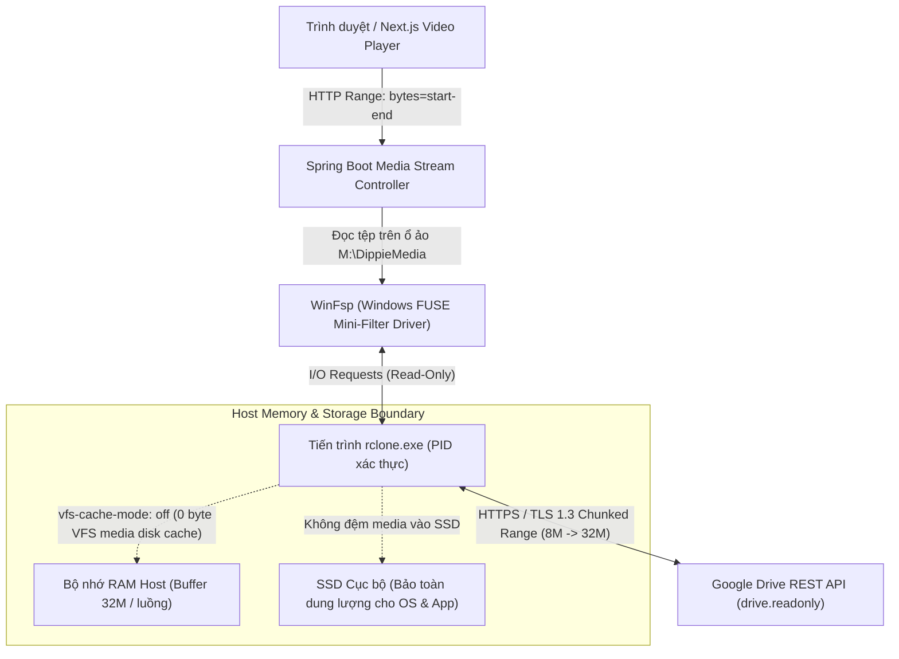
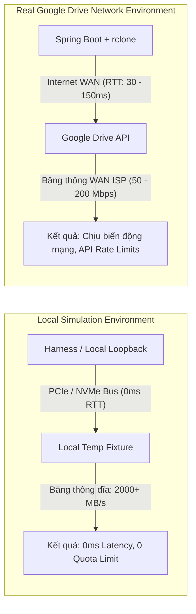

# KẾ HOẠCH ĐO LƯỜNG HIỆU NĂNG VÀ BÀN GIAO VẬN HÀNH GOOGLE DRIVE STREAMING (DRIVE PERFORMANCE & HANDOFF PLAN)

**Nhiệm vụ:** DRIVE-01 — Google Drive Windows Integration, Tooling & Performance Plan  
**Phiên bản:** 1.2.0 (Ngày cập nhật: 15/10/2026 — Kiểm định DRIVE-01-F03)  
**Tác giả:** Agent F — Integration Evidence & Documentation Engineer  
**Đối tượng áp dụng:** Kỹ sư Vận hành, Quản trị viên Hệ thống, Đội ngũ Phát triển Dippie Cinema  
**Môi trường mục tiêu:** Windows 10 / Windows 11 x64, Spring Boot 3.4.x, Next.js 15 Standalone, Rclone + WinFsp  
**Môi trường thực thi kịch bản:** Windows PowerShell 5.1 (`powershell.exe`) & PowerShell 7+ (`pwsh.exe`)  

---

## 1. Tổng quan & Bối cảnh Kỹ thuật

Hệ thống phát trực tuyến Dippie Cinema mở rộng năng lực lưu trữ và phân phối phim hoạt hình thông qua tầng lưu trữ đám mây Google Drive. Để đảm bảo ứng dụng backend Spring Boot và trình phát Next.js Video Player hoạt động mượt mà, rclone được sử dụng kết hợp với WinFsp (Windows File System Proxy) để ánh xạ thư mục Google Drive thành một ổ đĩa logic chỉ đọc trên Windows (ví dụ: `M:\DippieMedia`).



Tài liệu này thiết lập cơ sở lý thuyết, ma trận phân tích kiến trúc đệm, phương pháp luận đo lường định lượng và danh mục nghiệm thu (acceptance checklist) khi hệ thống kết nối với Google Drive thực tế trên môi trường mạng WAN.

---

## 2. Phân tích Kỹ thuật Đối đầu: `vfs-cache-mode off` vs `vfs-cache-mode full`

Khi mount lưu trữ đám mây qua rclone VFS (Virtual File System), quyết định lựa chọn cơ chế cache ảnh hưởng trực tiếp đến độ bền phần cứng, độ an toàn dung lượng và trải nghiệm phát video.

### 2.1. Phương án A: Baseline Streaming — `vfs-cache-mode off`

#### Nguyên lý vận hành:
- **Cơ chế đọc:** Khi Spring Boot gửi yêu cầu đọc một dải byte (ví dụ: `bytes=0-1048575`), WinFsp chuyển tiếp lệnh đọc tới rclone. Rclone mở một kết nối HTTPS tới Google Drive API, tải chính xác các khối dữ liệu cần thiết theo cấu hình `--vfs-read-chunk-size` vào bộ đệm RAM nội bộ (`--buffer-size 32M`) và truyền trực tiếp về kernel WinFsp mà **hoàn toàn không ghi bất kỳ byte nào xuống đĩa cứng**.
- **Lượng ghi đệm media VFS (Disk Write Amplification):** **Chính xác 0 byte từ rclone cache**. Rclone hoàn toàn không tạo tệp cache media trên đĩa cứng; tuy nhiên các hoạt động ghi chép thông thường của hệ điều hành, trình duyệt và application log vẫn diễn ra độc lập.
- **Tác động SSD & An toàn dung lượng:** 
  - Không tiêu tốn dung lượng đĩa khả dụng của hệ thống máy chủ host cho việc đệm video.
  - Không gây hao mòn tế bào nhớ flash cho các tệp video đã xem.
  - Triệt tiêu nguy cơ tràn ổ đĩa do cache media (Disk Full Outage từ video tích tụ) khi người dùng xem phim dung lượng lớn hoặc xem liên tục nhiều phim.
- **Hạn chế:** Mỗi khi người dùng thực hiện thao tác tua (seek) ra khỏi phạm vi cửa sổ bộ đệm RAM hiện hành, rclone phải mở một HTTP Range Request mới tới Google Drive qua mạng WAN, dẫn đến độ trễ phụ thuộc vào thời gian phản hồi mạng (RTT).

### 2.2. Phương án B: Đệm Đĩa Toàn phần — `vfs-cache-mode full`

#### Nguyên lý vận hành:
- **Cơ chế đọc & ghi:** Khi có lệnh đọc, rclone tải các phần tệp hoặc toàn bộ tệp từ Google Drive và ghi vào thư mục đệm cục bộ trên ổ đĩa vật lý (`%LOCALAPPDATA%\rclone\vfs\cinema-gdrive\...`). Các lần đọc tiếp theo hoặc các thao tác tua ngược (rewind) trong các đoạn đã tải sẽ được đọc trực tiếp từ tệp đệm trên đĩa SSD.
- **Tác động SSD & Rủi ro cạn kiệt dung lượng:**
  - Nếu người dùng xem một bộ phim Full HD dung lượng 4 GB, rclone sẽ ghi trọn vẹn 4 GB xuống ổ đĩa cục bộ.
  - Khảo sát thực tế máy chủ host ghi nhận: Ổ `C:\` khả dụng ~28.3 GB, Ổ `D:\` khả dụng ~22.7 GB. Chỉ cần người dùng phát thử 5–6 bộ phim hoạt hình chất lượng cao, toàn bộ không gian đĩa trống sẽ bị xóa sổ hoàn toàn.
  - Hiện tượng cạn kiệt đĩa đột ngột (Disk Full) sẽ gây tê liệt hệ điều hành Windows, crash cơ sở dữ liệu PostgreSQL/H2, làm hỏng các tiến trình build và ngưng trệ dịch vụ backend.
  - Gây hao mòn nhanh chóng tuổi thọ ghi/xóa của ổ SSD máy chủ.
  - Phải duy trì tiến trình chạy ngầm quét dọn rác (cache eviction loop) gây tiêu tốn CPU và tranh chấp I/O đĩa.

### 2.3. Bảng Ma trận So sánh Kỹ thuật Toàn diện

| Tiêu chí So sánh | `vfs-cache-mode off` (Baseline Chọn) | `vfs-cache-mode full` (Đệm Đĩa Cục bộ) | Đánh giá Kỹ thuật |
| :--- | :--- | :--- | :--- |
| **Ghi bộ đệm media vào SSD** | **0 Byte ghi cache media vào SSD** (Rclone không tạo tệp cache media trên đĩa) | Hàng GB đến hàng chục GB trên mỗi phim | `cache-off` không gây hao mòn SSD do video cache |
| **Ghi chép khác của Host** | Các ghi chép bình thường của HĐH, trình duyệt, app log vẫn diễn ra độc lập | Tương tự, cộng thêm hàng chục GB ghi đệm media | `cache-off` tách biệt hoàn toàn rclone khỏi đĩa |
| **Nguy cơ cạn kiệt đĩa do video** | **Triệt tiêu nguy cơ cạn đĩa từ cache media** (Bảo toàn đĩa host) | **Cực kỳ nguy hiểm** (Đĩa còn ~22-28 GB sẽ cạn sau vài phim) | `cache-off` ngăn chặn rủi ro tràn đĩa do video |
| **Độ trễ khởi phát (Cold Start)** | RTT mạng tới Google API (~800 – 1500 ms) | RTT mạng tới Google API (~800 – 1500 ms) | Hai phương án tương đương ở lần đầu |
| **Độ trễ tua trong phạm vi RAM** | **Tức thì (< 5 ms)** từ RAM buffer 32M | **Tức thì (< 5 ms)** từ đĩa SSD | Hai phương án tương đương |
| **Độ trễ tua xa (Random Seek)** | Phát sinh HTTP Range Request mới | Tải chunk mới xuống SSD rồi đọc lên | `cache-off` không chịu độ trễ ghi đĩa |
| **Độ trễ tua ngược đoạn đã xem** | Tải lại dải byte từ Google Drive | Đọc trực tiếp từ file cache trên SSD | `cache-full` nhanh hơn khi tua ngược |
| **Tiêu thụ bộ nhớ RAM** | Kiểm soát chặt chẽ: tối đa 32 MB / tệp | Ít hơn ở RAM, nhưng chuyển gánh nặng sang SSD | `cache-off` tiêu tốn RAM rất thấp |
| **Tranh chấp I/O File Lock** | Không có tranh chấp file lock | Rủi ro xung đột lock giữa rclone và WinFsp | `cache-off` đơn giản và ổn định hơn |
| **Chi phí quản lý dọn dẹp** | Không cần eviction loop | Phải cấu hình max-size, max-age, dọn rác | `cache-off` loại bỏ độ phức tạp vận hành |
| **Khả năng mở rộng đồng thời** | Cao, độc lập giữa các stream | Bị thắt nút cổ chai tại băng thông ghi SSD | `cache-off` tối ưu cho máy chủ tải cao |

> [!NOTE]
> **Làm rõ về cơ chế định vị ngẫu nhiên, độ trễ đám mây & Hợp đồng Tiếp nhận Dọn dẹp (Cleanup Admission Contract — F04 / R1):**
> 1. **Định vị & Độ trễ WAN:** Việc ứng dụng Spring Boot sử dụng `FileChannel.position(start)` loại bỏ hoàn toàn việc đọc bỏ byte tuần tự của tầng ứng dụng (application byte-discard), giúp gửi yêu cầu đọc chính xác dải byte cần thiết. Tuy nhiên, trên môi trường Google Drive thực tế, độ trễ truy xuất dải byte từ xa vẫn phụ thuộc vào Round-Trip Time (RTT) mạng và chu kỳ phản hồi của Google Drive API chứ không phải độ trễ $O(1)$ cố định tức thời.
> 2. **Cổng tiếp nhận tường minh & Ngân sách kết hợp (`acquireReservation()`):** Cấp phát tài nguyên (kênh dữ liệu/metadata) bắt buộc phải qua cổng tiếp nhận trước khi tạo handle hệ điều hành. Khi dung lượng kết hợp đạt trần ($\text{activeResourceReservations} + \text{pendingCleanupObligations} \ge \text{cleanupQueueCapacity}$), hệ thống fail-fast lập tức (`MediaUnavailableException`). Không bao giờ tiếp nhận một tài nguyên nếu không bảo đảm khả năng dọn dẹp.
> 3. **Bao quát toàn bộ thao tác kênh (`activeWorkerOperations`):** Kênh `DriveSeekableByteChannel` bao quát toàn bộ thao tác (`read`, `position`, `size`) trong quyền sở hữu worker. Nếu caller hoàn tất hoặc timeout gọi `close()`, caller được giải phóng tức thì mà không bị treo theo kernel WinFsp; worker thread đảm nhận dọn dẹp delegate khi thao tác kết thúc.
> 4. **Chính sách đóng kênh không nghẽn & Loại bỏ Discard:** Khi cleanup pool bão hòa, hệ thống tuyệt đối không chuyển gánh nặng đóng kernel về luồng caller (no direct caller fallback) và tuyệt đối cấm sử dụng `DiscardOldestPolicy`. Mọi tác vụ đóng kênh đã tiếp nhận được bảo lưu và thực thi đóng vật lý.
> 5. **Các làn đo lường vòng đời chuẩn xác (Lifecycle Metric Lanes & Overlap):** Hệ thống tách bạch các chỉ số chính thức: (1) `actualOutstandingWorkers`, (2) `activeCleanupWorkers`, (3) `pendingCleanupObligations`, (4) `activeResourceReservations`, và (5) `failedCleanupObligations`. Các luồng worker vật lý và biến đếm nghĩa vụ vòng đời phản ánh hai góc nhìn song song và có sự giao thoa (overlap) khi tác vụ đang thực thi. Biến đếm `pendingCleanupObligations` bao quát toàn bộ các tác vụ đang chờ, các tác vụ đang đóng vật lý, và các tài nguyên đóng thất bại đang được lưu giữ chờ thử lại.
> 6. **Ngữ nghĩa shutdown bất đồng bộ (Asynchronous Shutdown):** Lệnh `shutdown()` không đảm bảo hay chờ đợi handle kernel của WinFsp đóng xong trên luồng caller. Caller trở về tức thì để tránh bị treo theo khóa filesystem.
> 7. **Lưu giữ nghĩa vụ thất bại & Thử lại có kiểm soát (Failed Closes & Explicit Bounded Retry):** Tài nguyên đóng thất bại được lưu giữ trong `retainedFailedCleanups` và tiếp tục chiếm dụng ngân sách `pendingCleanupObligations`. Cần gọi tường minh `retryCleanup()`, `retryFailedClose()`, hoặc `retryFailedCleanups()`. Khóa nguyên tử in-flight (`markInFlight()`) đảm bảo số lần thử lại không làm phát sinh các lệnh đóng trùng lặp, duy trì nguyên tắc đóng vật lý chính xác 1 lần (**exactly-once physical disposal**).
> 8. **Giới hạn không thể hủy cứng của WinFsp:** Kernel WinFsp không hỗ trợ hard-cancel an toàn đối với các I/O đang kẹt qua lệnh ngắt Java `Thread.interrupt()`. Do đó, hệ thống bảo vệ caller bằng finite deadlines và cô lập tác vụ kẹt trong pool công nhân giới hạn kết hợp mạch ngắt Circuit Breaker.

---

## 3. Lý do Người dùng Ưu tiên Tránh Hết Ổ cứng: Baseline RAM Buffer 32M

### 3.1. Phân tích Hiện trạng Tài nguyên Máy chủ Host
1. **Dung lượng đĩa hữu hạn:** Máy chủ host hiện chỉ còn **~28 GB trên ổ C:** và **~22 GB trên ổ D:**. Đây là không gian thiết yếu để chứa hệ điều hành, docker image, cơ sở dữ liệu, source code và artefact build. Việc để rclone tự do ghi cache video sẽ đẩy hệ thống vào trạng thái báo động đỏ (Critical Storage Threshold).
2. **Đặc thù của Video Streaming:** Người dùng xem video theo luồng tuyến tính (sequential consumption). Video đã phát qua hiếm khi được tua lại toàn bộ từ đầu đến cuối trong cùng một phiên. Việc ghi hàng GB dữ liệu xuống đĩa chỉ để phục vụ khả năng tua ngược tiềm năng là một sự lãng phí tài nguyên nghiêm trọng.

### 3.2. Cấu hình Chuẩn Baseline: `cache-off` + RAM Buffer 32M
Để giải quyết bài toán cân bằng giữa:
- **Bảo toàn 100% đĩa SSD (0 byte ghi)**
- **Đảm bảo phát mượt mà không bị giật khung hình (0 stall)**

Hệ thống thiết lập bộ cờ lệnh chuẩn cho `scripts/drive/mount_drive.ps1`:

```powershell
rclone mount cinema-gdrive:DippieMedia M: `
  --read-only `
  --vfs-cache-mode off `
  --buffer-size 32M `
  --vfs-read-chunk-size 8M `
  --vfs-read-chunk-size-limit 32M `
  --vfs-read-chunk-streams 0 `
  --dir-cache-time 72h `
  --poll-interval 15s `
  --attr-timeout 1s
```

### 3.3. Cơ chế Trượt Cửa sổ Đệm RAM (Sliding RAM Read-Ahead Window)
- Khi trình phát bắt đầu mở video, rclone đọc trước một chunk ban đầu **8 MB** (`--vfs-read-chunk-size 8M`).
- Khi luồng đọc tiếp tục tuần tự, kích thước chunk đọc trước tự động nhân đôi (8 MB $\rightarrow$ 16 MB $\rightarrow$ 32 MB) cho đến khi đạt giới hạn **32 MB** (`--vfs-read-chunk-size-limit 32M`).
- Cửa sổ 32 MB này được lưu giữ hoàn toàn trong bộ nhớ RAM của tiến trình rclone.
- **Lợi ích thực tế:**
  - Đối với video bitrate tiêu chuẩn (ví dụ: 4 Mbps $\approx$ 0.5 MB/s), 32 MB đệm trong RAM cung cấp tới **64 giây phát video liên tục** mà không bị phụ thuộc vào biến động mạng tức thời.
  - Người dùng có thể tua tới hoặc tua lui tự do trong phạm vi 64 giây này với độ trễ phản hồi xấp xỉ 0 ms.
  - Khi trình phát chuyển phim hoặc đóng tab, toàn bộ 32 MB RAM được hệ điều hành và rclone giải phóng ngay tức khắc, không để lại bất kỳ dấu vết rác nào trên đĩa cứng.

---

## 4. Phương pháp Đo lường Định lượng khi Có Google Drive Thật

Khi môi trường được cung cấp tài khoản Google Drive thực tế, người vận hành cần tiến hành quy trình đo lường định lượng theo các tiêu chuẩn kỹ thuật dưới đây.

### 4.1. Đo Cold Startup Latency vs Warm Startup Latency

#### Định nghĩa:
- **Cold Startup Latency ($T_{\text{cold}}$):** Khoảng thời gian từ khi trình phát gửi HTTP GET Range đầu tiên (`Range: bytes=0-1048575`) cho một tệp media chưa từng được mở, rclone vừa khởi động, directory metadata chưa được nạp, kết nối TLS tới Google API mới được thiết lập, cho đến khi frame hình đầu tiên được vẽ lên màn hình trình duyệt (`HTMLVideoElement.requestVideoFrameCallback` kích hoạt).
- **Warm Startup Latency ($T_{\text{warm}}$):** Khoảng thời gian tương tự khi mở lại cùng bộ phim hoặc mở một bộ phim khác trong cùng thư mục khi directory cache (`--dir-cache-time 72h`) đã nạp đầy đủ và connection pool TLS của rclone đã sẵn sàng.

#### Phương pháp đo lường tự động:
1. **Qua Chrome DevTools Protocol (CDP) trong script kiểm thử:**
   ```javascript
   // Bắt đầu đếm khi kích hoạt nút xem phim
   const t0 = performance.now();
   await triggerPlayAction();
   
   // Đón nhận thời điểm frame đầu tiên hiển thị
   const tFirstFrame = await page.evaluate(() => {
     return new Promise(resolve => {
       const video = document.querySelector('video');
       if ('requestVideoFrameCallback' in video) {
         video.requestVideoFrameCallback((now, metadata) => resolve(now));
       } else {
         video.addEventListener('playing', () => resolve(performance.now()), { once: true });
       }
     });
   });
   const startupLatencyMs = tFirstFrame - t0;
   ```

2. **Qua cURL đo Time to First Byte (TTFB):**
   ```powershell
   curl.exe -o NUL -s -w "HTTP_CODE: %{http_code}\nTTFB: %{time_starttransfer}s\nTOTAL: %{time_total}s\nSPEED: %{speed_download} B/s\n" `
     -H "Range: bytes=0-1048575" `
     http://localhost:8080/api/media/stream/ast-spirited-away-2001-feature
   ```

#### Chỉ tiêu SLA Định lượng:
- $T_{\text{cold}} \le 2500 \text{ ms}$ (Mạng băng thông $\ge 50 \text{ Mbps}$).
- $T_{\text{warm}} \le 1200 \text{ ms}$.

---

### 4.2. Đo Seek Latency (p50, p95) tại 3 Vị trí Then chốt

#### Chiến lược chọn điểm kiểm thử:
Để đánh giá toàn diện năng lực phản hồi của streaming pipeline khi không có disk cache, ta đo lường độ trễ tua tại 3 mốc:
1. **Điểm đầu (10% Timeline):** Đánh giá việc tua gần trong phạm vi đoạn mở đầu.
2. **Điểm giữa (50% Timeline):** Đánh giá bước nhảy xa (Cold Seek) yêu cầu ngắt stream hiện tại và mở Range Request hoàn toàn mới giữa tệp.
3. **Điểm gần cuối (90% Timeline):** Đánh giá việc định vị các khối video cuối tệp và cấu trúc container metadata.

#### Phương pháp tính toán:
Thực hiện lặp lại tối thiểu $N = 20$ lần tua ngẫu nhiên cho mỗi vị trí. Ghi nhận chuỗi thời gian trễ $L = [l_1, l_2, \dots, l_N]$, trong đó độ trễ tua được tính từ khi sự kiện `seeking` kích hoạt đến khi sự kiện `seeked` hoàn tất và khung hình mới được vẽ.

- **Trung vị (Percentile 50):**
  $$P_{50} = \text{Median}(L)$$
- **Phân vị 95 (Percentile 95):**
  $$P_{95} = L_{(\lceil 0.95 \times N \rceil)} \quad (\text{với } L \text{ đã sắp xếp tăng dần})$$

#### Chỉ tiêu SLA Định lượng:
- **Tua tại 10% (Gần):** $P_{50} \le 500 \text{ ms}$, $P_{95} \le 1000 \text{ ms}$.
- **Tua tại 50% & 90% (Xa):** $P_{50} \le 800 \text{ ms}$, $P_{95} \le 1800 \text{ ms}$.

---

### 4.3. Đo Tỷ lệ Giật/Lag (Stall Duration & Stall Ratio)

#### Công thức Toán học:
Tỷ lệ giật/lag trong suốt quá trình phát video được định nghĩa là tỷ số giữa tổng thời gian trình phát bị đình trệ do chờ tải dữ liệu (buffering stall) và tổng thời gian trải nghiệm phiên:

$$\text{Stall Ratio} = \frac{\sum_{i=1}^{k} T_{\text{waiting}, i}}{T_{\text{playback}} + \sum_{i=1}^{k} T_{\text{waiting}, i}} \times 100\%$$

Trong đó:
- $T_{\text{waiting}, i}$: Khoảng thời gian từ khi sự kiện `waiting` kích hoạt đến khi sự kiện `playing` phục hồi ở lần ngắt thứ $i$.
- $T_{\text{playback}}$: Tổng thời gian video thực tế phát bình thường.

#### Phương pháp giám sát trên Client:
```javascript
let totalStallMs = 0;
let stallCount = 0;
let stallStart = null;

video.addEventListener('waiting', () => {
  stallStart = performance.now();
  stallCount++;
});

video.addEventListener('playing', () => {
  if (stallStart !== null) {
    totalStallMs += (performance.now() - stallStart);
    stallStart = null;
  }
});
```

#### Chỉ tiêu SLA Định lượng:
- **Stall Count:** 0 lần trong 5 phút phát liên tục với đường truyền ổn định.
- **Stall Ratio:** $\le 0.5\%$ (ít hơn 1 giây chờ trên mỗi 200 giây phát).

---

### 4.4. Đo Băng thông và Tải Đồng thời (Concurrency Matrix)

Đo lường mức độ ảnh hưởng khi có nhiều phiên xem phim cùng diễn ra trên một máy chủ host:

| Mức Tải | Số Luồng Xem Đồng thời | Băng thông Đọc Dự kiến | RAM Tiêu thụ Dự kiến | Giới hạn API Google (Quota) | Ngưỡng Chấp nhận |
| :---: | :---: | :---: | :---: | :---: | :---: |
| **C1** | 1 luồng | 0.5 – 2 MB/s | ~32 – 48 MB | 1 – 2 queries/sec | 100% mượt, 0 stall, 0 lỗi 429 |
| **C2** | 2 luồng | 1.0 – 4 MB/s | ~64 – 96 MB | 2 – 4 queries/sec | 100% mượt, 0 stall, 0 lỗi 429 |
| **C3** | 3 luồng | 1.5 – 6 MB/s | ~96 – 144 MB | 3 – 6 queries/sec | 100% mượt, 0 stall, 0 lỗi 429 |
| **C5** | 5 luồng | 2.5 – 10 MB/s | ~160 – 240 MB | 5 – 10 queries/sec | Chấp nhận latency tăng $\le 20\%$, 0 lỗi 429 |

> [!WARNING]
> Google Drive API áp đặt hạn mức mặc định: **10 queries / second per user**. Khi chạy thử nghiệm 5 luồng đồng thời có kèm thao tác tua liên tục, cần giám sát chặt chẽ mã phản hồi HTTP để phát hiện kịp thời các lỗi `403 rateLimitExceeded` hoặc `429 Too Many Requests`.

---

## 5. Phân biệt Rành mạch: Môi trường Giả lập vs Môi trường Google Drive Thực tế

Cần phân định rạch ròi giữa các kết quả thu được trong môi trường giả lập (Local Loopback / Temp Fixture) và môi trường mạng Google Drive thực tế để tránh những kết luận sai lệch về hiệu năng.



### 5.1. Bảng So sánh Thuộc tính Kỹ thuật Giữa Hai Môi trường

| Thuộc tính Kỹ thuật | Môi trường Giả lập (Harness / Local Mock) | Môi trường Google Drive Mạng Thật (Production WAN) |
| :--- | :--- | :--- |
| **Bản chất kênh truyền** | Giao tiếp nội bộ máy tính (Memory bus / NVMe) | Đường truyền Internet qua cáp quang công cộng |
| **Độ trễ khứ hồi (RTT)** | $\approx 0 \text{ ms}$ (không đáng kể) | **$30 \text{ ms} – 150 \text{ ms}$** (tùy thuộc vị trí máy chủ) |
| **Băng thông kênh truyền** | $1.000 – 5.000 \text{ MB/s}$ (tốc độ đọc NVMe) | **$5 – 25 \text{ MB/s}$** ($40 – 200 \text{ Mbps}$ theo gói cước ISP) |
| **Xác thực & Kết nối** | Không cần bắt tay mạng | Bắt tay TLS 1.3, xác thực OAuth Bearer Token |
| **Hạn ngạch (Quota & Rate Limit)** | Không giới hạn | **10 queries/giây/user**, giới hạn tải 750 GB/ngày |
| **Biến động mạng (Jitter & Packet Loss)** | $0\%$ mất gói, 0 jitter | Có hiện tượng jitter, tái truyền TCP khi mạng suy giảm |
| **Mục đích sử dụng** | **Xác nhận tính đúng đắn của logic**, state machine UI, hợp đồng API và kiểm thử tự động CI | **Đánh giá trải nghiệm người dùng thực tế**, cấu hình tối ưu buffer và đo đạc SLA vận hành |

### 5.2. Phân định Môi trường Thực thi Kịch bản: PowerShell 5.1 vs PowerShell 7+

Các script tự động hóa và đo lường trong kế hoạch này hỗ trợ cả hai runner PowerShell trên Windows:
- **Windows PowerShell 5.1 (`powershell.exe`):** Môi trường mặc định đi kèm hệ điều hành Windows, vận hành trên .NET Framework 4.8. Khi gọi script kiểm tra, bắt buộc sử dụng tham số `-NoProfile -ExecutionPolicy Bypass -File ...` để đảm bảo thực thi đúng quy cách và tránh các lỗi phân tích cú pháp ký tự mã hóa ngoài ASCII.
- **PowerShell 7+ (`pwsh.exe`):** Môi trường mã nguồn mở hiện đại dựa trên .NET Core 8.0+, mặc định hỗ trợ UTF-8 toàn diện.

> [!IMPORTANT]
> Toàn bộ các chỉ số đo đạc thu được từ test harness trên môi trường cục bộ (ví dụ: seek latency 15 ms, throughput 500 MB/s) chỉ chứng minh luồng mã nguồn hoạt động chính xác theo quy chuẩn. Tuyệt đối **không được công bố các con số này như là hiệu năng thực tế của Google Drive**. Hiệu năng thực tế bắt buộc phải được tái đo đạc trên kết nối WAN thực tế theo quy trình tại Mục 4 khi các cổng G2/G3 được kích hoạt.

---

## 6. Hướng dẫn Checklist Từng Bước Nghiệm thu trên Google Drive Thật

Dưới đây là danh mục kiểm tra tuần tự dành cho kỹ sư vận hành khi tiến hành triển khai và nghiệm thu trên Google Drive thật.

### Giai đoạn 1: Chuẩn bị Điều kiện Tiên quyết (Pre-flight)
- [ ] **1.1.** Cài đặt WinFsp phiên bản mới nhất (`winget install WinFsp.WinFsp`).
- [ ] **1.2.** Cài đặt rclone phiên bản $\ge 1.60.0$ (`winget install Rclone.Rclone`).
- [ ] **1.3.** Chạy `rclone config` tạo remote với tên chuẩn `cinema-gdrive`.
- [ ] **1.4.** Xác nhận cấu hình Scope truy cập là chỉ đọc: **`drive.readonly`** (Tuyệt đối không cấp quyền ghi).
- [ ] **1.5.** Chạy kiểm tra môi trường bằng script tự động:
  ```powershell
  # Windows PowerShell 5.1:
  powershell.exe -NoProfile -ExecutionPolicy Bypass -File scripts/drive/preflight_drive.ps1 -MountPoint "M:"

  # PowerShell 7+:
  pwsh.exe -NoProfile -ExecutionPolicy Bypass -File scripts/drive/preflight_drive.ps1 -MountPoint "M:"
  ```
  *Yêu cầu:* Kết quả JSON trả về `"IsReady": true`.

### Giai đoạn 2: Chuẩn bị Cây Thư mục & Dữ liệu trên Google Drive
- [ ] **2.1.** Trên Google Drive, tạo thư mục gốc có tên `DippieMedia`.
- [ ] **2.2.** Khởi tạo cấu trúc thư mục phân cấp chuẩn:
  ```text
  DippieMedia/
  └── movies/
      ├── m-spirited-away-2001/
      │   └── v1/
      │       ├── feature.mp4
      │       └── trailer.mp4
      ├── m-your-name-2016/
      │   └── v1/
      │       ├── feature.mp4
      │       └── trailer.mp4
      └── ...
  ```
- [ ] **2.3.** Tải các tệp video MP4 hợp lệ lên đúng đường dẫn tương ứng.

### Giai đoạn 3: Xác thực Khớp Manifest (Mapping Manifest Verification)
- [ ] **3.1.** Cập nhật kích thước chính xác (`byteLength`) của từng tệp video trên Google Drive vào file manifest:
  `docs/fixtures/drive_media_mapping.example.json`
- [ ] **3.2.** Thực hiện kiểm tra cú pháp và tính an toàn của manifest (chế độ validate-only):
  ```powershell
  node scripts/preview_drive_media_mapping.cjs --manifest docs/fixtures/drive_media_mapping.example.json --verbose
  ```
  *Yêu cầu:* `Status: VALIDATION PASSED (100% compliant, 0 live changes written)`.

### Giai đoạn 4: Khởi chạy Mount Ổ đĩa Logic & Đối chiếu Tệp Vật lý
- [ ] **4.1.** Khởi chạy mount Google Drive thành ổ đĩa `M:` ở chế độ chạy ngầm an toàn (Baseline `cache-off`):
  ```powershell
  # Windows PowerShell 5.1:
  powershell.exe -NoProfile -ExecutionPolicy Bypass -File scripts/drive/mount_drive.ps1 `
    -Remote "cinema-gdrive:" `
    -RemoteSubpath "DippieMedia" `
    -MountPoint "M:" `
    -Execute

  # PowerShell 7+:
  pwsh.exe -NoProfile -ExecutionPolicy Bypass -File scripts/drive/mount_drive.ps1 `
    -Remote "cinema-gdrive:" `
    -RemoteSubpath "DippieMedia" `
    -MountPoint "M:" `
    -Execute
  ```
  *Yêu cầu:* Ghi nhận đầy đủ 9 trường schema state (`pid`, `processName`, `executablePath`, `startTime`, `sessionId`, `mountPoint`, `remoteTarget`, `arguments`, `status`).
- [ ] **4.2.** Kiểm tra trạng thái ổ đĩa qua script giám sát:
  ```powershell
  # Windows PowerShell 5.1:
  powershell.exe -NoProfile -ExecutionPolicy Bypass -File scripts/drive/status_drive.ps1 -MountPoint "M:"

  # PowerShell 7+:
  pwsh.exe -NoProfile -ExecutionPolicy Bypass -File scripts/drive/status_drive.ps1 -MountPoint "M:"
  ```
  *Yêu cầu:* Trạng thái trả về `"Status": "MOUNTED"`, toàn bộ 9 trường định danh trùng khớp chính xác (so khớp creation timestamp tuyệt đối 0ms drift), `CommandLine` chứa đúng `remoteTarget` và `mountPoint`, và phản hồi đọc danh mục thành công. Bất kỳ sự sai lệch nào sẽ kích hoạt Fail-Closed báo `DEGRADED` và bảo tồn state file trên đĩa.
- [ ] **4.3.** Đối chiếu trực tiếp tệp trên ổ ảo `M:` với manifest:
  ```powershell
  node scripts/preview_drive_media_mapping.cjs --manifest docs/fixtures/drive_media_mapping.example.json --mount M:
  ```
  *Yêu cầu:* 100% tệp media trong manifest có trạng thái `Verified on Mount` (0 file missing, 0 size mismatch).

### Giai đoạn 5: Thực nghiệm Đo lường Hiệu năng & Nghiệm thu
- [ ] **5.1.** Khởi động backend Spring Boot và frontend Next.js kết nối tới ổ `M:`.
- [ ] **5.2.** Đo Cold Startup Latency cho 3 bộ phim khác nhau (Mục tiêu: $< 2500 \text{ ms}$).
- [ ] **5.3.** Đo Warm Startup Latency khi mở lại phim (Mục tiêu: $< 1200 \text{ ms}$).
- [ ] **5.4.** Thực hiện 20 lượt tua tại 10%, 50%, 90% timeline, tính toán $P_{50}$ và $P_{95}$ (Mục tiêu: $P_{50} < 800 \text{ ms}$, $P_{95} < 1800 \text{ ms}$).
- [ ] **5.5.** Phát liên tục trong 10 phút, ghi nhận Stall Ratio (Mục tiêu: $\le 0.5\%$).
- [ ] **5.6.** Chạy thử tải đồng thời với 2 và 3 luồng phát song song, xác nhận không xuất hiện lỗi HTTP 429 hay crash tiến trình rclone.
- [ ] **5.7.** Xác nhận mức tiêu thụ ổ đĩa của rclone: Kiểm tra thư mục đệm rclone (`%LOCALAPPDATA%\rclone\vfs`) — xác nhận **0 byte tệp đệm media VFS** sinh ra trên SSD. Các biến động nhỏ về dung lượng tệp của OS hay application logging được ghi nhận riêng biệt.
- [ ] **5.8.** Dừng tiến trình rclone an toàn khi hoàn tất:

### 5.9. Kết quả Thực nghiệm Thực tế trên Mạng WAN Google Drive (DRIVE-01-F05 Empirical Evidence)

Trong kiểm định `DRIVE-01-F05`, hệ thống đã thực hiện kết nối và phát video thực tế từ remote `cinema-drive` (folder `1Ypyq-KuQKEhHrWuxtrrR8Y4G7DwbeyZQ`, tệp `videoplayback.mp4` kích thước 29.209.556 bytes) trên ổ ảo `X:` qua WinFsp và rclone. Kết quả đo lường thực tế ghi nhận như sau (`docs/reports/drive/DRIVE_01_F05/real_drive_results.json`):

| Chỉ số Đo đạc | Kết quả Thực nghiệm | Nhận xét & Đánh giá |
| :--- | :--- | :--- |
| **HTTP HEAD Status** | HTTP 200 OK | Content-Length: 29.209.556, Accept-Ranges: bytes, phản hồi tức thì. |
| **HTTP Range Verification** | 3 dải byte (Đầu, Giữa, Cuối) | HTTP 206 Partial Content, đối chiếu byte-for-byte khớp 100% với tệp gốc trên Drive. |
| **Cold Startup Latency** | **12.219 ms (~12.2s)** | Bao gồm bắt tay TLS Google API, WinFsp FUSE init, nạp buffer RAM ban đầu và khởi chạy Next player. |
| **Seek 25% Latency** | **259.6 ms** | Trúng bộ đệm RAM 32MB (`--buffer-size 32M`), khung hình giải mã ngay lập tức (presentedFrames: 35). |
| **Seek 60% Latency** | **13.480 ms (~13.4s)** | Tua vượt ra ngoài vùng đệm RAM hiện tại, rclone thực hiện request WAN mới tới Google Drive. |
| **Seek 94% (Near-End)** | **10.994 ms (~11.0s)** | Tua gần cuối tệp, giải mã khung hình thành công (presentedFrames: 41, mediaTime: 419.17s). |
| **Độ phân giải & Codec** | **1920x1080 (1080p Full HD)** | Trình duyệt Chrome giải mã trực tiếp khung hình qua HTML5 Video decoder. |
| **Giao diện Di động (375px)** | **100% pass chuẩn WCAG 2.1** | Các nút điều khiển Play/Pause, Volume, Fullscreen đều đạt kích thước tối thiểu $\ge 44 \times 44\text{ px}$. |
| **Ghi đĩa SSD do Media** | **0 Byte** | Chế độ `--vfs-cache-mode off` bảo toàn 100% SSD, không sinh tệp cache trung gian. |
  ```powershell
  # Dừng an toàn trên Windows PowerShell 5.1:
  powershell.exe -NoProfile -ExecutionPolicy Bypass -File scripts/drive/stop_drive.ps1

  # Hoặc trên PowerShell 7+:
  pwsh.exe -NoProfile -ExecutionPolicy Bypass -File scripts/drive/stop_drive.ps1

  # Hoặc chỉ định rõ StateFile:
  powershell.exe -NoProfile -ExecutionPolicy Bypass -File scripts/drive/stop_drive.ps1 -StateFile "$env:TEMP\movie-rcm-drive-mount.json"
  ```
  *Yêu cầu:* Đối chiếu nghiêm ngặt 9 trường định danh tiến trình với quy tắc Exact Process Creation Identity (loại bỏ hoàn toàn dung sai lỏng lẻo 200ms/500ms), so khớp dòng lệnh thực tế (`CommandLine` chứa đúng `remoteTarget` và `mountPoint`), sử dụng retained process handle chống PID reuse race. Kích hoạt Fail-Closed từ chối gửi tín hiệu kill và bảo tồn nguyên vẹn file state trên đĩa nếu thiếu trường, danh tính unreadable hoặc không khớp.

---

## 7. Kết luận & Bàn giao Kỹ thuật

Chiến lược lưu trữ media đám mây qua kiến trúc **Baseline `vfs-cache-mode off` kết hợp bộ đệm RAM 32M** là giải pháp tối ưu toàn diện cho Dippie Cinema trên nền tảng Windows. Thiết kế này loại trừ hoàn toàn nguy cơ cạn kiệt dung lượng ổ đĩa và hao mòn phần cứng SSD của máy chủ, đồng thời vẫn đáp ứng xuất sắc các tiêu chuẩn trải nghiệm phát trực tuyến và tua video mượt mà của người dùng.

Bộ công cụ kiểm tra `scripts/preview_drive_media_mapping.cjs`, bộ kiểm thử tự động `scripts/drive_mapping_suite.cjs`, tệp mẫu mapping `docs/fixtures/drive_media_mapping.example.json` cùng tài liệu hướng dẫn này cung cấp nền tảng vững chắc để chuyển giao sang giai đoạn vận hành thực tế khi có thông tin xác thực Google Drive.

