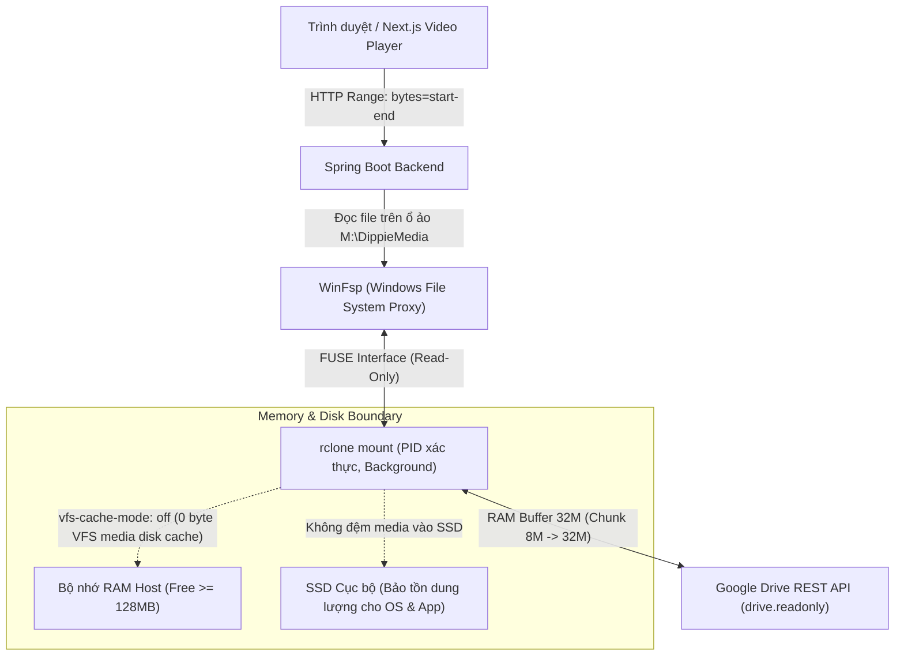

# HƯỚNG DẪN VẬN HÀNH GOOGLE DRIVE TRÊN WINDOWS (GOOGLE DRIVE WINDOWS RUNBOOK)
**Tác vụ:** DRIVE-01 — Windows Operations & Google Drive Tooling Foundation  
**Phiên bản:** 1.1.0 (Ngày cập nhật: 15/10/2026 — Kiểm định DRIVE-01-F02)  
**Phạm vi áp dụng:** Hệ điều hành Windows 10 / Windows 11 / Windows Server x64  
**Môi trường thực thi hỗ trợ:** Windows PowerShell 5.1 (`powershell.exe`) & PowerShell 7+ (`pwsh.exe`)  
**Trạng thái công cụ:** Đã kiểm thử tự động đạt 100% trên cả PowerShell 5.1 và PowerShell 7 (`scripts/drive/test_drive_tooling.ps1`)

---

## 1. Tổng quan Bộ Công cụ Vận hành Google Drive

Nhằm tích hợp dịch vụ lưu trữ đám mây Google Drive vào hệ sinh thái phát media của Dippie Cinema một cách an toàn, hiệu quả và không sử dụng đĩa cứng vật lý (SSD) làm bộ đệm media trung gian, bộ công cụ PowerShell tự động hóa được xây dựng tại thư mục `scripts/drive/`:

```
scripts/drive/
├── preflight_drive.ps1    # Kiểm tra điều kiện tiên quyết hệ điều hành, WinFsp, rclone, RAM, session
├── mount_drive.ps1        # Mount Google Drive với baseline streaming (mặc định dry-run, -Execute để chạy ngầm)
├── status_drive.ps1       # Truy vấn trạng thái ổ đĩa (MOUNTED, NOT_MOUNTED, DEGRADED) với chống PID reuse
├── stop_drive.ps1         # Dừng tiến trình rclone an toàn theo PID đã xác thực 9 trường danh tính (Fail-Closed)
└── test_drive_tooling.ps1 # Bộ kiểm thử tự động toàn diện cho bộ công cụ trên PS 5.1 và PS 7
```

### 1.1. Phân biệt Môi trường Thực thi: Windows PowerShell 5.1 vs PowerShell 7+

Hệ thống được thiết kế và kiểm thử nghiêm ngặt để tương thích độc lập trên cả hai môi trường PowerShell phổ biến của Windows:

| Đặc điểm Kỹ thuật | Windows PowerShell 5.1 (`powershell.exe`) | PowerShell 7+ (`pwsh.exe`) |
| :--- | :--- | :--- |
| **Nền tảng thực thi** | .NET Framework 4.8 (Windows Desktop CLR) | .NET Core 8.0+ / .NET 9 |
| **Cơ chế mã hóa tệp (File Encoding)** | Mặc định ANSI/ASCII nếu không có BOM; yêu cầu UTF-8 with BOM hoặc ký tự ASCII thuần cho script | Mặc định UTF-8 without BOM |
| **Cú pháp hỗ trợ** | Cú pháp PowerShell 5 truyền thống (không hỗ trợ `?:`, `??=`, `&&`, `||`) | Hỗ trợ đầy đủ toán tử pipeline chains và ternary |
| **Lệnh thực thi chuẩn** | `powershell.exe -NoProfile -ExecutionPolicy Bypass -File ...` | `pwsh.exe -NoProfile -ExecutionPolicy Bypass -File ...` |
| **Bảo đảm tương thích** | Mã nguồn script trong `scripts/drive/` tuân thủ cú pháp PS 5.1, an toàn mã hóa | Tương thích ngược hoàn toàn, thực thi tối ưu trên runtime hiện đại |

### 1.2. Phân định Ranh giới Môi trường: Môi trường Giả lập vs Google Drive Thật

Để đảm bảo tính trung thực và độ tin cậy của các báo cáo kỹ thuật:
- **Môi trường Giả lập (Local Temp Fixture / Test Harness):** Được sử dụng trong các bài kiểm thử tự động CI, test suite (`test_drive_tooling.ps1`, harness browser walkthrough). Môi trường này sử dụng thư mục tạm trên ổ cứng cục bộ, đường truyền loopback nội bộ máy tính ($0 \text{ ms}$ RTT), không có độ trễ mạng Internet và không tiêu tốn hạn ngạch Google API.
- **Môi trường Google Drive Thực tế (Production WAN):** Là môi trường vận hành thật khi kết nối tới remote Google Drive qua rclone và WinFsp. Dữ liệu đi qua mạng Internet WAN ($30 - 150 \text{ ms}$ RTT), phải chịu giới hạn hạn ngạch Google Drive API (10 QPS/user), bắt tay TLS 1.3 và phụ thuộc băng thông ISP. Các chỉ số đo lường hiệu năng thực tế (Startup latency, Seek latency, Stall ratio) chỉ có giá trị khi được thực hiện trên môi trường này.

### Kiến trúc Luồng Dữ liệu Streaming Media



---

## 2. Hướng dẫn Cài đặt Điều kiện Tiên quyết (Official Prerequisites)

Hệ thống yêu cầu hai thành phần hạ tầng cấp hệ điều hành trên Windows: **WinFsp** và **Rclone**.

### 2.1. Cài đặt WinFsp (Windows File System Proxy)
WinFsp cung cấp tầng tương thích FUSE (Filesystem in Userspace) trên nhân Windows, cho phép rclone ánh xạ remote đám mây thành ổ đĩa logic Windows.

- **Trang chủ chính thức:** [https://winfsp.dev](https://winfsp.dev)
- **Kho mã nguồn & Bản phát hành GitHub:** [https://github.com/winfsp/winfsp/releases](https://github.com/winfsp/winfsp/releases)
- **Cài đặt khuyến nghị qua Windows Package Manager (`winget`):**
  ```powershell
  winget install WinFsp.WinFsp
  ```
- **Hoặc cài đặt qua MSI Installer:**
  Tải bản cài đặt mới nhất `winfsp-<version>.msi` từ trang chủ WinFsp và chạy cài đặt theo thiết lập chuẩn.
- **Kiểm tra sau cài đặt:**
  ```powershell
  Test-Path "HKLM:\SOFTWARE\WinFsp"
  Test-Path "$env:ProgramFiles\WinFsp\bin\winfsp-x64.dll"
  ```

### 2.2. Cài đặt Rclone
Rclone là công cụ đồng bộ và mount lưu trữ đám mây đa nền tảng.

- **Trang tài liệu Google Drive rclone chính thức:** [https://rclone.org/drive/](https://rclone.org/drive/)
- **Trang tải về rclone:** [https://rclone.org/downloads/](https://rclone.org/downloads/)
- **Cài đặt khuyến nghị qua `winget`:**
  ```powershell
  winget install Rclone.Rclone
  ```
- **Hoặc qua Chocolatey / Scoop:**
  ```powershell
  # Qua Chocolatey
  choco install rclone

  # Hoặc qua Scoop
  scoop install rclone
  ```
- **Kiểm tra sau cài đặt:**
  ```powershell
  rclone version
  ```

---

## 3. Hướng dẫn Cấu hình Remote Google Drive (`rclone config`)

Để đảm bảo tính bảo mật của tài nguyên lưu trữ và tuân thủ nguyên tắc đặc quyền tối thiểu (Principle of Least Privilege), remote Google Drive **bắt buộc** phải được cấu hình với phạm vi chỉ đọc (**`drive.readonly`**).

### Các bước thực hiện:

1. Mở PowerShell và khởi chạy trình hướng dẫn cấu hình:
   ```powershell
   rclone config
   ```
2. Nhập `n` để tạo một remote mới:
   ```text
   n) New remote
   name> cinema-gdrive
   ```
3. Chọn loại lưu trữ (Storage type):
   Nhập `drive` hoặc chọn số tương ứng với Google Drive:
   ```text
   Storage> drive
   ```
4. Google Application Client ID & Secret:
   - Nếu có OAuth Client ID riêng của tổ chức, dán Client ID và Client Secret vào đây.
   - Nếu sử dụng cho mục đích thử nghiệm nội bộ, nhấn `Enter` để sử dụng mặc định.
5. **Chọn Scope (Phạm vi truy cập) — QUAN TRỌNG:**
   Chọn mục `drive.readonly` (thường là lựa chọn số `2`):
   ```text
   scope> 2
   # drive.readonly: Read-only access to file metadata and file contents
   ```
   > [!IMPORTANT]
   > Tuyệt đối không chọn scope `1` (`drive` toàn quyền đọc/ghi). Toàn bộ hệ thống streaming media chỉ đọc tài nguyên, cấu hình `drive.readonly` loại trừ hoàn toàn nguy cơ xóa nhầm hoặc sửa đổi video trên cloud.
6. Thư mục gốc (Root folder ID) và Service Account:
   - `root_folder_id`: Để trống hoặc nhập ID thư mục `DippieMedia` trên Google Drive.
   - `service_account_file`: Để trống nếu sử dụng tài khoản cá nhân, hoặc nhập đường dẫn file JSON key nếu dùng Google Cloud Service Account.
7. Chỉnh sửa cấu hình nâng cao (`Advanced config`):
   - Chọn `n` (No).
8. Xác thực OAuth (`Auto config`):
   - Chọn `y` để rclone tự động mở trình duyệt web đăng nhập tài khoản Google và cấp quyền đọc.
9. Xác nhận cấu hình (`Keep this "cinema-gdrive" remote?`):
   - Chọn `y` (Yes), sau đó nhấn `q` để thoát `rclone config`.

### Vệ sinh & Bảo mật Thông tin Xác thực (Secret Hygiene):
- File cấu hình mặc định được lưu tại `%APPDATA%\rclone\rclone.conf`.
- **Tuyệt đối không:** Commit file `rclone.conf` vào Git repository. File `.gitignore` của dự án đã cấu hình chặn mọi file chứa secret.
- Các script vận hành (`preflight_drive.ps1`, `mount_drive.ps1`, `status_drive.ps1`) được lập trình với cơ chế an toàn tuyệt đối: **không bao giờ in hoặc xuất nội dung token/secret ra màn hình console hay log**.

---

## 4. Hướng dẫn Vận hành Chi tiết (Operation Runbook)

### 4.1. Bước 1: Kiểm tra Điều kiện Tiên quyết (`preflight_drive.ps1`)
Chạy script kiểm tra hệ điều hành, rclone, WinFsp, bộ nhớ và phiên làm việc trước khi thực hiện bất kỳ thao tác mount nào:

```powershell
# Chạy trên Windows PowerShell 5.1:
powershell.exe -NoProfile -ExecutionPolicy Bypass -File scripts/drive/preflight_drive.ps1 -MountPoint "M:"

# Hoặc chạy trên PowerShell 7+:
pwsh.exe -NoProfile -ExecutionPolicy Bypass -File scripts/drive/preflight_drive.ps1 -MountPoint "M:"
```

**Tham số:**
- `-MountPoint`: Ký tự ổ đĩa (ví dụ `"M:"`) hoặc đường dẫn thư mục NTFS. Mặc định là `"M:"`.
- `-RclonePath`: (Tùy chọn) Đường dẫn chỉ định cụ thể đến `rclone.exe`.
- `-ConfigPath`: (Tùy chọn) Đường dẫn chỉ định cụ thể đến `rclone.conf`.

**Đặc điểm vận hành:**
- Thực thi ở chế độ chỉ đọc (**read-only**), không tạo hoặc thay đổi bất kỳ tập tin nào trên hệ thống.
- Xuất dữ liệu cấu trúc JSON chuẩn (`IsReady`, `Status`, `BlockReasons`, `HostOS`, `Rclone`, `WinFsp`, `MountTarget`, `UserSession`, `SystemCapacity`).
- Đánh giá tính khả dụng của WinFsp bằng 3 lớp kiểm tra độc lập: Registry (`HKLM:\SOFTWARE\WinFsp`), DLL tệp tin (`winfsp-x64.dll`), và bộ lọc mini-filter (`fltmc filters`).

---

### 4.2. Bước 2: Kế hoạch Dry-Run & Khởi chạy Mount (`mount_drive.ps1`)

#### Xem trước kế hoạch (Dry-Run / WhatIf):
Mặc định, lệnh chạy ở chế độ **Dry-Run** an toàn để quản trị viên đối chiếu các cờ lệnh mà không tạo tiến trình nền:

```powershell
# Windows PowerShell 5.1:
powershell.exe -NoProfile -ExecutionPolicy Bypass -File scripts/drive/mount_drive.ps1 -Remote "cinema-gdrive:" -RemoteSubpath "DippieMedia" -MountPoint "M:"

# PowerShell 7+:
pwsh.exe -NoProfile -ExecutionPolicy Bypass -File scripts/drive/mount_drive.ps1 -Remote "cinema-gdrive:" -RemoteSubpath "DippieMedia" -MountPoint "M:"
```

#### Thực hiện Mount thật sự (`-Execute`):
Khi các điều kiện preflight đã sẵn sàng, thêm cờ `-Execute` để khởi chạy tiến trình chạy ngầm:

```powershell
# Windows PowerShell 5.1:
powershell.exe -NoProfile -ExecutionPolicy Bypass -File scripts/drive/mount_drive.ps1 `
  -Remote "cinema-gdrive:" `
  -RemoteSubpath "DippieMedia" `
  -MountPoint "M:" `
  -Execute

# PowerShell 7+:
pwsh.exe -NoProfile -ExecutionPolicy Bypass -File scripts/drive/mount_drive.ps1 `
  -Remote "cinema-gdrive:" `
  -RemoteSubpath "DippieMedia" `
  -MountPoint "M:" `
  -Execute
```

**Cờ rclone streaming chuẩn được tự động áp dụng:**
```text
--read-only
--vfs-cache-mode off
--buffer-size 32M
--vfs-read-chunk-size 8M
--vfs-read-chunk-size-limit 32M
--vfs-read-chunk-streams 0
--dir-cache-time 72h
--poll-interval 15s
--attr-timeout 1s
```

**Lưu trữ trạng thái chuẩn hóa (9-Field State Schema):**
- Khi kích hoạt với `-Execute`, script ghi nhận đầy đủ **9 trường dữ liệu định danh bắt buộc** vào file state JSON (`$env:TEMP\movie-rcm-drive-mount.json`):
  1. `pid`: ID tiến trình rclone được hệ điều hành cấp phát.
  2. `processName`: Tên tiến trình chuẩn (`"rclone"`).
  3. `executablePath`: Đường dẫn tuyệt đối chuẩn hóa tới `rclone.exe`.
  4. `startTime`: Dấu thời gian khởi tạo chính xác theo định dạng ISO 8601.
  5. `sessionId`: Windows Logon Session ID của người dùng khởi chạy.
  6. `mountPoint`: Điểm mount ổ đĩa logic (ví dụ: `"M:"`).
  7. `remoteTarget`: Tên remote và đường dẫn con (ví dụ: `"cinema-gdrive:DippieMedia"`).
  8. `arguments`: Danh sách hoặc chuỗi tham số cờ lệnh streaming đã kích hoạt.
  9. `status`: Trạng thái ban đầu của vòng đời tiến trình (`"MOUNTING"` / `"RUNNING"`).

---

### 4.3. Bước 3: Kiểm tra Trạng thái Ổ đĩa (`status_drive.ps1`)
Để kiểm tra tiến trình rclone và mức độ phản hồi của ổ đĩa ảo:

```powershell
# Windows PowerShell 5.1:
powershell.exe -NoProfile -ExecutionPolicy Bypass -File scripts/drive/status_drive.ps1 -MountPoint "M:"

# PowerShell 7+:
pwsh.exe -NoProfile -ExecutionPolicy Bypass -File scripts/drive/status_drive.ps1 -MountPoint "M:"
```

**Các trạng thái trả về:**
- **`MOUNTED`**: Tiến trình rclone chạy hợp lệ (toàn bộ 9 trường định danh trùng khớp với tiến trình sống) và ổ đĩa `M:` có thể truy cập, đọc dữ liệu bình thường.
- **`NOT_MOUNTED`**: Không có file state hoặc tiến trình rclone đã kết thúc.
- **`DEGRADED`**: Phát hiện một trong các tình huống bất thường:
  - Ổ đĩa xuất hiện nhưng không có file state quản lý (untracked mount).
  - Tiến trình đã tắt nhưng ổ đĩa chưa được gỡ (stale mount).
  - Thiếu bất kỳ trường nào trong 9 trường định danh của file state (Incomplete State Schema).
  - PID ghi nhận trong state file đã bị chiếm bởi một tiến trình khác của hệ thống (**PID reuse detected**).

---

### 4.4. Bước 4: Dừng Ổ đĩa An toàn (`stop_drive.ps1`)
Khi cần bảo trì hoặc tháo gỡ ổ đĩa:

```powershell
# Dừng tiến trình rclone an toàn theo state file mặc định ($env:TEMP\movie-rcm-drive-mount.json):
# Windows PowerShell 5.1:
powershell.exe -NoProfile -ExecutionPolicy Bypass -File scripts/drive/stop_drive.ps1

# PowerShell 7+:
pwsh.exe -NoProfile -ExecutionPolicy Bypass -File scripts/drive/stop_drive.ps1

# Hoặc chỉ định rõ StateFile cụ thể:
powershell.exe -NoProfile -ExecutionPolicy Bypass -File scripts/drive/stop_drive.ps1 -StateFile "$env:TEMP\movie-rcm-drive-mount.json"

# Xuất kết quả dạng JSON:
powershell.exe -NoProfile -ExecutionPolicy Bypass -File scripts/drive/stop_drive.ps1 -AsJson

# Buộc dừng nếu tiến trình bị treo:
powershell.exe -NoProfile -ExecutionPolicy Bypass -File scripts/drive/stop_drive.ps1 -Force
```

**Cơ chế bảo vệ chống dừng nhầm tiến trình & Hợp đồng Fail-Closed:**
- **Bắt buộc đủ 9 trường định danh:** Script đối chiếu toàn bộ 9 trường dữ liệu của file state. Nếu thiếu bất kỳ trường nào, script lập tức kích hoạt chính sách **Fail-Closed**: từ chối gửi bất kỳ tín hiệu dừng tiến trình nào và **giữ nguyên file state trên đĩa** để phục vụ kiểm tra/truy vết.
- **Đối chiếu danh tính chính xác (Strict Ownership Verification):** PID trong state file được đối chiếu nghiêm ngặt với tiến trình sống qua 5 thuộc tính: PID, `processName == "rclone"`, đường dẫn thực thi chuẩn hóa, thời điểm khởi động chính xác (loại trừ dung sai thời gian lỏng lẻo) và Session ID.
- **Tuyệt đối không** sử dụng lệnh `taskkill /IM rclone.exe /F` hay dừng theo tên hàng loạt để tránh tắt nhầm các tác vụ rclone khác của người dùng trên máy.
- Nếu PID đã bị hệ thống tái sử dụng cho tiến trình khác (PID reuse), script từ chối dừng (`PID_REUSE_REJECTED`) và phát cảnh báo an toàn.

---

### 4.5. Bước 5: Chạy Bộ Kiểm thử Tự động (`test_drive_tooling.ps1`)
Quản trị viên hoặc CI/CD pipeline có thể xác thực toàn bộ hoạt động của bộ công cụ bằng một lệnh duy nhất:

```powershell
# Chạy kiểm thử trên Windows PowerShell 5.1:
powershell.exe -NoProfile -ExecutionPolicy Bypass -File scripts/drive/test_drive_tooling.ps1

# Chạy kiểm thử trên PowerShell 7+:
pwsh.exe -NoProfile -ExecutionPolicy Bypass -File scripts/drive/test_drive_tooling.ps1
```

**Lưu ý quan trọng về tính chất kiểm thử:**
- Bộ kiểm thử tự động kiểm tra các ca kiểm thử bảo mật, tính bất biến của preflight, các cờ baseline streaming, bảo vệ chống PID reuse, kiểm tra các trạng thái status và bảo mật tuyệt đối secret/token.
- Toàn bộ quá trình kiểm thử này thực thi trên **Môi trường Giả lập Cục bộ (Local Temp Fixture & Mock Processes)** với các tiến trình giả lập vô hại (child process recorder) nhằm đảm bảo an toàn tuyệt đối, không thực hiện mount thật và không tiêu tốn hạn ngạch kết nối mạng Google Drive.

---

## 5. Phân tích Kỹ thuật Chuyên sâu: Tại sao Chọn VFS Cache-Mode Off & RAM Buffer 32M?

Thiết kế cờ mount của Dippie Cinema được tối ưu hóa đặc biệt cho bài toán **Streaming Video HTTP Range Requests (RFC 9110)** trên máy chủ Windows:

### 5.1. So sánh `vfs-cache-mode off` vs `vfs-cache-mode full`

| Tiêu chí | `--vfs-cache-mode off` (Được chọn) | `--vfs-cache-mode full` (Chế độ cache đĩa) |
| :--- | :--- | :--- |
| **Ghi bộ đệm media vào SSD** | **0 Byte ghi cache media vào SSD** (Rclone đọc streaming qua RAM, không tạo file cache trên đĩa) | Ghi liên tục các đoạn chunk video vào thư mục cache cục bộ |
| **Ghi chép khác của Host** | Các ghi chép bình thường của HĐH, trình duyệt, app log vẫn diễn ra độc lập | Tương tự, cộng thêm hàng chục GB ghi đệm media |
| **Nguy cơ cạn kiệt đĩa do video** | **Triệt tiêu nguy cơ cạn đĩa từ cache media** (Không tích tụ file đệm trên ổ C:/D:) | Rất cao khi phát đồng thời nhiều phim dung lượng lớn trên ổ đĩa có hạn |
| **Phù hợp HTTP Range** | Tối ưu cho tác vụ tua video, đọc header `moov` atom trực tiếp | Phải chờ tải hoặc ghi file tạm xuống đĩa |
| **Độ trễ khởi động** | Tức thì khi Range request gửi đến | Trễ I/O do ghi đệm file xuống hệ thống tệp |

> [!NOTE]
> **Làm rõ ranh giới ghi đĩa và độ trễ:**
> 1. Thiết lập `--vfs-cache-mode off` đảm bảo rclone hoàn toàn không sử dụng ổ SSD làm bộ đệm video. Tuy nhiên, nó không ngăn cản các hoạt động ghi chép thông thường của hệ điều hành Windows, trình duyệt (browser cache), hoặc logging của ứng dụng.
> 2. Ở tầng ứng dụng, cơ chế `FileChannel.position(start)` loại bỏ việc đọc bỏ byte tuần tự (application byte-discard), cho phép gửi yêu cầu đọc chính xác dải byte cần thiết. Mặc dù vậy, trên môi trường Google Drive thực tế, độ trễ truy xuất dải byte từ xa vẫn phụ thuộc vào Round-Trip Time (RTT) mạng và thời gian xử lý API của Google Drive chứ không phải độ trễ cố định tức thời.

> [!TIP]
> **Kết luận kiến trúc:** Các tệp phim chất lượng cao (1080p, 4K) có dung lượng từ 2GB đến hơn 20GB. Nếu sử dụng `--vfs-cache-mode full`, mỗi lần người dùng xem phim hoặc tua ngẫu nhiên, rclone sẽ liên tục đọc-ghi hàng gigabyte dữ liệu lên SSD host. Điều này nhanh chóng làm suy giảm tuổi thọ tế bào nhớ NAND Flash của SSD và gây cạn kiệt dung lượng đĩa khả dụng (~22-28 GB). Do hệ thống chỉ phục vụ các yêu cầu HTTP Range đọc dữ liệu tuần tự từng đoạn, **chế độ `vfs-cache-mode off` kết hợp RAM buffer 32M là giải pháp baseline an toàn và phù hợp nhất**.

### 5.2. Vai trò của RAM Buffer 32M (`--buffer-size 32M`)
- Khi người dùng bắt đầu phát một video MP4, trình duyệt gửi yêu cầu HTTP Range để đọc header tệp (`moov` atom) nhằm xác định codec, thời lượng, và bảng định vị khung hình (sample tables).
- Với cờ `--buffer-size 32M`, rclone dành riêng một vùng đệm 32MB trong bộ nhớ RAM cho mỗi tệp đang mở.
- Vùng đệm RAM cho phép rclone nạp trước dữ liệu luồng kế tiếp với tốc độ truyền cực nhanh trong RAM, loại bỏ hiện tượng giật hình (buffering/stuttering) khi phát video mà không tốn một chu kỳ ghi đĩa SSD nào.

### 5.3. Chiến lược Đọc Đoạn Tăng dần (Adaptive Chunk Reading)
Bộ cờ baseline kết hợp bộ ba tham số chunking:
1. `--vfs-read-chunk-size 8M`: Kích thước đoạn dữ liệu đọc khởi điểm ban đầu là 8MB. Khi trình duyệt chỉ cần đọc vài kilobyte header đầu tệp, rclone không tải quá nhiều dữ liệu dư thừa từ Google Drive.
2. `--vfs-read-chunk-size-limit 32M`: Khi người xem tiếp tục phát video liên tục theo thời gian thực, kích thước đoạn nạp sẽ tăng dần theo hàm mũ đôi (`8M -> 16M -> 32M`) và dừng ở mức trần 32MB. Giới hạn này ngăn chặn việc đọc ồ ạt vượt quá tốc độ tiêu thụ của luồng phát.
3. `--vfs-read-chunk-streams 0`: Vô hiệu hóa việc mở nhiều luồng tải chunk song song không kiểm soát. Việc mở quá nhiều luồng song song sẽ nhanh chóng làm cạn kiệt hạn ngạch API của Google Drive (lỗi `403 Rate Limit Exceeded`).

### 5.4. Tối ưu hóa Metadata Cache
- `--dir-cache-time 72h`: Lưu giữ cấu trúc cây thư mục trong bộ nhớ 72 giờ vì kho lưu trữ phim ít khi thay đổi cấu trúc cây thư mục trong phiên vận hành.
- `--poll-interval 15s`: Kiểm tra thay đổi trên Drive qua API Changes mỗi 15 giây.
- `--attr-timeout 1s`: Giảm thời gian giữ thuộc tính file để phản ánh kịp thời trạng thái sẵn sàng.

---

## 6. Lưu ý về Phân tách Phiên Windows (Session Isolation)

Trên hệ điều hành Windows, các ký tự ổ đĩa mạng hoặc ổ đĩa ảo (như `M:`) được liên kết cục bộ với **Windows Logon Session (Phiên đăng nhập)** của tài khoản khởi tạo:

- **Vấn đề tách phiên:** Nếu rclone được khởi chạy dưới một dịch vụ Windows chạy ở Session 0 (hệ thống) trong khi backend Spring Boot chạy ở Session 1 (phiên desktop của người dùng), backend sẽ nhận được lỗi `Drive not found` đối với `M:`.
- **UAC Elevation (Token đôi):** Khi tài khoản thuộc nhóm Administrator bật UAC, Windows tạo hai token (Filtered User Token và Elevated Admin Token). Ổ đĩa mount ở cửa sổ thường có thể không nhìn thấy ở cửa sổ Run as Administrator trừ khi kích hoạt khóa Registry:
  ```powershell
  Set-ItemProperty -Path "HKLM:\SOFTWARE\Microsoft\Windows\CurrentVersion\Policies\System" -Name "EnableLinkedConnections" -Value 1 -Type DWord
  ```
- **Quy tắc vàng vận hành:** Luôn đảm bảo lệnh `mount_drive.ps1` được thực thi trong **cùng phiên làm việc và cùng ngữ cảnh người dùng** với tiến trình chạy ứng dụng backend Spring Boot.

---

## 7. Xử lý Sự cố & Khắc phục Lỗi Thường gặp (Troubleshooting)

### Sự cố 1: Lỗi `Fatal error: failed to mount FUSE fs: mount stopped before calling Init: mount failed: cgofuse: cannot find winfsp`
- **Nguyên nhân:** WinFsp chưa được cài đặt hoặc DLL chưa được đăng ký trong hệ thống.
- **Khắc phục:**
  1. Chạy `powershell -ExecutionPolicy Bypass -File scripts/drive/preflight_drive.ps1`.
  2. Cài đặt lại WinFsp qua winget: `winget install WinFsp.WinFsp`.
  3. Khởi động lại terminal PowerShell để nạp lại biến môi trường và PATH.

### Sự cố 2: Lỗi `Drive letter 'M:' is already in use`
- **Nguyên nhân:** Ký tự ổ đĩa `M:` đã được gán cho ổ đĩa mạng, USB, hoặc một tiến trình mount trước đó.
- **Khắc phục:**
  1. Kiểm tra ổ đĩa hiện có: `Get-PSDrive -PSProvider FileSystem`.
  2. Chọn ký tự ổ đĩa khác chưa sử dụng (ví dụ `X:`, `Y:`, `Z:`):
     ```powershell
     powershell -ExecutionPolicy Bypass -File scripts/drive/mount_drive.ps1 -MountPoint "X:" -Execute
     ```

### Sự cố 3: Lỗi `403 rateLimitExceeded` từ Google Drive
- **Nguyên nhân:** Quá nhiều yêu cầu truy vấn API trong khoảng thời gian ngắn hoặc remote chưa được cấu hình Client ID riêng.
- **Khắc phục:**
  1. Kiểm tra lại cờ `--vfs-read-chunk-streams 0` đã được bật để không tạo luồng tải ồ ạt.
  2. Tạo Google Cloud OAuth Client ID & Secret riêng theo hướng dẫn tại [https://rclone.org/drive/#making-your-own-client-id](https://rclone.org/drive/#making-your-own-client-id) và cập nhật qua `rclone config`.

### Sự cố 4: Lỗi `VERIFICATION_FAILED` hoặc `IDENTITY_MISMATCH` khi dừng tiến trình (`stop_drive.ps1`)
- **Nguyên nhân:** State file bị thiếu một hoặc nhiều trường trong 9 trường định danh bắt buộc (ví dụ: thiếu `sessionId`, `arguments`, `status`), hoặc PID trong state file đã bị chiếm dụng bởi tiến trình khác của hệ thống (PID reuse).
- **Khắc phục:**
  1. Hệ thống tuân thủ chính sách **Fail-Closed**: Tuyệt đối không gửi tín hiệu kill bừa bãi và **giữ nguyên file state trên đĩa** để phục vụ kiểm tra/truy vết.
  2. Mở file state tại `$env:TEMP\movie-rcm-drive-mount.json` để kiểm tra các trường bị thiếu hoặc sai lệch.
  3. Sử dụng lệnh an toàn `Get-CimInstance Win32_Process -Filter "ProcessId = <PID>"` để xác định danh tính thực tế của tiến trình đang chiếm giữ PID.

### Sự cố 5: Lỗi mã hóa ký tự (Encoding / Parser Error) trên Windows PowerShell 5.1
- **Nguyên nhân:** Windows PowerShell 5.1 (`powershell.exe`) chạy trên .NET Framework 4.8 và mặc định đọc tệp script theo ANSI/ASCII nếu tệp không có byte UTF-8 BOM, có thể gây ra lỗi phân tích cú pháp (`UnexpectedToken`) nếu script chứa ký tự đa byte thô.
- **Khắc phục:**
  1. Toàn bộ script chuẩn trong thư mục `scripts/drive/` được chuẩn hóa cú pháp PS 5.1 an toàn và không phụ thuộc vào locale của hệ thống.
  2. Khi thực thi trên Windows PowerShell 5.1, luôn sử dụng tham số `-NoProfile -File`:
     ```powershell
     powershell.exe -NoProfile -ExecutionPolicy Bypass -File scripts/drive/status_drive.ps1 -MountPoint "M:"
     ```
  3. Hoặc chuyển sang sử dụng PowerShell 7+ (`pwsh.exe`) với runtime .NET hiện đại mặc định hỗ trợ UTF-8 toàn diện:
     ```powershell
     pwsh.exe -NoProfile -ExecutionPolicy Bypass -File scripts/drive/status_drive.ps1 -MountPoint "M:"
     ```

---
*Tài liệu được bảo trì bởi Dippie Cinema Platform Operations Team.*

