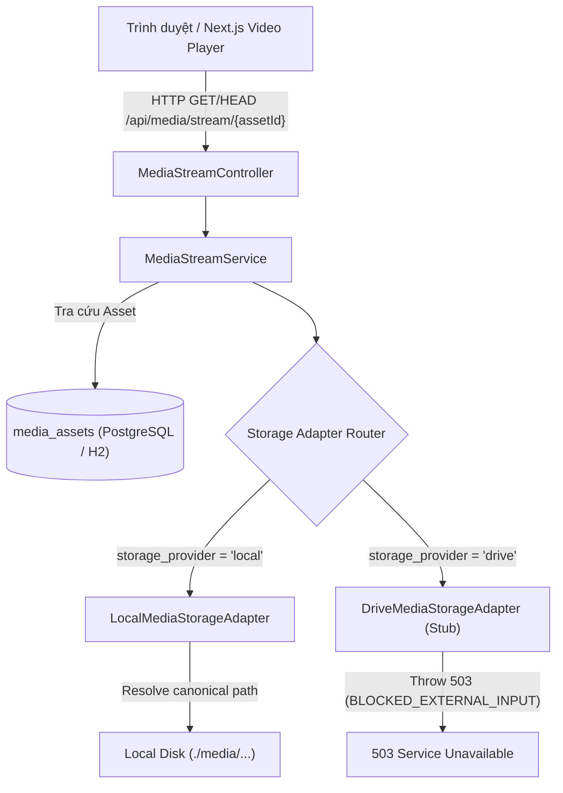

# HƯỚNG DẪN VẬN HÀNH LƯU TRỮ VÀ TÍCH HỢP GOOGLE DRIVE (MEDIA STORAGE RUNBOOK)
**Milestone:** M4 — Media Playback & Windows Storage Foundation  
**Phiên bản:** 1.1.0-F01 (Ngày cập nhật: 14/10/2026)  
**Tác giả:** Dippie Cinema Platform Team  
**Trạng thái Google Drive:** `BLOCKED_EXTERNAL_INPUT / NOT_IMPLEMENTED` (DriveMediaStorageAdapter là unavailable stub; chưa mount & chưa wire implementation)  
**Trạng thái Local Storage:** `VERIFIED_LOCAL` (Local boundary & player lifecycle verified qua M4-F01)

---

## 1. Tổng quan Kiến trúc Lưu trữ Media

Hệ thống Dippie Cinema triển khai mô hình kiến trúc **Pluggable Storage Adapter** cho phép phục vụ luồng video (feature films và trailers) qua giao thức HTTP Range (RFC 9110) mà không nạp toàn bộ tệp vào bộ nhớ:



---

## 2. Khảo sát Hiện trạng Môi trường Host

Đợt kiểm tra tự động ghi nhận:
- **Hệ điều hành:** Windows 10/11 Enterprise x64.
- **FFmpeg:** `ffmpeg version 8.1.1-full_build-www.gyan.dev` — **ĐÃ SẴN SÀNG** trên PATH.
- **Rclone:** Chưa cài đặt (`rclone: The term 'rclone' is not recognized`).
- **WinFsp (Windows File System Proxy):** Chưa cài đặt (cần thiết để rclone tạo ổ đĩa ảo Windows mount).
- **Dung lượng đĩa khả dụng:**
  - Ổ đĩa `C:\`: ~28.3 GB khả dụng.
  - Ổ đĩa `D:\`: ~22.7 GB khả dụng (Thư mục dự án: `D:\Class\movie-rcm-system`).
- **Kết luận:** Tuân thủ chỉ thị nghiêm ngặt của prompt, không tự động tải hoặc can thiệp cài đặt các gói hệ điều hành cấp sâu (WinFsp/rclone) mà ghi nhận rõ trạng thái `BLOCKED_EXTERNAL_INPUT`. Toàn bộ luồng phát cục bộ (Local Storage), tua HTTP Range, Player và kiểm thử đã được hoàn thiện độc lập.

---

## 3. Quy trình Thiết lập Google Drive (Khi Được Cung cấp Môi trường)

Khi môi trường được cung cấp tài khoản và thông tin xác thực Google Drive, quản trị viên thực hiện các bước sau:

### Bước 1: Cài đặt WinFsp
WinFsp cung cấp FUSE layer cho hệ điều hành Windows:
```powershell
# Cài đặt qua winget (Khuyến nghị)
winget install WinFsp.WinFsp

# Hoặc tải file cài đặt MSI chính thức từ:
# https://github.com/winfsp/winfsp/releases
```

### Bước 2: Cài đặt Rclone
```powershell
# Cài đặt qua winget
winget install Rclone.Rclone

# Hoặc qua Chocolatey / Scoop:
# choco install rclone
# scoop install rclone
```
Kiểm tra lại trên terminal:
```powershell
rclone version
```

### Bước 3: Cấu hình Remote Google Drive
Chạy lệnh cấu hình tương tác:
```powershell
rclone config
```
1. Chọn `n` (New remote).
2. Tên remote: `cinema-gdrive`.
3. Storage type: `drive` (Google Drive).
4. Nhập Client ID và Client Secret (hoặc để trống để sử dụng mặc định).
5. Phạm vi truy cập (Scope): `2` (Read-only access: `drive.readonly`).
6. Hoàn tất xác thực OAuth trên trình duyệt theo hướng dẫn của rclone.

### Bước 4: Khởi chạy Mount Ổ đĩa Ảo Windows (Baseline Read-Only, Cache-Off)
Gắn remote Google Drive thành một ký tự ổ đĩa (ví dụ `X:`):
```powershell
# Baseline Google Drive Mount: read-only, cache-off (không chiếm dụng đĩa cục bộ)
rclone mount cinema-gdrive:cinema-media X: `
  --read-only `
  --vfs-cache-mode off `
  --buffer-size 16M `
  --dir-cache-time 72h `
  --poll-interval 15s `
  --attr-timeout 1s
```
*Ghi chú về Disk Caching:*
- **Mặc định:** Sử dụng `--vfs-cache-mode off` để không chiếm dụng bộ nhớ đệm đĩa SSD cục bộ.
- **Opt-in SSD Cache:** Chế độ đệm đĩa (`--vfs-cache-mode full`) chỉ được cân nhắc kích hoạt sau khi có số đo thực nghiệm latency/throughput và phải kèm giới hạn dung lượng nghiêm ngặt (ví dụ `--vfs-cache-max-size <limit>`). Tuyệt đối không bật cache không giới hạn hoặc giả định một con số cố định khi chưa đo đạc trên Drive thật.

### Bước 5: Cấu hình Ứng dụng Backend Spring Boot
Khai báo biến môi trường hoặc cấu hình trong `application.yml`:
```yaml
app:
  media:
    root: ${APP_MEDIA_ROOT:./media}
    drive-mount: ${APP_MEDIA_DRIVE_MOUNT:}
```
*Lưu ý quan trọng:* Trong backend hiện tại, `DriveMediaStorageAdapter` là một **stub có chủ đích** trả về `MediaUnavailableException` (503 Service Unavailable) với thông điệp `BLOCKED_EXTERNAL_INPUT: rclone/WinFsp chưa được cấu hình`. Việc chỉ thiết lập biến môi trường `APP_MEDIA_DRIVE_MOUNT` sẽ **không** tự động biến Drive thành khả dụng; việc cài đặt adapter đọc tệp Drive thật sẽ chỉ được triển khai khi hạ tầng và quyền truy cập Drive được phê duyệt.

---

## 4. Kế hoạch Kiểm thử & Nghiệm thu Google Drive (Test Plan)

Sau khi mount thành công:

1. **Kiểm tra File System:**
   ```powershell
   Get-ChildItem -Path "X:\cinema-media"
   ```
   Đảm bảo các tệp video mẫu xuất hiện trên ổ đĩa ảo.

2. **Đăng ký Media Asset vào Cơ sở Dữ liệu:**
   Chèn bản ghi vào bảng `media_assets`:
   ```sql
   INSERT INTO media_assets (
       id, movie_id, kind, storage_provider, relative_path,
       version, mime_type, byte_length, duration_seconds, is_public, is_available
   ) VALUES (
       'ast-gdrive-feature-001',
       'the-last-orbit',
       'feature',
       'drive',
       'features/the-last-orbit-4k.mp4',
       'v1',
       'video/mp4',
       2147483648,
       7200.0,
       TRUE,
       TRUE
   );
   ```

3. **Kiểm tra Luồng Phát qua REST API:**
   - Preflight Header:
     ```bash
     curl -i -X HEAD http://localhost:8080/api/media/stream/ast-gdrive-feature-001
     ```
     Kỳ vọng: HTTP 200 OK, `Accept-Ranges: bytes`, `Content-Length: 2147483648`.
   - Tua HTTP Range:
     ```bash
     curl -i -H "Range: bytes=10485760-20971519" http://localhost:8080/api/media/stream/ast-gdrive-feature-001 -o chunk.bin
     ```
     Kỳ vọng: HTTP 206 Partial Content, `Content-Range: bytes 10485760-20971519/2147483648`.

---

## 5. Chính sách Dự phòng Tự động (Graceful Fallback Policy)

Trong mọi trường hợp khi Google Drive chưa được thiết lập hoặc xảy ra sự cố ngắt kết nối:
1. **Cô lập lỗi (Fault Isolation):** Các yêu cầu truy cập tài nguyên thuộc `storage_provider = 'drive'` sẽ trả về mã `503 Service Unavailable` cùng thông báo chi tiết mà không làm gián đoạn các luồng phát cục bộ (`storage_provider = 'local'`).
2. **Fallback Trailer:** Nếu một bộ phim chưa có video feature hoặc trailer trên Drive, hệ thống tự động suy diễn sang trường `videoUrl` của bảng `movies` (M1/M2/M3 compatibility).
3. **Player Resiliency:** Trình phát phía frontend hiển thị modal thông báo lỗi nhẹ nhàng kèm nút "Thử lại" lưu trữ chính xác vị trí thời gian `currentTime` để người dùng tiếp tục xem ngay khi mạng hồi phục.
